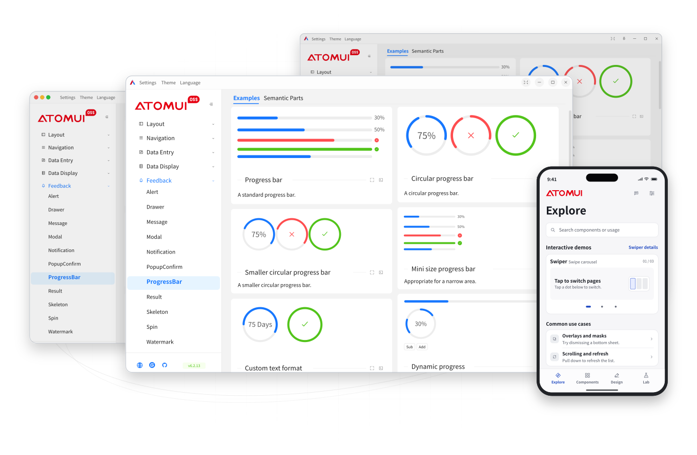

<br/>
<div align="center">

[](https://ant-design.antgroup.com/components/overview)
[](https://www.nuget.org/packages/AtomUI.Desktop.Controls)
[![][github-contributors-shield]][github-contributors-link]
[![][github-stars-shield]][github-stars-link]
[](https://www.nuget.org/packages/AtomUI.Desktop.Controls)
[![][github-license-shield]][github-license-link]

[Changelog](./CHANGELOG.md) · [Report Bug][github-issues-link] · [Request Feature][github-issues-link]

</div>


[github-release-shield]: https://img.shields.io/github/v/release/AtomUI/AtomUI?color=369eff&labelColor=black&logo=github&style=flat-square

[github-release-link]: https://github.com/AtomUI/AtomUI/releases

[github-releasedate-shield]: https://img.shields.io/github/release-date/AtomUI/AtomUI?color=black&labelColor=black&style=flat-square

[github-releasedate-link]: https://github.com/AtomUI/AtomUI/releases

[github-contributors-shield]: https://img.shields.io/badge/contributors-welcome-c4f042?labelColor=black&style=flat-square

[github-contributors-link]: https://github.com/AtomUI/AtomUI/graphs/contributors

[github-forks-shield]: https://img.shields.io/github/forks/AtomUI/AtomUI?color=8ae8ff&labelColor=black&style=flat-square

[github-forks-link]: https://github.com/AtomUI/AtomUI/network/members

[github-stars-shield]: https://img.shields.io/github/stars/AtomUI/AtomUI?color=ffcb47&labelColor=black&style=flat-square

[github-stars-link]: https://github.com/AtomUI/AtomUI/network/stargazers

[github-issues-shield]: https://img.shields.io/github/issues/AtomUI/AtomUI?color=ff80eb&labelColor=black&style=flat-square

[github-issues-link]: https://github.com/AtomUI/AtomUI/issues

[github-license-shield]: https://img.shields.io/badge/license-LGPL--3.0-white?labelColor=black&style=flat-square

[github-license-link]: https://github.com/AtomUI/AtomUI/blob/master/LICENSE

Documentation Language: [English](README.md) | [简体中文](README.zh-CN.md)

#### Overview

AtomUI is an Ant Design 6 component system for Avalonia/.NET desktop applications. It brings Ant Design's enterprise
interaction patterns, visual language, design tokens and theme customization model to native cross-platform apps on
Windows, macOS and Linux.

The project includes production-oriented desktop controls, icon packages, font packages, native window integration,
DataGrid, ColorPicker and source generators for custom controls, tokens and localization. Feedback, issues and pull
requests are welcome.



#### Features

- Ant Design 6 experience adapted for native Avalonia desktop applications.
- A broad set of ready-to-use controls for enterprise software, including layout, navigation, data entry, feedback,
  data display and optional advanced packages.
- Token-driven theming built on Avalonia's style and resource system, with support for consistent customization across
  controls.
- Cross-platform desktop support for Windows, macOS and Linux with a shared .NET/XAML development model.
- Source generators for custom controls, theme tokens and localization to reduce repetitive infrastructure code.

#### Requirements

.NET 8, .NET 10 and .NET 11 (NuGet packages ship net8.0 / net10.0 / net11.0)<br>
Avalonia 12.2.0<br>
Windows, macOS 12 or later, and Linux<br>

Building from source requires .NET SDK 10.0.300 or later (SDK 11 included); packing the three Release target
frameworks requires SDK 11. Building the browser Gallery links SkiaSharp and HarfBuzz natively, so it needs the
WebAssembly workload for the active SDK: `wasm-tools` on SDK 10, `wasm-tools-net10` on SDK 11. Without it the build
only warns that `NativeFileReference` won't be linked, and the resulting app cannot render.

Trimmed and AOT publishing follows the SDK-selected official ILLink, ILC and WASM toolchain, without SDK or
servicing-version allowlists: TypeMap and the net8-only package compatibility bridge target .NET 10 and later, and
the net8 trimming and NativeAOT backends accept the official 8.x engines. Publish checks validate the converted maps
and consumed outputs.

#### Latest Release Notes

AtomUI 6.3.0 ships Ant Design, Shadcn and PrimeNG as independent design languages. The release also improves
scoped token updates, generated startup data and desktop control behavior. Upgrading from 6.3.0 requires
explicit language registration and migration of custom theme definitions and rules. See the
[migration guide](docs/releases/6.3.0-api-changes.md) and [Changelog](./CHANGELOG.md#630).

#### Incubator

Thanks to Tongming Lake Center for their incubation support of AtomUI OSS

<div style="margin-top: 50px">
  
</div>

#### Community

<div align="center">
    <table>
      <tr>
        <th>Telegram</th>
        <th>WhatsApp</th>
        <th>WeChat Group</th>
        <th>QQ Group</th>
      </tr>
      <tr>
        <td> </td>
        <td> </td>
        <td></td>
        <td></td>
      </tr>
    </table>
</div>

#### Get Started

##### Add NuGet packages

For an Avalonia desktop application using Ant Design, install `AtomUI.Desktop.Controls.Themes.AntDesign`. It brings in
the desktop controls and the Ant Design design language. Add DataGrid, ColorPicker and Extras as needed.

The following packages are available on NuGet.

| Package                             | Description                                                                |
|-------------------------------------|----------------------------------------------------------------------------|
| AtomUI.Native                       | Native platform infrastructure                                             |
| AtomUI.Core                         | Core infrastructure — theme system, token system and animations             |
| AtomUI.Fonts.AlibabaSans            | Alibaba Sans font package                                                  |
| AtomUI.Fonts.AlibabaPuHuiTi         | Alibaba PuHuiTi font package                                               |
| AtomUI.Icons.Shared                 | Icon infrastructure                                                        |
| AtomUI.Icons.AntDesign              | Ant Design icon package                                                    |
| AtomUI.Controls.Shared              | Shared interfaces and enums for control development                        |
| AtomUI.Controls                     | Base controls and shared control capabilities                              |
| AtomUI.Desktop.Controls             | Desktop control library — the main package                                 |
| AtomUI.Desktop.Controls.Themes.AntDesign | Ant Design values for the desktop controls                             |
| AtomUI.Desktop.Controls.DataGrid    | DataGrid control (opt-in)                                                  |
| AtomUI.Desktop.Controls.ColorPicker | ColorPicker control (opt-in)                                               |
| AtomUI.Desktop.Controls.Extras      | Supplemental desktop controls (opt-in)                                     |
| AtomUI.Generator                    | Source generators for custom controls, tokens and localization             |

```bash
dotnet add package AtomUI.Desktop.Controls.Themes.AntDesign --version 6.3.0
```

You can also install the packages from your IDE's NuGet package manager. In Rider, open:

NuGet -> Packages

Search for "AtomUI" and install the packages your project needs.

> Before installation, check "Frameworks" and "Dependencies" in the package details to confirm compatibility with your
> target framework and Avalonia version.

##### Enable AtomUI library

###### Project Configure

```xml
<Project Sdk="Microsoft.NET.Sdk">
    <PropertyGroup>
        <OutputType>WinExe</OutputType>
        <TargetFramework>net10.0</TargetFramework>
        <ImplicitUsings>enable</ImplicitUsings>
        <Nullable>enable</Nullable>
        <BuiltInComInteropSupport>true</BuiltInComInteropSupport>
        <ApplicationManifest>app.manifest</ApplicationManifest>
    </PropertyGroup>

    <ItemGroup>
        <PackageReference Include="AtomUI.Desktop.Controls.Themes.AntDesign" Version="6.3.0"/>
        <PackageReference Include="AvaloniaUI.DiagnosticsSupport" Version="2.2.1"/>
    </ItemGroup>
</Project>
```

###### Program.cs Configure

Enable AtomUI on the `AppBuilder` chain and replace `MyApp` with your project's namespace.

```csharp
using Avalonia;
using System;
using AtomUI;
using AtomUI.DesignLanguages.AntDesign;
using AtomUI.Desktop.Controls;
using AtomUI.Localization;
using AtomUI.Theme;

namespace MyApp;

internal class Program
{
    [STAThread]
    public static void Main(string[] args) => BuildAvaloniaApp()
        .StartWithClassicDesktopLifetime(args);

    public static AppBuilder BuildAvaloniaApp()
    {
        return AppBuilder.Configure<App>()
                         .UseAtomUIPlatformDetect()
                         .WithAtomUIDefaultOptions()
                         .UseAtomUI(builder =>
                         {
                             builder.UseLanguages(
                                 LanguageTags.EnUS,
                                 [LanguageTags.EnUS, LanguageTags.ZhCN, LanguageTags.ZhTW]);
                             builder.UseAlibabaSansFont();
                             builder.UseDesktopControls();
                             builder.UseAntDesign(static ant => ant.WithDefaultTheme(AntDesignThemes.DaybreakBlue));
                         })
                         .WithDeveloperTools()
                         .LogToTrace();
    }
}
```

###### Declare the `Application` Class as `partial`

The AtomUI generator hooks the `partial` application class into startup, so AtomUI is ready before `Initialize()` runs.
Keep your existing `OnFrameworkInitializationCompleted()` override to create the main window.

```csharp
using Avalonia;
using Avalonia.Markup.Xaml;

namespace MyApp;

public partial class App : Application
{
    public override void Initialize() => AvaloniaXamlLoader.Load(this);
}
```

To start in dark mode, also set the initial selection inside the `UseAtomUI` callback.

```csharp
builder.WithInitialTheme(
    ThemeSelection.Of<AntDesignLanguage>().WithAppearance(ThemeAppearance.Dark));
```

Use `IThemeManager.ApplyAsync` to change the selection at runtime. See the [startup guide](docs/guides/startup/overview.md)
to add a splash screen.

###### Add optional controls

Install the package at the same AtomUI version and add the matching call inside `UseAtomUI`.

| Controls | NuGet package | Startup call |
| --- | --- | --- |
| DataGrid | `AtomUI.Desktop.Controls.DataGrid.Themes.AntDesign` | `builder.UseDesktopDataGrid();` |
| ColorPicker | `AtomUI.Desktop.Controls.ColorPicker.Themes.AntDesign` | `builder.UseDesktopColorPicker();` |
| Extras | `AtomUI.Desktop.Controls.Extras` | `builder.UseDesktopExtras();` |

At startup, AtomUI matches the referenced Ant Design value packages to the enabled controls.
See the [design language guide](docs/guides/theming/design-language-packages.md) for details.

###### Start building with AtomUI

After AtomUI is registered, you can use AtomUI controls and Ant Design icons directly in XAML.

```xml
<atom:Window xmlns="https://github.com/avaloniaui"
             xmlns:atom="https://atomui.net"
             xmlns:antdicons="https://atomui.net/icons/antdesign">
  <atom:Space Orientation="Horizontal">
    <atom:Button ButtonType="Primary">Get Started</atom:Button>
    <atom:Button Icon="{antdicons:AntDesignIconProvider StarOutlined}">Star on GitHub</atom:Button>
  </atom:Space>
</atom:Window>
```

<div style="height:50px"></div>

#### All Control Gallery

You can launch the gallery project locally to browse the available controls, usage patterns, examples and generated
documentation.

To run the Gallery in an IDE, open `AtomUI.slnx`, expand the `Gallery` solution folder, and set
`AtomUIGallery.Desktop` as the startup project.

```bash
git clone https://github.com/AtomUI/AtomUI.git
cd AtomUI
dotnet run --project controlgallery/AtomUIGallery.Desktop/AtomUIGallery.Desktop.csproj
```

<div style="height:50px"></div>

#### Simple Examples

The gallery is intentionally comprehensive. If you prefer compact starter projects, visit:

[AtomUI/AtomUI.Examples](https://github.com/AtomUI/AtomUI.Samples)

These samples show smaller application setups that are easier to copy into a new project.

#### Sponsors

<table>
  <tr>
    <td align="center" width="50%">
      <a href="https://sophnet.com/">
        
      </a>
      <p>SophNet provides an AI model API platform for stable, efficient model integration.</p>
    </td>
    <td align="center" width="50%">
      <a href="https://hsy.com/aboutus/">
        
      </a>
      <p>HSY provides cloud servers, DDoS protection and GPU compute services for secure business cloud deployment.</p>
    </td>
  </tr>
</table>

#### Acknowledgements

<div>
    <div align="center">
      <h1>Ant Design</h1>
      
    </div>
Ant Design is an enterprise-level UI design language and React component library launched by Ant Group. It provides a set of high-quality, unified React components with rich preset themes and internationalization support, dedicated to improving the design and development efficiency of enterprise applications. Its elegant design and excellent development experience make it one of the most popular front-end solutions for middle and back-end projects.
</div>

<div style="margin-top: 50px">
    <div align="center">
        <h1>Avalonia OSS</h1>
        
    </div>
Avalonia is a cross-platform .NET UI framework that uses XAML language for interface design. It supports multiple platforms including Windows, macOS, Linux, iOS, and Android, providing a development experience similar to WPF. With its high-performance rendering engine and rich control library, Avalonia helps enterprises quickly build modern desktop and mobile applications.

</div>

#### License Description

Projects using AtomUI OSS must comply with LGPL v3. <strong>Commercial applications, including internal company
software, personal commercial products and outsourced projects, may use AtomUI for free when linking to the published
binaries</strong>. If you customize AtomUI from source code, you must either open source the modified code under the
license terms or purchase a commercial license. For commercial licensing, contact Beijing Qinware Technology Co., Ltd.

### 🤝 Contributing

Contributions of all types are more than welcome, if you are interested in contributing code, feel free to check out our
GitHub [Issues][github-issues-link] to get stuck in to show us what you’re made of.

[![][pr-welcome-shield]][pr-welcome-link]

[![][github-contrib-shield]][github-contrib-link]

[github-issues-link]: https://github.com/AtomUI/AtomUI/issues

[pr-welcome-shield]: https://img.shields.io/badge/PR%20WELCOME-%E2%86%92-ffcb47?labelColor=black&style=for-the-badge

[pr-welcome-link]: https://github.com/AtomUI/AtomUI/pulls

[github-contrib-shield]: https://contrib.rocks/image?repo=chinware%2FAtomUI

[github-contrib-link]: https://github.com/AtomUI/AtomUI/graphs/contributors
