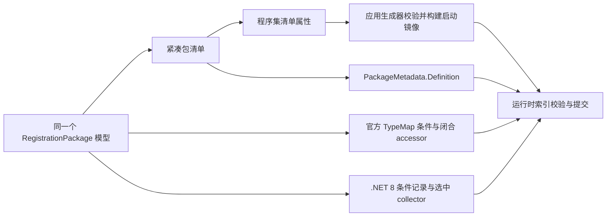

# 控件注册生成与启动清单优化架构

统一入口、紧凑清单和直接文本校验镜像已实现。发布验证见本页第 6 节。本文件定义目标架构与放行条件。现有实现及量化样本见[生成物体积评估](generated-registration-size-review.md)，
清单布局及应用镜像校验见[启动清单去冗余](../systems/startup/package-manifest-optimization.md)。

## 1. 范围和架构决定

1. 所有生成控件包走同一个包定义入口 `PackageMetadata.Definition.Register(...)`，基础包继续通过 `Definition.Ensure(...)` 幂等启用。
   Common、可选、资源专用、空包、Mobile、商业及第三方包共用同一模型和编码。按正常包声明和目标框架决定生成内容。
2. 启动清单与应用镜像各使用单一格式，切换时统一重建 Core、生成器、构建工具、控件包与应用。格式不符明确报错。
3. 官方 TypeMap、Browser 精细裁剪和 .NET 8 条件注册继续参与生产流程。所有预编译消费及已支持的跨目标消费用本轮重新生成的包验证。
4. 放行依据是逻辑等价和实际裁剪等价。体积收益分别归到生成源码、程序集及发布产物、启动分配或常驻对象。

本轮收敛生成入口和传输表示。按主题拆工厂、变更裁剪 key、重写 .NET 8 条件记录 ABI、搬迁到 sidecar 或内嵌资源，
均作为后续独立议题。主题推导、语言激活和调度时序沿用原有契约。

## 2. 统一包模型与两条后端路径

- 生成控件包时必须具备包定义和当前清单运行时契约。将缺失运行时契约改为生成期诊断。普通应用的 token 或语义生成任务仍按各自触发条件运行。
- 构造一次不可变的逻辑清单并编码一次，程序集清单属性与运行时 `Definition` 复用同一值。空包和资产专用包同样有清单。
  单项工厂沿用当前真实类型、资源导出、平台条件及惰性缓存。

| 路径 | 生成与消费契约 |
| --- | --- |
| 官方 TypeMap | 生成完整的条件 Attribute、具体 Group 和闭合 accessor，链接器按真实依赖选择映射。启动索引从清单中的每控件候选键调用 `ContainsFragment`，首次使用再调用 `ResolveFragment`。移除独立的生成式 `Register/Ensure`、`Collect` 与 `CandidateKeys`，保留清单里的候选键及非裁剪单项分派 |
| Browser | 继续使用官方标记结果。按现有 ABI 接入具体 Group 和 helper，在 Mark 后、Sweep 前只写入已选片段。清单升级不改变方法绑定与完成验证 |
| .NET 8 及现代桥接 | 保留后端消费的 `Collect`、`CollectFull`、`CollectSelected` 和带固定调用形态的片段 thunk。选中路径仍通过已知的 `SelectedFragments` 建立键到片段对应关系。条件记录格式、执行模板、桥接身份和作用域保持当前协议 |

构建期继续使用完整逻辑清单做依赖探测与校验。运行时仅对已启用包访问其完整数据，未启用包的资源归属诊断继续由应用镜像提供。
无生成镜像、手写注册和运行时追加仍调用当前完整校验，原有 slot、资源、快照及失败回滚保持一致。

## 3. 紧凑清单与应用镜像

紧凑清单保留原有逻辑记录结构。单包字符串表按实际字节收益收录重复文本，其他文本内联。控件、TypeMap 条件和资源依赖各自保留原记录。
字段顺序、类型、标签及离线对照见[二进制结构](../systems/startup/package-manifest-optimization.md#4-包清单的二进制结构)。
保持现有 Base64 程序集属性与运行时定义入口，构建和运行时统一使用严格读取器。启动镜像单独版本化，保留自己的顺序与资源索引。

镜像与实际包的相等性继续由精确内容验证。紧凑校验载荷允许应用镜像以较小的无损表示保存校验数据，运行时在有限缓冲区逐字节核对。
当解压开销未通过启动验收时，仍可交付已通过的统一生成入口和紧凑清单，在镜像格式中使用直接文本表示。详细规则见[清单与镜像协议](../systems/startup/package-manifest-optimization.md)。

生成源码的长字面量使用编译期分段处理。源码格式不影响运行时内容。源文件拆分和短类型别名是独立的源码体积优化，
只有在实际编译后的属性、类型绑定、方法 ABI 及依赖集合等价时才采用。

## 4. 实施边界与阶段门槛

| 阶段 | 共享改动范围 | 放行证据 |
| --- | --- | --- |
| CR-0 固定基线 | 冻结真实包、清单、生成 ABI、链路产物与当前启动数据 | 能逐字段查询基线以及已用、未用片段和资产集合。旧产物仅用于对照 |
| CR-1 收敛生成入口 | `RegistrationModelBuilder`、`RegistrationPackage`、`TokenResourceKeyGenerator`、`TypeMapRegistrationWriter` 和 `StartupManifestWriter` | 官方路径无旧入口及冗余辅助成员，清单仍逐字节相同。所有活跃后端和空包、资产包的生成与行为一致，缺少必需运行时契约报明确诊断 |
| CR-2 切换紧凑清单 | 共享清单编解码器、包生成器、引用读取、镜像生成和运行时包定义同步升级 | 逻辑记录与冻结基线逐项相同。重复生成确定。格式不符及损坏输入在提交前拒绝。用重建的预编译包从干净缓存消费 |
| CR-3 分离镜像重复 | `StartupImageWriter` 与 `StartupImage` 使用无损校验载荷，依赖 CR-2 | 校验仍逐字节。索引内容、完整性和提交顺序相同。减少大清单的明文保留，启动验收通过。候选可独立退回新镜像的直接文本 |
| CR-4 合并发布验证 | 固定全部拟交付改动，运行实际后端发布和业务检查 | 所有适用后端的依赖与排除结果一致，启动和资源行为一致，体积和内存收益归因清楚 |

共享模型、编解码和生成接口按表中顺序确定。每个阶段先做定向检查，昂贵发布和采样在候选稳定后合并。
遇到裁剪差异先定位具体条件、根或工厂，撤回相应优化。发布候选的工具链、控件包和应用须成套构建与验证。

## 5. 正确性证据

| 层级 | 必须对照的事实 |
| --- | --- |
| 模型与依赖 | 同一批真实包逐项对比程序集和类型身份、控件、Token、Semantic PART、资源 URI、类型化导出、owner、可见性、平台 guard、key、顺序和空值。共享和多目标字典的依赖边逐条一致 |
| 裁剪产物 | 在既有实际发布入口分别检查官方 TypeMap、Browser、ILLink8/ILC8 和适用的混合 ABI。对照保留集合与排除集合，验证使用的控件和资产能运行，未用同目录项和未启用包的工厂仍缺失 |
| 应用行为 | 真实启动后创建模板、查询资源、切换主题。验证仅使用 Token/Identity/语义部件时的保留、可选包诊断、包追加、失败回滚及未使用语言的惰性求值 |
| 失败输入 | 格式不匹配、错包、单字节内容变化、非法 UTF-8、越界索引、异常长度和损坏压缩载荷均有可定位诊断，提交前失败 |
| 收益 | 同工具链比较生成源码和最长行、PE、发布包、启动分段和常驻堆。仅记录实际测得的收益，沿用既有裁剪与启动门槛 |

放行同时要求正向保留和负向排除。比较时沿用相同应用入口及链接器配置，不添加人为根，不采用全量注册或跳过校验。
以[既有 AOT 验证与交付门槛](aot-and-trimming.md#8-验证与交付门槛)和[启动验收线](../systems/startup/verification.md)为准。
缺少适用证据的消费路径保持待验状态。

## 6. 实施与验收记录

| 项目 | 已取得的证据 |
| --- | --- |
| CR-1 官方生成路径 | 收敛入口前后，桌面主包清单的 609,020 个字符完全一致。移除无调用方成员后，生成文件先减少 64,400 B |
| CR-2 紧凑编码 | 冻结的九个真实清单与候选逐包展开比较，逻辑记录字节相等。官方 TypeMap 特性逐条相同。桌面主包清单从 456,763 B 降至 180,330 B，生成文件从 3,271,350 B 降至 2,477,966 B |
| 定向验证 | 精确空包字节样例在基线上失败，候选通过。临时专项验证覆盖记录往返、空值、截断、越界、展开上限和镜像不一致，完成后清理。最终 Core 48、生成器 85、Gallery 28 项均通过 |
| 官方 NativeAOT | 同一 macOS arm64 Button 夹具的基线与候选都报告 `PRODUCT_PASS selected`。实际 ILC map 中 274 个控件代理与 271 组资产工厂的标识集合相同。可执行文件从 50,113,296 B 降至 47,752,240 B |
| Browser 解释执行 | 实际裁剪发布通过。链接回执为 `output-verified`，覆盖五个 accessor。Chrome 中完成 Gallery 启动 |
| Browser AOT | 实际发布与 Chrome 启动通过。解释执行与 AOT 两份 `output-verified` 回执中的五条 accessor 记录及方法体摘要相同 |
| .NET 8 ILLink8 | 普通 Release 构建通过。冻结的五份条件注册记录与候选逐字节相同。通过真实 ILLink8 裁剪发布，运行 Button 夹具得到 `PRODUCT_PASS selected` |
| .NET 8 ILC8 | 使用工作区的受控编译器包，真实发布 macOS arm64 NativeAOT 夹具。编译器记录实际选择，运行得到 `PRODUCT_PASS selected` |
| CR-3 镜像压缩 | 候选提供直接文本校验，逐字符验证加载包。压缩标签留待精确帧验证与既有启动性能门槛均通过后启用 |
| 最小夹具启动诊断 | macOS NativeAOT Button 夹具预热后交错 10 对，全部输出 `PRODUCT_PASS selected`。进程耗时配对中位差 −3.23 ms，峰值 RSS 配对中位差 −6,701,056 B。该数据用于夹具诊断，正式 Gallery 首帧和常驻堆仍须按既有口径验收 |

日志、冻结清单和 map 保存在本轮本地验收目录 `/private/tmp/atomui-registration-cr.b8DQ8bLX`。实发证据按上表适用范围认定。
重建包的跨目标发布消费、独立仓库消费、正式 Gallery 启动与常驻内存采样尚待取得对应证据。发布日志中的 `GlobalClockReflection` 裁剪诊断保留供审查。

### 主仓 OSS 控件包覆盖

从[主仓发布项目清单](../../../scripts/NuGetPackageProjects.ps1)核对直接使用 `PackageMetadata.Definition` 的 OSS 控件包。
以下六个包均进入重建后的本地 NuGet feed，并由同一个空缓存消费应用注册。

| 控件包 | 验收 |
| --- | --- |
| `AtomUI.Controls` | Common 注册身份，新清单等价，实际物化 9 个主题资产 |
| `AtomUI.Desktop.Controls` | 新清单等价，实际物化 319 个主题资产 |
| `AtomUI.Desktop.Controls.ColorPicker` | 新清单等价，实际物化 15 个主题资产，.NET 8 Release 构建通过 |
| `AtomUI.Desktop.Controls.DataGrid` | 新清单等价，实际物化 18 个主题资产，.NET 8 Release 构建通过 |
| `AtomUI.Desktop.Controls.Extras` | 重建的 NuGet DLL 含紧凑清单，解码后 0 个控件、0 个资产。消费应用仍显式启用 Extras，空包进入镜像校验并成功提交。.NET 8 Release 构建通过 |
| `AtomUI.Toolkits.GalleryBase` | 新清单等价，实际物化 13 个主题资产，.NET 8 Release 构建通过 |

本地 feed 为 net10.0 消费场景打包了 30 个运行库及生成器包。空缓存消费应用实际恢复的 28 个 AtomUI 依赖均来自该 feed。应用使用公开入口，ColorPicker 与
DataGrid 在 Ant Design、PrimeNG、Shadcn 下都创建模板，切回 Ant Design 后仍正常。源码侧资产验证共物化 374 项。
两个 Browser 发布回执均记录了 ColorPicker 与 DataGrid 的 accessor。证据见同一验收目录中的 `oss-pack.log`、
`oss-consumption-proof.json`、`oss-cold-run.log`、`oss-theme-assets.log` 和各 .NET 8 构建日志。

[AtomUI.Mobile](../systems/mobile/overview.md) 是独立 OSS 消费仓库。其控件入口仍引用此前的生成类型，迁移按现有 M5 前置门槛安排。
