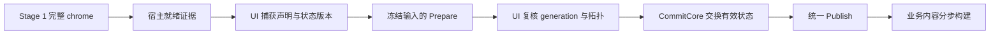

# 分级启动演化与提交边界

状态：工作树已统一成功封存、贡献合并与事务执行门；兼容与性能验收见实施记录。
现行接入入口见[启动与注册链路](startup-and-registration.md)。

## 1. 目标与事实边界

分级启动保持 opt-in。第一阶段显示完整窗口 chrome 和应用加载态，第二阶段完成剩余框架准备及业务内容。
同时衡量窗口出现、完整首帧、加载期间输入响应、全部就绪和保留内存；缩短 `UseAtomUI` 同步段不能替代这些指标。

当前实现边界如下：

| 边界 | 实现 | 保留限制 |
|---|---|---|
| 工作调度 | 冻结语言输入、标准 schema 元数据后台构建，Shell 单独调度 | 任意 Deferred Action、Resolver、evaluator 和资源 factory 保持原线程，不能中途抢占 |
| 就绪判定 | 指定根可见后等待 compositor rendered batch；普通前台窗另等 Activated | 不提供显示器 presentation 证据；非激活窗不强迫激活 |
| 状态提交 | 校验双方后交换全部有效状态，再 Publish | 独立的多次跨线程查询不形成跨系统读事务 |
| 注册身份 | 根据最终实际贡献刷新指纹；控件 cell 拒绝跨 registry revision 复用 | 全局 Token 凭独立输入证据复用；控件跨代细粒度复用待后续测量 |
| 生命周期 | 单阶段完成及 staged 各终态释放构建列表、actions/hooks；cell 不引用历史 snapshot | 活动读取视图仍合法持有自身版本 |

目标不通过移除标题栏、菜单、支持语言、嵌套滚动或现有内容取得更短的时间，也不通过永久关闭动画或隐藏错误取得验收。

## 2. 职责与数据流

| 所有者 | 责任 |
|---|---|
| Core `ApplicationScope` | 应用级一次性启动状态机、任务取消、跨主题/语言协调和启动事件 |
| ThemeManager | 主题 schema、Catalog、根/局部快照与语义准备；不接管本地化数据 |
| LocalizationHost / LanguageManager | Catalog、支持语言、Snapshot 和 LanguageRevision 准备；保持服务身份稳定 |
| 静态主题资源 provider | 稳定宿主关系、有序资源查询、候选资产物化和单次发布 |
| 平台 lifetime host | 目标窗口存在、窗口关闭与实际激活/可观测渲染里程碑 |
| Gallery / 业务应用 | 加载态、可交互主菜单、Shell、导航和页面创建 |

内部准备载体为 `StageTwoEvolutionPlan`。它代表一次跨子系统提交的完整结果；不是新的公开 Builder，
也不复制另一份长期 ThemeManager。载体包含：输入 generation、scope topology/stamp、目标 registry/Catalog、
主题与局部快照、语义 registry、静态资源有序表和已验证的语言演化结果。

## 3. Capture、Prepare、CommitCore、Publish

### Capture

- 仅 UI 线程读取当前主题请求、当前语言、有效 scope 拓扑和应用生命周期状态。
- 注册声明按原顺序执行，数据随后冻结；不把可变 Builder、Visual、资源宿主或任意业务 Action 交给后台线程。
- 当前 `Deferred(Action)` 作为接入兼容层保留。可延迟的是声明式注册；线程未知的第三方回调在原线程执行。
- Builder 按操作能力校验阶段：初始主题、FollowSystem 模板、应用标识、字体、owned services、initializer 和
  Deferred 声明仅在初始配置窗口可用；包、Resolver、用户目录和本地化声明可在各自注册窗口收集。
  不支持的晚期变更在入口拒绝，不允许接受后静默失效。
- 成功路径收集余量后通过同一 `Freeze` 检查失败或未完成包；失败回调内捕获异常不能解除失败标记。
  `CloseStageTwoWindow` 仅负责异常/取消路径的幂等关闭，不替代成功校验。

### Prepare

- Stage 1 与 Stage 2 共用 Builder 的有效主题来源构建逻辑，包含显式 Resolver 和 `UseUserThemeDirectory` 生成的来源；
  Stage 2 不能用显式 Resolver 列表替换完整来源集合。
- 初次 Build 与增量 Merge 共用贡献遍历、去重和 provider 资源排序；规范化初始配置和目录使用共同准备入口。
- Semantic registry 只构建一次，由相同不可变候选完成验证与提交。
- 完成候选 registry、身份/冲突校验、主题绑定、纯 Token 计算、支持语言覆盖校验和最终资源顺序。
- 未提交结果不写入当前 Manager 字段，不改 `Resources.MergedDictionaries`，不设置 Avalonia 属性，也不通知观察者。
- 只把已经证明线程安全的纯计算和来源读取移到后台；自定义 Resolver/evaluator 没有线程能力声明时，不能静默
  改变其执行线程。剩余 UI 准备须按已测成本分片；原生资源和 ControlTheme factory 仍在允许的宿主线程物化。
- 不可变 schema 后台构建不捕获易变的根主题或 scope 状态；进入现有事务执行门后再读取最新请求与拓扑，
  因而准备 schema 期间允许正常 UI 交互。有效状态的准备、双系统校验/提交及全部 Publish 在同一执行门内完成。
- 提交前复核 generation、scope stamp 和语言版本；取消、关闭或准备回调导致的状态变化使该候选不可提交。
- 大工作集使用有界执行策略，避免把启动问题换成并行内存峰值或首帧 CPU 争用。

### CommitCore

- 回到 UI 线程复核 generation、当前语言、主题请求和 scope stamp；过期结果丢弃或重新准备。
- 先完成 registry、静态查询表、Semantic registry、根/局部 snapshot、语言 registry/revision/支持语言的有效状态交换。
- 该步骤不执行用户回调、资源 factory、文件读取、可能失败的校验或资源通知。不能把 `AddOwner`、`RemoveOwner`、
  MergedDictionaries 增删和 Avalonia 属性赋值假定为无回调操作。
- 不使用“先发布主题，再提交语言，再回滚字段”模拟原子性。后台 `ILocalizer` 一次查询也必须捕获匹配的
  Catalog registry 与语言 revision；不允许分别读取两代状态。
- 这里的原子性是所有框架回调看到一致提交，以及每个公开读取操作获得完整状态；独立的跨线程多次 API 调用
  不自动构成全局事务读取。若需跨子系统读取视图，必须显式定义其捕获边界。

### Publish

- Catalog 内容或诊断变化时，在主题与语言 CommitCore 完成、`ThemeChanged` 发布后，通过与手动刷新共用的
  `ThemeCatalogChanged` 发布路径通知订阅者。注册演化复用执行时的 generation，不新增用户意图序号；目录未变不额外通知。
- 所有有效状态已可查询后，再传播 variant/FlowDirection、资源通知、Theme/Language/Catalog 事件；随后完成启动清理，再发布启动结果。
- 已存在资源 provider 保持身份稳定，每个受影响资源根至多发布一次该次演化通知；禁止每个资产发布一次通知。
- 公开订阅者逐个隔离异常。提交后的业务异常属于观察者/业务初始化失败，不把框架结果改成
  `Failed`，也不改写已经成功完成的任务。
- `IAtomUIStartup.Completion` 成功完成表示框架完备，不表示 Gallery Shell 已绘制或首个页面已可交互；这些由业务里程碑单独记录。

## 4. 就绪、取消与重入

- `Opened`、动画帧回调、根 `Render`、compositor commit、实际 display presentation 和平台激活是不同里程碑。
  宿主只能声明已获得证据的里程碑；不得把动画回调改名为“已呈现”。
- 普通前台 macOS Gallery 需覆盖目标窗口真实激活与完整 chrome；显式 `ShowActivated=false`、托盘/后台启动和
  无窗口应用不应被强迫激活，也不能无限等待。该类宿主使用明确的就绪策略。
- 找不到 MainWindow 不能静默证明“首帧已完成”。延迟建窗、single-view host 和多窗口的目标必须可判定。
- `ApplicationScope` 持有唯一 internal `AtomUIStartup`，统一拥有 `State`、`Completion` 和 `ProgressChanged`。
  同步模式走 `Configuring → Ready`；分阶段走 `Configuring → WaitingForHost → Initializing → Ready`。
  失败保留原始异常；取消使用真正 canceled 任务；终态不可被重复调度或应用释放覆盖。
- 晚观察者读取相同 Completion；可选 UI 线程进度不重放，不能替代终态查询。调用者通过 `WaitAsync` 取消
  自身等待不会取消应用。未注册 AtomUI 时 GetStartup 抛明确错误。
- 就绪观察者先构造并登记 owner，再显式 Start；同步发现关闭不能让未登记对象逃过取消清理。
- 可见帧具有代际：Hide 作废已排队 RAF、compositor 回调及启动回调，Show 后重新取证。
- Stage 2 复用普通主题变更、目录刷新和 scope 更新的执行门及延迟 Dispose 协议；发布内的重入请求排队执行。
  演化不是新用户主题意图，沿用当前 generation，不能作废在演化发布期间提交的 Apply 请求。
- 排队的目录 Reload 保留提交时 generation，在进入同一个执行门后，成组捕获 catalog、snapshot、当前请求、
  scope 和 resolver 基线；不能把旧 catalog 与排队期间演化后的 snapshot 混合用于失败回滚。
- 成功、失败和取消先关闭注册输入、释放等待订阅和 staging hooks，再完成公开任务。准备中关闭时先取消生命周期
  令牌并封闭注册能力，待正在执行的任务退出 finally 后才发布 Canceled；清理异常不能让任务永久悬空。
  原始启动失败与清理失败同时发生时保留原始异常并记录清理失败。关闭后排队回调不得再访问已销毁服务。
- 不使用固定 sleep 猜测首帧，也不依赖 Background 优先级解决正在执行的 UI 长任务。

当前 lifetime 选择：已有 MainWindow 直接等待；延迟 MainWindow 须在 Show 前声明，Opened 后等待目标根。
single-view 等待已声明 MainView 挂载到 TopLevel。显式 OnExplicitShutdown 且无 MainWindow、无视图/无 lifetime
使用无 surface 策略，不声称完成首帧。关闭订阅保持到 Stage 2 终态，准备期间关闭也取消。

## 5. 跨阶段复用

主题资源与惰性槽位由[惰性物化与资源查询](../systems/theming/lazy-materialization.md)定义；注册身份和资源顺序
由[控件与资源注册契约](control-registration-contracts.md)定义；语言增量构建由
[本地化运行时](../systems/localization/runtime.md)定义。

优先复用已经验证的不变部分：全局 schema、全局 Token 计算结果、未变化 Catalog 的语言行、已创建资产与独立控件槽。
完整 registry 改变不能简单迫使全局计算重跑，也不能因为“全局值应不变”而错误复用跨代控件 slot。

分区未完成和真实裁剪路径按实际 schema 计算；非裁剪完整 Collect 提供包完整指纹，余量全部消费后才允许组合。
Stage 2 刷新所有实际包证据，不能继续使用 Stage 1 的包清单。

## 6. 生命周期与复杂度预算

- Stage 2 结束后清除 `_deferredRegistrations`、协调 hooks、builder 和段收集输入。应用服务只保留最终运行时状态。
- LocalizationHost 不额外长期保留已被替代的 Stage 1 registry/snapshot 集；活动读取捕获的旧代引用自然存活到读取结束。
- 已发布快照的可达性只能由活动 context、调用方合法读取视图、有界 cache 和进行中的提交解释，不能由历史父链保活。
- 有序资源旧集与增量优先使用线性 merge；合并已排序包时保留完整排序键与冲突校验，不能把有序分段直接拼接。
- 初次与第二次提交不逐项拆卸现有 provider。复杂度核查同时记录排序次数、工厂调用、通知次数和真实字典物化数。

单阶段初始化完成、Stage 2 成功/失败，以及尚未进入 Stage 2 的取消都调用同一个构建数据退休入口。
有效 registry、SemanticParts 与稳定资源表继续服务查询；不保留另一份 descriptor/provider/资源注册集合。

## 7. 架构备选与采用条件

| 方案 | 收益与成本 | 处置 |
|---|---|---|
| 单阶段框架 + Gallery Shell 后置 | 改动面小；完整注册仍在首帧前 | 正确基线与复杂度对照，保留 |
| 分阶段注册 + 不可变准备结果 + 稳定 provider | 可以分散首帧成本，避免重复挂载和部分发布 | 已实现，收益与剩余 UI 长任务分别验收 |
| 生成紧凑完整 schema/稳定身份表 + 按需物化 | 可能减少运行中 registry 重建；增加生成器/ABI 设计成本 | 后续实验，不作为前两阶段修复的依赖 |

完整 schema 备选不等于在首帧前恢复全部 descriptor 构造。只有构建期预计算的数据足够紧凑、实际减少 JIT/分配，
并兼容第三方包与裁剪选中集合时才值得采用；不引入永久完整注册名单或运行时程序集扫描。

## 8. 验收证据

先以相同 UX 和资源结果证明正确，再比较同源码系列的单阶段、仅 Shell 后置、分级启动三组产物。
JIT 与 NativeAOT 分开记录；`Opened`、绘制、平台激活、Stage 2 完成、Shell 绘制和首次输入响应分列。
同时记录最大 UI 连续占用、分配、实际物化数、通知数和提交后存活对象。

历史缺 chrome 的启动数字和单次进程 smoke 不能作为完整首帧提速依据。具体样本、版本身份、目标预算和任务顺序
归实施计划与带日期的测量记录；正式架构不依赖一次特定硬件上的耗时常量。
