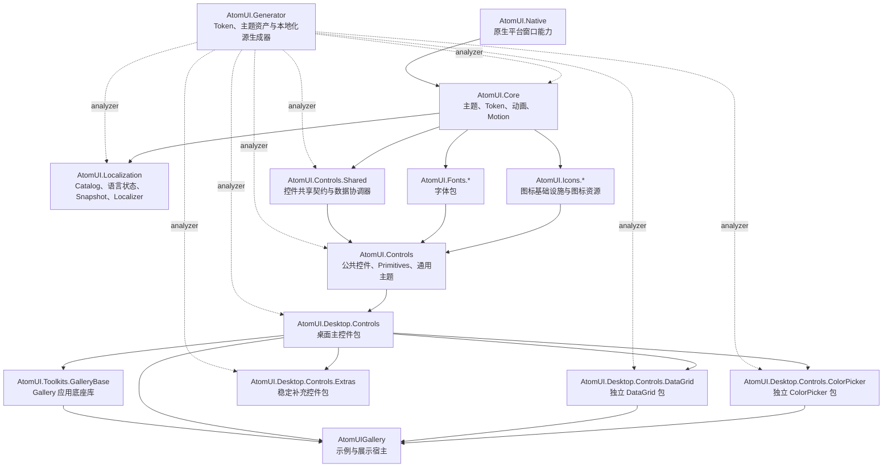
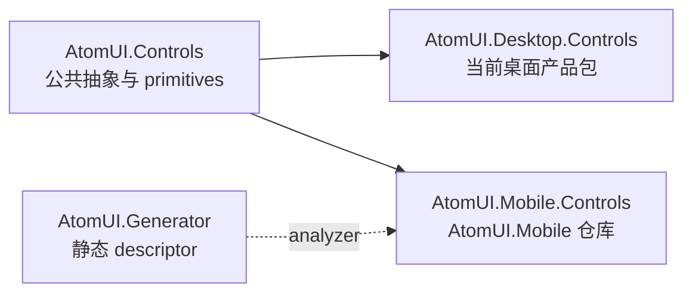
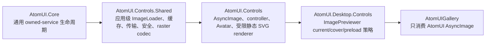

# AtomUI 整体架构

AtomUI 是基于 Avalonia/.NET 的桌面与跨平台控件系统。整体架构按平台能力、运行时基础设施、共享契约、Control 包、
可选扩展包、编译期生成和 Gallery 工具层组织。

## 导航

- [架构基础](foundations/overview.md)：依赖关系、运行平台、启动注册、构建和打包。
- [跨模块系统](systems/overview.md)：启动、主题、本地化、Control 基础设施、渲染和窗口系统的架构入口。
- [启动系统](systems/startup/overview.md)：`UseAtomUI` 入口、启动生命周期、Splash 与主窗体交接。
- [字体子系统](systems/typography/overview.md)：字体包注册、字体族回退、字号与行高 Token 派生。
- [Control 基础设施](systems/control-infrastructure/overview.md)：异步加载、过滤与响应式共享契约。
- [Motion 动效系统](systems/motion/overview.md)：重构目标架构；Motion 继承扩展、无 Actor 执行、布局和真实帧时验收。
- [统一图片加载系统](systems/image-loading/overview.md)：当前应用级图片管线、公共 Source、缓存安全和控件 API。
- [渲染系统](systems/rendering/overview.md)：边框渲染与跨 VisualRoot 的视觉层规则。
- [Mobile 系统](systems/mobile/overview.md)：指向独立 AtomUI.Mobile 仓库的移动 Runtime 与验证契约。

## 当前源码架构

下图只描述当前仓库项目和直接产品关系，不包含尚未创建的 Mobile Controls 或 Mobile Gallery Host。

## AtomUI Mobile

`AtomUI.Mobile.Controls` 位于独立仓库 [AtomUI/AtomUI.Mobile](https://github.com/AtomUI/AtomUI.Mobile)，与 Desktop 平行，复用稳定基础设施但不依赖 Desktop，以 NuGet 方式消费
本仓库的包；其架构、宿主与验证由该仓库维护。

目标依赖、包 ownership 和 Runtime 不变量分别见 [项目依赖关系](foundations/dependency-graph.md)、
[Mobile Controls 模块](../modules/mobile-controls/overview.md)和 [Mobile 系统架构](systems/mobile/overview.md)。

## 统一图片加载层

统一图片加载不新增项目，也不改变 `Core -> Controls.Shared -> Controls -> Desktop.Controls` 的依赖方向：

Core 只提供通用应用托管服务收集、attach、回滚和逆序销毁，不引用 `ImageSource`、HTTP、codec 或 cache。完整公共 API、
管线、平台和验证契约由 [统一图片加载系统](systems/image-loading/overview.md)拥有；各 Control 文档描述对应控件契约，不得
另行维护平行的图片加载 API。

## 核心运行链路

AtomUI 应用通常分两步接入：

1. 在 `AppBuilder` 上调用 `WithAtomUIDefaultOptions()` 应用平台默认配置。
2. 在同一 `AppBuilder` 链上调用 `UseAtomUI(builder => ...)` 登记主题、本地化、字体、Control 包和可选包；具体应用类声明为 `partial`，由生成的 `RegisterServices` 挂接在 `Initialize()` 之前完成提交。

根 `IAtomUIBuilder` 组合主题与本地化 Builder。主题链路收集生成式 Control descriptor、主题 Provider、算法
descriptor 和 ControlTheme asset manifest；本地化链路收集 Catalog、编译后 Translation Bundle 与支持语言配置。
启动注册的完整顺序见 [启动与注册链路](foundations/startup-and-registration.md)。

## 源码包边界

- `AtomUI.Native` 提供原生平台窗口能力，不决定上层 Control 和主题策略。
- `AtomUI.Localization` 提供应用级本地化运行时。
- `AtomUI.Core` 提供主题、Token、资源、动画和应用入口基础设施。
- `AtomUI.Controls.Shared` 提供跨 Control 共享契约和数据协调能力。
- `AtomUI.Controls` 提供公共 Control 与 Primitives。
- `AtomUI.Desktop.Controls` 提供桌面主 Control 包、Popup、Overlay 和 Window 能力。
- DataGrid、ColorPicker 和 Extras 是按需引用的独立桌面包。
- `AtomUI.Generator` 以 Analyzer 方式提供静态 descriptor、资源键、注册和本地化输出。
- `AtomUI.Toolkits.GalleryBase` 为 Gallery 应用提供产品中立的工具层。

上述列表是当前源码包。`AtomUI.Mobile.Controls` 位于 AtomUI.Mobile 仓库，不在本解决方案中，也不由本仓库发布。

具体项目引用与内部可见性见 [项目依赖关系](foundations/dependency-graph.md)。

## 横切系统

- 主题、Token、Semantic Part、本地化和统一图片加载属于跨模块系统，由 `architecture/systems/` 统一导航。
- 平台差异遵守 [运行平台策略](foundations/runtime-platforms.md)。
- Control 边框遵守 [边框渲染架构](systems/rendering/border-rendering.md)。
- 跨普通视觉树绘制遵守 [视觉层规范](systems/rendering/visual-layers.md)。
- 控件注册采用已采纳的 [TypeMap AOT 架构](foundations/aot-and-trimming.md)，该入口统一说明本地实现、验证与发布状态。
  [注册管线](foundations/aot-typemap-registration.md)、[控件与资源契约](foundations/control-registration-contracts.md)和
  [Browser 链接后端](foundations/aot-browser-linking.md)分别拥有生成、资源和平台边界；日常编码遵守
  [AOT 编程规范](../engineering/development/aot-programming-guidelines.md)。
