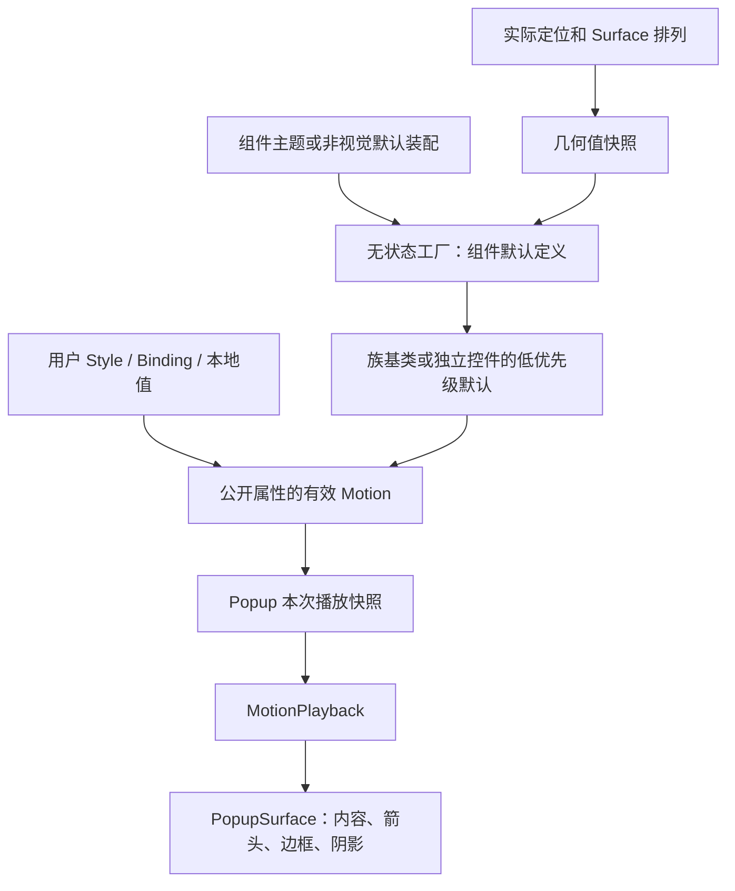

# 弹层组件动效架构

本文拥有 Popup、Flyout 和语义组件之间的默认动效配置、几何解析、展示准备与宿主接入契约。
[组件规格](built-in-motion.md#弹层组件选择)拥有各组件的轨迹和时长；[播放协议](playback-and-lifecycle.md)拥有请求、取消与终态资源。
本文定义正式设计合同，源码符合程度与运行证据统一由[验证状态](verification.md#弹层组件动效接入状态)维护。

## 1. 定位与原则

语义组件确定动效规格，Popup 解析实际定位与表面几何，配置 owner 发布有效定义，Core Motion 执行播放。
通用 Popup 没有特定组件语义，默认允许无动效；具体选择器、Picker、菜单与浮层通过主题或非视觉接入提供默认配置。

动效作用于已有 PopupSurface，内容、边框、箭头和阴影共同缩放与淡入淡出。native/overlay 共享同一视觉语义，
不移动业务内容、不创建替代视觉树、不改变内容尺寸、限高、滚动条、焦点或键盘行为。

首次 appear 与后续 enter 使用同一组件规格，leave 对应同一规格的离场定义。触发延迟、异常 deadline 与视觉时长分别管理。
准备阶段保持自然布局并预隐藏，实际 Slide/ZoomBig 从 0.8 开始；不将 CSS prepare 的 scale(0) 误作有效播放起点。

## 2. 基类属性、默认装配与所有权

打开/关闭动效的配置入口统一为 `OpenMotion`、`CloseMotion`，类型均为 `AbstractMotion?`。
具备同一弹层职责的控件族在已有基类声明，派生控件继承；不同框架继承树通过 `AddOwner` 复用
`Popup.OpenMotionProperty`、`Popup.CloseMotionProperty` 的现有注册，保持属性身份，不创建统一控件基类或新设置容器。
普通 Button、ContentControl 与仅有背景过渡等能力的 IMotionAwareControl 不因共享动效能力而获得这对配置。

组件主题决定 Select、Dropdown、Menu、Tooltip 等默认轨迹；这些名称表达组件语义，不作为 Popup 上的可设置模式。
配置不经过 `DefaultMotionPreset`、`MotionProfile` 或其他预设枚举属性。实际几何与活动原点是内部准备数据，
不成为第三个动效设置入口，也不按用户 Motion 的类型猜测组件来源。



| 角色 | 单一责任 |
| --- | --- |
| 控件族基类 | 声明两项配置属性及对应 CLR 入口，派生类型继承，不复制播放状态机 |
| 组件 ControlTheme | 提供组件默认 Motion、Fast/Mid Token 和模板接线，不拥有计时与物理关闭 |
| 配置 owner | 拥有公开配置的有效值与主题默认，不拥有帧时钟 |
| Popup | 物理宿主、定位几何、显示准备、请求身份及最终关闭 |
| 默认定义与实例复制 | 主题原型本身是合法 Motion，按实例复制纯配置；播放前消费几何及菜单语义值快照，不订阅、不保存控件引用 |
| Core Motion | 播放、替代、取消、全局禁用与呈现资源，不判断组件种类 |

| 接入形态 | 配置 owner |
| --- | --- |
| Select、Cascader、TreeSelect | AbstractSelect 声明，实际控件实例拥有有效配置，PART_Popup 单向消费 |
| DatePicker、RangeDatePicker、TimePicker、RangeTimePicker | InfoPickerInput 声明，RangeInfoPickerInput 及具体控件继承，PART_Popup 单向消费 |
| AutoComplete、AutoCompleteSearchEdit、AutoCompleteTextArea | AbstractAutoComplete 声明，各实例拥有配置 |
| ComboBox | ComboBox 自身声明，不改变 AvaloniaComboBox 继承关系 |
| ColorPicker、GradientColorPicker | AbstractColorPicker 声明，实际 PART_Popup 单向消费 |
| 独立 Flyout、MenuFlyout | Flyout 实例 |
| FlyoutHost 托管 Flyout、PopupConfirm | FlyoutHost；内部 Flyout 只转发 |
| ContextMenu | ContextMenu 实例 |
| DropdownButton、SplitButton | 各自控件实例声明入口，关联 Flyout 只转发；普通 Button 不声明 |
| ToolTip、OverflowTip | ToolTip 实例声明入口；OverflowTip 复用实际 ToolTip，不重复注册或新增宿主 Motion 附加属性 |
| 菜单 popup 项 | 真正拥有子菜单 Popup 的 MenuItem/内部 NavMenuItem；Menu/NavMenu 本体不增加含义不清的整树开关配置 |
| DataGrid 筛选 | 实际筛选 Flyout 继承已有配置；DataGrid 本体不增加控制行、列或全部浮层的同名入口 |
| 直接 Popup | Popup 本身，默认无动效 |

模板型控件由公开配置所在控件单向传给实际 Popup；非视觉组合为外层配置 owner→Flyout→Popup。
直接使用 Flyout 时由 Flyout 自身提供配置。托管时不得以内部 Flyout 的本地赋值覆盖外层绑定，
也不得把内部默认反向写回公开属性。组件默认与用户覆盖在同一配置 owner 上遵循正常属性优先级。
更换 Flyout/owner 时先退役旧身份，强制结束旧物理宿主，再释放定位/配置转发，最后登记新接入。

Menu 各 popup 层级的默认可不同；未提供菜单项配置时保留各层主题默认，显式 null 关闭对应方向。
不得将根 Menu 的空值无条件广播给全部子菜单，也不得把 NavMenuItem 的内部实现类型提升为新的公开类型。
Inline、TreeView、Expander/Collapse 的内容展开不并入 popup 配置，尤其不改变已有 TreeView 的 null 回退合同。

内部数据只包括请求前取得的值类型几何/菜单语义快照及活动反向原点。快照包含实际 placement、翻转、FlowDirection、
anchor/content Rect、alignment 与箭头 Token 偏移，以及真实菜单层级和横向顶层语义；它不保存控件引用，不作为 Avalonia 属性发布。
已有请求身份继续负责异步有效性，不建立第二套业务开关状态。

## 3. Public API 与主题覆盖

OpenMotion/CloseMotion 在上述配置入口均为可读写 StyledProperty，默认绑定模式 OneWay，不启用逻辑树自动继承。
注册元数据默认 null；组件默认由主题或有真实展示上下文的低优先级装配提供。基类不存放共享的可变默认 Motion 实例。
IsMotionEnabled 和 MotionDuration 继续表达组件开关与有效请求时长。

| 配置来源 | 契约 |
| --- | --- |
| 组件默认 | 在配置 owner 上以主题 Setter 或明确的低优先级默认值覆盖提供实际 Motion 定义 |
| 应用 Style、绑定与本地值 | 遵循 Avalonia 正常优先级覆盖 owner 默认 |
| 显式 OpenMotion=null / CloseMotion=null | 禁用对应方向；不能以空值回退重新启用 |
| 清除覆盖 | 重新显现当前组件、当前几何对应的默认值 |
| 禁用动效、全局 EnableMotion=false、零时长 | 直接收敛最新业务目标，释放准备与运行资源 |

未设置与显式 null 不能仅用 GetValue 得到的空值混为一谈；禁止用 `owner.OpenMotion ?? defaultMotion`
代替默认优先级，也不能无条件转发元数据 null 抹掉内部主题默认。单向接入必须保留配置来源与正常覆盖语义。

模板拥有的固定关系由 ControlTheme 的 TemplateBinding/编译绑定声明，不另建同生命周期的代码订阅。
组件默认由主题直接设置两个属性。AXAML 可见静态成员声明为 AbstractMotion，值本身也是具有正常 Build 行为的 Motion；
内部默认定义额外实现 ITemplate，在 Setter 实例化时复制配置，不能把一个可变默认实例直接共享给多个控件。
静态原型只持有配置和静态几何函数，不持有使用者。非视觉 Flyout 以同一显式复制入口创建 Style 优先级默认值。
不存在 DefaultMotions、Motion 对容器或 Popup→owner 的默认值回传；几何变化不替换公开定义、不建立默认几何绑定。

默认定义通过内部可执行准备契约接受值快照并返回本次内置定义。Popup 只对实现该契约的定义执行准备，
不按用户 Motion 的内置基类猜测默认来源。源定义的 Duration/Delay/Easing/Origin/FillMode 均不被修改；显式 Origin 优先。
菜单层级与横向 NavMenu 的区别在准备阶段读取真实语义值，不以高优先级条件 Setter 覆盖应用 Style。
初始化在物理 Show 前完成默认接入，首次布局后才解析实际几何，提交前重新读取有效值。

组件主题的内部默认值写法为：

```xml
<Setter Property="OpenMotion" Value="{x:Static atom:PopupMotionDefaults.SelectOpen}" />
<Setter Property="CloseMotion" Value="{x:Static atom:PopupMotionDefaults.SelectClose}" />
```

这里的静态成员是类型正确的 Motion 原型；Setter 经其 ITemplate 能力为每个样式实例复制定义，实际 owner 得到独立实例。
复制保留 Duration/Delay/Easing/Origin/FillMode 与几何函数；不复制目标、计时或请求状态。不能以单独模板包装类型作为该静态成员的声明类型，
否则 IDE 会报告与 AbstractMotion 属性不兼容。应用仍通过公开两属性配置普通 Motion。

非视觉 Flyout 无自身 ControlTheme，应在真实展示上下文建立 BindingPriority.Style 的可释放默认值覆盖，并注释其 AXAML 不可行原因。
Host/ContextMenu 使用自身主题；内部 owner→Flyout→Popup 转发为 OneWay。托管模式不能同时启用独立 Flyout 的竞争默认值覆盖。
非视觉 Token 绑定具有明确资源上下文和释放会话，不能在构造时依赖 Application 永久订阅。

Popup 现有播放约定将 owner 有效 MotionDuration 作为本次请求覆盖，优先于定义自身 Duration；不修改定义的 Duration。
组件默认 Fast/Mid 按[组件规格](built-in-motion.md#弹层组件选择)选择。自定义定义完全保留其 Origin/Build，不能按类型识别后强制套用默认原点。

DatePicker 从 InfoPickerInput 继承同名入口，实例配置写法为：

```xml
<atom:DatePicker>
    <atom:DatePicker.OpenMotion>
        <atom:FadeInMotion />
    </atom:DatePicker.OpenMotion>
    <atom:DatePicker.CloseMotion>
        <atom:FadeOutMotion />
    </atom:DatePicker.CloseMotion>
</atom:DatePicker>
```

该写法仅建立控件对定义对象的引用；两个定义都不保存 DatePicker/Popup、任务或订阅，
也不在构造函数中绑定全局 Token。定义可由资源字典长期持有而不反向保活使用过的控件。

### 3.1 禁用与当前请求收敛

组件仅有 IsMotionEnabled；不另设 IsMotionAllowed 等同源 Token 镜像开关。Core 在准备时统一解析既有目标开关与有效 EnableMotion，
并在活动播放期间观察真实目标资源作用域的全局策略变化，不逐帧查 Token，也不把观察绑定到 Motion 定义上。
全局禁用使当前请求停止帧驱动、跳过剩余 Delay、按其终点和 FillMode 正常完成；Popup 的离场可据此继续物理关闭。
外部取消、替代、卸载与失败仍保持各自结果，不伪装为 Completed；同步通知后必须复核请求身份。
重新启用不复活旧请求。初值或回调可同步重入，订阅租约先登记再发布；结束、失效与异常统一释放观察。

## 4. 实际方向与原点

### 4.1 Slide

| 最终实际侧 | 轨迹 | 内容框内比例原点 |
| --- | --- | --- |
| 下 | SlideUpIn/Out | `(0,0)` |
| 上 | SlideDownIn/Out | `(1,1)` |
| 右 | SlideLeftIn/Out | `(0,0)` |
| 左 | SlideRightIn/Out | `(1,0)` |

选择器/Picker 使用上下分支，Dropdown 使用四方向。最终 placement 与已有翻转结果共同决定方向，不能只读取 RequestedPlacement。
Horizontal Menu 是固定 SlideUp 的单独规格，不合并进自动翻转策略。RTL 不改变上下 Slide 的缩放轴。

### 4.2 独立 Menu 与 Dropdown 子菜单

独立 Menu/NavMenu 的 LTR ZoomBig 原点为：

| 最终 placement | 内容框内比例原点 |
| --- | --- |
| rightTop / bottomLeft | `(0,0)` |
| leftTop / bottomRight | `(1,0)` |
| leftBottom / topRight | `(1,1)` |
| rightBottom / topLeft | `(0,1)` |

普通 Menu 的 RTL 最终覆盖为 `(1,0)`，不再镜像该表。Dropdown 内嵌 Menu 使用不同的样式作用域，
其 ContextMenu/MenuFlyout 等嵌套子菜单原点固定 `(0,0)`，包含 RTL 与翻转。两类都使用 ZoomBig，但不能合并原点策略。
组件上下文沿已有 MenuSemanticLevel 与容器准备链传播，不按 Popup 位于哪一侧猜测所属组件。

### 4.3 Tooltip 与 Popover 家族

原点来自定位 alignment 与边对齐箭头偏移，不无条件取中心或可见箭头尖端。令目标框 T 与已定位内容框 B 位于同一坐标系：

`x = (max(T.left,B.left) + min(T.right,B.right))/2 - B.left`

`y = (max(T.top,B.top) + min(T.bottom,B.bottom))/2 - B.top`

坐标不擅自 clamp；两框有间距时原点允许在内容框外。topLeft/bottomLeft 使用 x=a；topRight/bottomRight 使用 x=B.width-a，
其中 `a = r > 12 ? r+2 : 12`，单位 DIP。Tooltip 的 r 来自有效全局 BorderRadius，Popover 家族来自 BorderRadiusLG；
该公式来自对应组件的 Token 推导，不能以任意实例 CornerRadius 替代。其他 placement 的 x 和所有 placement 的 y 保留 alignment 值。

隐藏箭头不自动改为中心；完全缺少 alignment 数据时才采用 50%/50% 回退。目标框、IsPointAtCenter 和定位偏移复用现有真实数据，
alignment 原点与可见箭头位置分别验证，不为校准动画重新移动箭头或复制一套定位算法。

### 4.4 表面坐标、阴影与包络

统一使用同一 TopLevel 下的 DIP，跨 native/overlay 边界显式转换，不混用屏幕物理像素。
内容框 B 在 PopupSurface 中为 `(bx,by,bw,bh)`，框内比例原点 `(rx,ry)` 转为表面绝对原点：
`O=(bx+rx*bw, by+ry*bh)`。alignment 坐标加 B 的表面偏移。Origin 使用 RelativeUnit.Absolute，
不能将内容框比例直接套在包含 shadow buffer 的整个 Surface 上。

包含现有阴影的绘制边界为 V，本次初始缩放矩阵为 S0，则全程包络为 `U=union(V, O+S0*(V-O))`。
Slide 的对应轴、ZoomBig 的双轴起始缩放为 0.8，这些曲线无超调，端点包络覆盖全程。
只有 U 确实超过原生分配时才增加本次所需透明缓冲，并反向补偿内容定位，保持 B 的屏幕坐标不变；
缓冲在动作开始前冻结并保持到物理关闭，不逐帧 resize。不以裁剪阴影、clamp 原点或切换 Overlay 规避错误。

最终几何来自已提交定位与真实排列；自定义回调改变定位后重新确认。Ant 组件不支持的居中边对齐等位置属于 AtomUI 扩展：
菜单取对应边中点，无法解析的 Custom 使用所选族的中心默认，不宣称为对应 Ant placement 的等价结果。

## 5. 展示准备、播放与关闭

打开顺序为：确定组件默认与配置 owner→Surface attach 在物理显示前预隐藏→物理打开/表面就绪→一次真实布局→解析最终定位、内容框与原点→
准备本次默认定义→重新读取有效 OpenMotion、开关和时长→核对版本与表面身份→播放并释放准备→稳定打开。

不能在布局前捕获 Motion，再以该旧值完成布局后的播放。布局和属性通知可重入，准备与提交后续步骤均重新验证当前请求身份。
一次布局后仍 NotReady 时稳定显示或关闭，不无限重试，不以固定 Delay 等待就绪。

关闭沿 Popup 单一 Idle→Requesting→Pending→Playing→Completing 状态机收敛；普通关闭保留宿主，当前离场结束、身份/目标一致且关闭意图仍有效时才最终关闭。
Requesting 同步询问语义 owner 的 Closing；取消时保留内容、子菜单和现有播放，不启动离场。Completing 保持到旧宿主物理释放后才发布完成，通知中新开宿主不受旧事务清理。Flyout.HideCore 与实际 Popup 使用同一有效 CloseMotion，不各自推导是否支持离场。重复 Hide 不绕过已有离场；同目标 ShowAt 反向复用宿主。关闭中重开使旧关闭失效；进入中关闭接续现有呈现值。

同一 Surface 的双方均支持内部几何准备时，反向沿用活动请求原点，直到稳定态后才在下一请求采用新几何；
为本次请求生成相应定义，不修改已发布对象。来源由可执行准备契约判定，不按用户 Motion 类型猜测。
任一侧为用户定义时保留其 Origin/Build 及现有通道交接语义，不承诺不同原点下完整矩阵连续。
定位变化只影响下一次准备，不替换已发布定义或重启动画时长。

detach、目标/owner 失效、跨 TopLevel、窗口销毁和模板替换遵守已有生命周期关闭规则；Flyout 的强制关闭先终止仍存在的物理 Popup，不能仅凭 Flyout.IsOpen 或 Popup.IsOpen 的逻辑请求值判断已拆宿主，定位转发必须保留到物理关闭之后；Pinned-open 普通关闭仍被拦截。
禁用中收敛、零时长与失败回滚都释放准备及播放资源。Opened/Closed 保持物理宿主事件语义，不改成动画完成通知，也不得重复发布。

## 6. 宿主与输入边界

native PopupRoot 和 OverlayPopupHost 共用 PopupSurface→VisualLayerManager→ShadowsAwareContainer→内容。
native 在 Surface 外有静态标准 PART_ContentPresenter，以 Surface.Margin 表达本次透明动画缓冲；宿主定位将其视为 Deflate，逻辑内容位置保持不变。仅内部默认 Popover/Tooltip 的实际包络超界时分配，按 RenderScaling 向外取整；窗口 Width/Height/Min/Max 保留内容约束并叠加缓冲，缓冲只增不减直到 Closed。内层内容通过编译逻辑祖先绑定读取 PopupRoot.Content，不能跨 Content 边界使用 TemplateBinding。Overlay 不增加该节点或 native 缓冲。
完整表面共用变换与透明度；不逐帧动画 OS 窗口尺寸或边框，不切换透明窗口类型，不拆独立阴影窗口。
阴影缓冲不参与业务测量，终态位置、Min/Max、限高及滚动保持原契约。

离场按对应组件 pointer-events:none 的语义抑制表面输入：Overlay 使用可撤销覆盖，native 复用已有输入区域协议；
完成、反向、失败或失效时恢复最新底层来源。原生入场整窗输入暂停是现行宿主合同，与 Ant DOM 入场可交互有差异，
视觉规格对齐不隐式改写该合同；Overlay 入场继续保持其既有输入行为。

Windows、macOS、X11、Wayland 只在原生窗口映射、透明合成和输入区域提交上适配；组件方向、曲线和原点计算不复制到平台层。
已有阴影实机证据按有效范围复用，新动效的首帧、几何包络与离场恢复独立验收。

## 7. 资源、性能与 AOT

主题默认定义在样式实例内保持稳定。每次播放准备只生成当前方向所需的内置定义，配置好 Origin 后交给既有播放管线，
不生成 Motion 对，不发布几何变化，也不建立以控件或定义为 key 的全局缓存。
定义不保存 target、任务、CTS 或订阅；动态资源留在主题或有上下文的 scoped binder，不放在普通 Motion 对象上。

### 7.1 定义对象与运行对象分离

DatePicker→OpenMotion/CloseMotion 是允许的配置引用；Motion 定义→DatePicker/Popup/页面的反向持有不属于定义模型。
AbstractMotion 及其内置定义是普通配置对象，不为资源绑定改造成非视觉 AvaloniaObject，不设置 Owner/Target，
不缓存本次 Builder、MotionContext、Task、CancellationTokenSource 或事件委托。
默认工厂和框架生成的委托不捕获控件。Token 在有上下文的准备/执行层读取，配置对象不订阅 Application 事件。
共享定义参与多个控件播放时，每次都生成独立运行快照；配置不被写入动画进度或上一次目标。

属性注册、AddOwner 和 CLR 包装只提供配置入口；不在属性构造或赋值时建立长期全局观察。
模板关系由声明式绑定承担，换模板后旧 Popup/Surface 的可回收性必须验证，不能仅凭使用了 TemplateBinding 判定安全。
InfoPickerInput 替换模板时先结束物理 Popup，再释放退役模板声明上的父主题订阅；普通关闭保留可复用的业务 presenter。
Popup 的跨视觉根 Child 声明随模板 owner 退役。已脱离视觉树且没有当前合成节点的 Border 缓存，可在该退役边界释放；挂载中或已重用的节点必须跳过。
这两处框架兼容操作集中在 Core.Reflection 的固定成员边界，使用精确 DynamicDependency 保留，依赖升级时重新核验；不修改合成图。
非视觉 Flyout 的可替换绑定必须有明确释放 owner；不以清空 DataContext、清除用户 Motion 属性或导航缓存绕过回收要求。
配置 owner 注销/替换时，先完成旧宿主的生命周期关闭，再在仍匹配该 owner、且没有新活动宿主的条件下退役定位缓存。
框架的上次定位目标由现有 PopupFlyoutBaseReflectionExtensions 的固定内部方法边界清空，精确 DynamicDependency 保留该方法；
可复用 presenter 子树中已脱离且没有当前合成节点的 Border 缓存复用既有保护入口释放，防止其祖先链保留旧宿主的定位目标。
普通关闭保留 IsOpen=true 重开所需的目标；owner 退役释放不清空用户内容或定义，不修改挂载中节点或新一代宿主。

### 7.2 获取与释放

| 获取项 | 释放边界 |
| --- | --- |
| 主题默认创建值 | 随样式实例释放；原型/定义只含配置和静态函数，不反向引用使用者 |
| Flyout 低优先级默认值覆盖、可替换配置转发 | owner 更换、unregister、detach、销毁与失败回滚 |
| 非视觉 Flyout Token 绑定 | 取消打开、普通物理关闭、生命周期关闭与失败回滚 |
| 帧驱动、外部取消注册、活动请求的全局策略观察 | 正常完成、取消、替代、故障或目标卸载；空闲不保留全局观察 |
| Surface 准备、播放、离场输入覆盖 | 完成、替代、关闭、模板或目标失效 |
| FillMode 终态记录 | 后继成功请求、Reset、Popup 物理关闭、模板/目标失效；不持有运行任务、时钟或策略观察 |
| 原生阴影输入资源 | 沿用一次打开会话的既有释放入口 |

正常完成允许按 FillMode 保持必要终态值，不允许保留活动播放资源。弱表不替代时钟、资源事件和取消注册的显式释放；
全局时钟或资源发布者仍可能形成强根。同步回调与异步 finally 都只释放本请求的句柄，不能清除新请求的覆盖。

普通自定义 Motion 直接交给播放管线，不采集默认几何。内部定义只在请求准备时读取一次实际布局/语义快照；
实例初始化和翻转不需要默认值绑定链或属性通知。

无逐帧布局、默认定义重建或 Token 查询；几何仅在动作准备边界采集。固定模板关系由 AXAML 表达，运行时几何只提供计算值。
Core 不反向认识 Popup，也不为动态原点增加专用公共播放 API。内部准备定义继承既有 Slide/Zoom，曲线与帧驱动仍由 Core 统一实现。全部定义静态引用、AXAML 无参构造可达，
不新增反射扫描、字符串发现或动态注册。

## 8. 兼容与验证

公共属性类型、主题 key、Semantic Part、内容树与输入选择语义保持稳定。启用默认动效会改变普通物理关闭的完成时间；
业务提交意图与最终物理关闭分别处理，不能因等待 leave 丢失候选状态清理、焦点或控件事件。

验证覆盖组件族与菜单来源、实际翻转、RTL、动态原点、Fast/Mid、自定义与显式空值、清除覆盖、Token 更新、首次出现、
快速反向、禁用中收敛、模板/owner 更换、资源释放和原生/Overlay 首尾帧。正常轨迹在 0/25/50/75/100% 采样，
曲线数值容差 1e-6；同缩放下原点换算误差不超过 1 个物理像素。轨迹数值、渲染结果、输入和物理事件分别计证。

原始选择器、Picker、菜单与 Flyout 场景保留限高、标题、滚动条和嵌套滚动；不能用放宽布局约束后的通过替代原场景。
Headless 不替代原生显示证据；NativeAOT、Release、平台与性能证据分别记录在验证页。测试生命周期遵守项目现行规范。

### 8.1 内存验收阻断条件

新增基类属性与单向传递必须用真实编译 AXAML 验证，包含第 3 节 DatePicker/Fade 示例。
可回收性与行为、运行句柄分别取证；窗口退出正常、RSS 暂未上涨或功能用例通过，均不能代替以下验收：

| 场景 | 必须证明 |
| --- | --- |
| 实例 AXAML 配置，正常打开/关闭后移除页面 | DatePicker、Popup、Surface、旧页面在调度与任务收尾后可回收 |
| Motion 由应用资源或测试强引用长期持有 | 定义仍存活，使用过它的控件和页面仍可回收；保留已完成 Task 时也不保活目标 |
| 入场、离场、Delay 中卸载或关闭窗口 | 请求结束，帧与资源观察释放，无迟到回调访问新宿主 |
| 控件继续存活，替换模板或 Motion | 旧 Popup、旧 Surface、无其他 owner 的旧定义可回收；新配置继续有效 |
| 全局禁用、快速反向或失败清理 | 活动句柄归零，必要终态记录在 Reset/失效后释放，重入不残留旧资源 |
| 真实 Gallery 重复进入、开关和离开页面 | 导航稳定后旧页面及弹层对象数量不持续增长；有明确缓存的对象按其逐出合同单独统计 |

WeakReference 场景在独立创建方法中返回弱引用，先处理 Dispatcher 与异步收尾，再验证 GC；
避免测试局部变量、闭包或诊断集合本身保活目标。资源更新和重新接入行为同时保留，不能用静态化 Token、
禁用动画或省略原始关闭步骤换取可回收。未完成该验收不得宣称无泄漏或交付该配置能力。

## 9. 组件文档入口

- 选择器：[ComboBox](../../../controls/desktop/navigation/combo-box/overview.md)、[Select](../../../controls/desktop/data-entry/select/overview.md)、[AutoComplete](../../../controls/desktop/data-entry/auto-complete/overview.md)、[Cascader](../../../controls/desktop/data-entry/cascader/overview.md)、[TreeSelect](../../../controls/desktop/data-entry/tree-select/overview.md)。
- Picker：[DatePicker](../../../controls/desktop/data-entry/date-picker/overview.md)、[TimePicker](../../../controls/desktop/data-entry/time-picker/overview.md)。
- 菜单：[Menu/ContextMenu/MenuFlyout](../../../controls/desktop/navigation/menu/overview.md)、[NavMenu](../../../controls/desktop/navigation/nav-menu/overview.md)、[DropdownButton](../../../controls/desktop/navigation/dropdown-button/overview.md)、[SplitButton](../../../controls/desktop/general/split-button/overview.md)、[DataGrid 筛选](../../../controls/desktop/data-display/data-grid/overview.md)。
- 浮层：[InfoFlyout](../../../controls/desktop/data-display/info-flyout/overview.md)、[Tooltip](../../../controls/desktop/data-display/tooltip/overview.md)、[PopupConfirm](../../../controls/desktop/feedback/popup-confirm/overview.md)、[ColorPicker](../../../controls/desktop/data-entry/color-picker/overview.md)。
- 宿主：[Popup 架构](../../../controls/desktop/other/popup/overview.md)、[Popup 实现](../../../controls/desktop/other/popup/implementation.md)。
