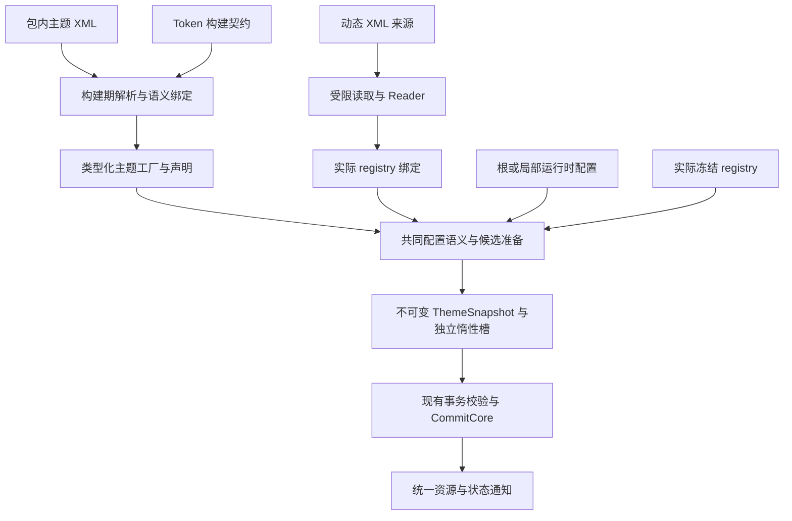

# 编译主题包架构

> 状态：已按静态声明生成的边界收敛，尚未发布；本次构建、定向测试及静态/动态差分已通过，平台检查范围见验证文档。本文定义主题包构建期编译的正式边界，
> 验证要求和证据边界见[验证文档](verification.md)，共同运行语义见[主题运行时](../runtime.md)。

## 1. 定位与文档所有权

编译主题包将随程序发布的 `.theme.xml` 转换为类型化 C# 注册与默认赋值。运行时消费生成产物，
按实际配置构造候选 ThemeSnapshot，再由唯一 ThemeManager 提交。外部动态 XML 继续经过受限读取、解析和绑定，
最终遵循相同配置、计算、资源查询及提交语义。

本模块编译主题静态声明；Token 派生统一由现有运行时算法执行。Avalonia 继续负责 AXAML 编译、模板、布局与绑定。主题包不能负责应用启动、窗口创建、本地化或可选控件包的隐式启用。

| 文档 | 所有权 |
|---|---|
| 本文 | 目标、模块边界、逻辑模型、语义与来源接入、阶段支持范围 |
| [构建与产物协议](compilation.md) | XML/schema 输入、字面量生成、版本一致性、增量构建、AOT/裁剪 |
| [执行与生命周期](execution-and-lifetime.md) | 运行路径选择、候选状态、注册演化、线程、缓存、对象所有权与失败清理 |
| [验证与交付](verification.md) | 差分、生命周期、故障注入、平台/裁剪和性能验收 |

配置优先级、算法策略、作用域继承和结果事件的共同语义由[主题运行时](../runtime.md)拥有；本模块不得维护另一套规则。
控件、资产保留及平台能力由[控件注册契约](../../../foundations/control-registration-contracts.md)和
[TypeMap 管线](../../../foundations/aot-typemap-registration.md)拥有。源级接线与资源延迟遵守
[惰性物化](../lazy-materialization.md)。

## 2. 目标与不可变约束

目标是省去运行时包内 XML 读取、语法树重建、静态名字解析与静态字面量转换。生成代码直接注册并写入强类型
默认值；现有 ThemeCompiler 根据有效配置执行算法并创建快照。构建期不执行算法或生成派生结果。

字体描述保留标准 FontFamily 构造及依赖内部解析，这是明确批准的边界，详见[值生成](compilation.md#32-支持的值生成)。
其余静态值仍遵守支持域的类型化生成要求，不以字体例外扩大运行期字符串转换范围。

必须保持：

1. ThemeSnapshot 是有效 Token 值的唯一真源；生成工厂不得直接修改 Application.Resources 或活动 ThemeContext。
2. 静态包、动态 XML、根主题和局部主题使用现有 ThemeCompiler 和算法实现；相同支持域内的输入产生相同类型和值。
3. 实际控件集合由应用注册及真实链接结果决定；主题包不扫描程序集，不隐式注册控件，不写死应用控件 slot。
4. 同一资源 key 的覆盖、variant、词法作用域与应用覆盖优先级不变；Token 编译不重排 AXAML 资产。
5. 根/作用域候选准备、失败回滚和发布进入现有事务执行门；不增加平行主题管理器或第二套发布队列。
6. 静态字段只保存受支持的不可变数据及无应用捕获的代码入口，不保存应用、scope、资源宿主或活动快照。
7. 未使用主题不求值，未查询控件不创建 Own Token 结果，未命中资产不构造字典；元数据枚举不能触发这些工作。
8. 格式、语义或绑定错误有明确诊断；不能通过忽略覆盖项、使用旧产物或静默改走 XML 来掩盖错误。

## 3. 重构基线与实现范围

本次重构前，Core 的固定 DaybreakBlue XML 由 Toolchain Tasks 生成 syntax document，运行时继续绑定与计算；
Gallery 其他内置主题通过 avares resolver 读取 XML。本次将这五款主题接入统一类型化生成入口。
ControlTheme 的 AXAML 工厂和逐控件注册早已独立生成，不能将它们计作本模块新增收益。

| 项目 | 重构基线 | 本模块路径 |
|---|---|---|
| 静态 XML | Core 特例生成 document，其余读字节 | 所有显式编译输入均生成可执行的类型化主题定义 |
| 静态 Token 值 | Binder 按名字查 descriptor 并转换字符串 | 构建期校验/转换，运行时执行强类型写入 |
| 全局计算 | 根据有效配置运行算法，允许缓存复用 | 继续由现有运行时算法计算，沿用有效缓存复用 |
| Control Own | 依据实际 registry 按需求值 | 保留按需边界，静态覆盖预绑定；不默认提前执行第三方 evaluator |
| XML 来源 | 统一字节 Resolver/source | 保留 XML source；编译包通过独立的类型化注册入口进入同一个 Catalog |
| 资源生效 | 候选快照、静默提交、统一通知 | 沿用，不开放直接发布捷径 |

具体生成签名和构建项见[ABI v1](../../../../reference/theming/compiled-theme-abi-v1.md)。不能仅凭生成成功宣称启动更快
或已兼容所有主题包；发布支持范围取决于对应验收证据。

## 4. 总体数据流

静态路径不实例化 XML 语法树，不为了接入旧 Binder 把已类型化值重新格式化为字符串。动态路径不引入运行时
C# 编译、表达式树编译、反射程序集发现或代码下载。

## 5. 模块与依赖边界

| 所有者 | 责任 |
|---|---|
| Core 运行时 | 现有 ThemeCompiler、配置合并、算法、值规范化、快照及事务 |
| Generator | 读取符号与声明，解析静态字面量，校验可访问性，生成类型化注册与赋值 |
| Toolchain Common/Tasks | 有界 XML 校验，传输声明文本、位置与摘要，验证构建产物 |
| 控件包 | 导出自身 Token 构建契约、现有运行期 descriptor/evaluator 与真实资源工厂 |
| 主题包 | 提供 XML、元数据、类型化注册与默认赋值；不持有运行中的应用 |
| ThemeManager/Catalog | 来源冲突、实际注册绑定、有效配置、快照/缓存和统一提交 |
| 资源 Provider/Bridge | 已提交值查询、宿主关系和既有通知/释放协议 |

不新增运行时对 Generator/Toolchain 的引用，也不让 Core 引用 Controls/Desktop。构建器读取依赖包导出的
中立事实或元数据，不加载业务程序集执行代码。工具分工和构建时序见[构建协议](compilation.md#2-工具分工)。

## 6. 逻辑模型

以下名称表示逻辑模型职责，不是对应公开 C# 类型名或已发布 wire 格式。已实现签名由
[生成 ABI v1](../../../../reference/theming/compiled-theme-abi-v1.md)维护；生成代码不能调用 Core private/internal 成员绕过跨程序集契约。

| 模型 | 保存内容 | 生命周期/限制 |
|---|---|---|
| ThemePackageManifest | 包身份、编译 ABI、内容摘要、主题元数据、契约要求、工厂标识 | 不含应用状态；枚举不创建主题值 |
| ThemeMetadata | Id、Name、默认标志、来源身份、声明 appearance、定义显式主色（未声明为 null） | 菜单可直接消费；运行时覆盖后的实际值仍来自 snapshot |
| ThemeProgram | 分阶段类型化静态赋值、算法选择、按 identity 组织的覆盖与工厂 | 共享代码及只读声明；不保存 registry slot 或父 snapshot |
| RegistryBinding | 主题契约到当前 registry descriptor/slot 的绑定与校验结果 | 应用/registry 代际所有；不得跨 registry 借用 slot |
| 编译输入 | 已解析来源、规范化有效配置、实际 registry、必要环境输入 | 不可变；不得捕获 Visual 或任意服务容器 |
| 候选结果 | 全局值、资源投影、惰性控件槽及诊断 | 由既有 transaction 拥有，成功移交或失败释放 |

工厂接收冻结输入与本次候选的 writer，只能构造候选值。Writer 不暴露 Application、活动 ResourceDictionary、
通知或提交方法；完成后不得继续写入或留在闭包中。生成方法拆分遵循主题/计算阶段/控件边界，避免单一巨型方法。

## 7. 静态声明与运行时配置语义

生成工厂必须保留 Seed、Map、Alias、Own 四类写入的阶段信息。不能把最终颜色表反推回 Seed 后重新求值，
也不能将所有覆盖统一放到算法执行之后。

运行时路径严格复用[配置合并规则](../runtime.md#43-合并规则)，其中易错边界包括：

- 根请求 Inherit=false 保留“库默认值 + 当前主题定义”，丢弃较低层应用初始覆盖。
- 局部 Inherit=false 以库默认值为基线，丢弃父作用域以及所选主题定义等继承输入。
- 算法列表整体替换，不拼接；未指定和显式空列表不同。必须保留完整顺序、算法版本和 appearance effect。
- Control disabled/global/custom 策略及其 Own/Global 覆盖分类保持一致，不能污染兄弟控件或全局值。
- Motion/Wave 最终规范化仍在正确阶段执行；生成的默认值不能绕过这些行为开关。

静态层可预先规范化，但动态覆盖仍须验证。优化必须基于完整有效输入；“主题包未修改”不代表应用字体、种子色、
父 scope 或算法链未变化。没有完整依赖声明时，重算对应全局/控件计算单元，不猜测单个字段的依赖集合。

## 8. Catalog、来源与显式注册

编译输入项为 `AtomUIThemeDefinition`，其文件进入构建流程。
包作者通过生成的包级注册 helper 显式接入主题 Builder，注册仅提交 manifest 和 factory handle。
新入口须检查 Builder 阶段、重复包/主题身份与 ABI，不调用资源 factory 或 evaluator。

原 `IThemeDefinitionSource.OpenRead()` 继续表示字节来源；不新增“相信我已编译”的布尔旁路，也不通过类型名猜测可信性。
Catalog 内部以明确的 XML/编译产物来源类型承接两种输入，并使用相同冲突与事务规则。

- 主题来源顺序继续决定展示顺序，不提供覆盖语义；跨 XML/编译包重复 Theme.Id 一律诊断。
- 静态 Catalog 保持恰好一个默认主题；可刷新用户来源不能声明默认主题。
- 编译包损坏、ABI 不兼容、必要契约缺失均为静态来源错误，不能忽略某主题后假装加载成功。
- 用户目录保持整批刷新、实际字节摘要、失败保留旧目录等既有语义；编译包的注册与赋值入口不参与文件重新解析。
- 不可刷新编译包修订在应用生命周期内固定；替换程序集需要新注册域，不支持原地替换正在使用的工厂。
- 动态文件被删除或所选主题消失时，继续执行现有 Catalog 的默认主题回退和事务规则，不改用同名包静默覆盖。

可发布原 XML 用于查看、导出或显式动态加载；它不作为编译产物错误时的隐式兜底。资源路径兼容与是否打包源文件
由包发布契约明确声明，删除已有 avares 资源属于另行评审的兼容性变化。

## 9. 控件要求与两阶段启动

XML v1 的显式 `<Controls>` 覆盖保持严格语义：它要求当前使用该定义的 registry 存在匹配控件及 Token。
不能把未知控件改成“可选覆盖”，也不能借主题包自动注册缺失控件。按需计算所有已注册控件的默认 Own Token
与 XML 显式要求某个控件是两件不同的事。

第一阶段实际使用的主题必须满足第一阶段 registry 的全部要求。若其 XML 显式覆盖非关键控件，宿主需明确调整
关键注册集合、将该主题定义/包的注册也留到第二阶段，或采用单阶段启动；不静默剥离覆盖、延后报告坏定义或更换首帧主题。
Catalog 会验证全部已登记定义，仅延迟选中该主题不能避开校验。两种来源遵守同一限制。未来若引入可选 Control 主题片段，必须版本化定义新语义，不能改变 XML v1 的含义。

第二阶段：先收集并成功封存包 → 对候选 registry 重新绑定编译产物 → 准备主题与语言 → 进入现有统一提交。
控件 slot 重排必须重建绑定；全局计算结果可按独立全局输入证据复用。框架初始化状态继续由 IAtomUIStartup 管理，
主题工厂不产生第二个初始化完成事件。详细执行顺序见[注册演化](execution-and-lifetime.md#4-注册演化与并发请求)。

## 10. 首个实现范围与扩展条件

首个实现覆盖：现有 XML v1、内置可生成的值类型、全局与 Control 的静态覆盖、现有算法组合、两种主题来源、
实际 registry 绑定，以及现有惰性 Own/evaluator 调用。

- 第三方 evaluator 保留运行期调用，不执行任意 C# 方法体来生成默认快照。
- 不引入推导任意 C# 依赖图的优化器、主题脚本、运行时编译器或穷举颜色/字体组合。
- 自定义类型没有已定义的类型化生成表达时，编译输入报错；作者可显式继续使用原动态 XML 接入，不能静默降级。
- Global 派生与 Own evaluator 均在运行时执行；控件结果仍按首次消费边界计算。
- 新的运行期公开入口应集中在包注册和受限工厂 ABI，不为每个优化再增加一种应用层主题管理方式。

完成交付必须通过[验证要求](verification.md)。设计目标和测试计划不能作为“无资源泄漏”或性能收益的完成证据。
