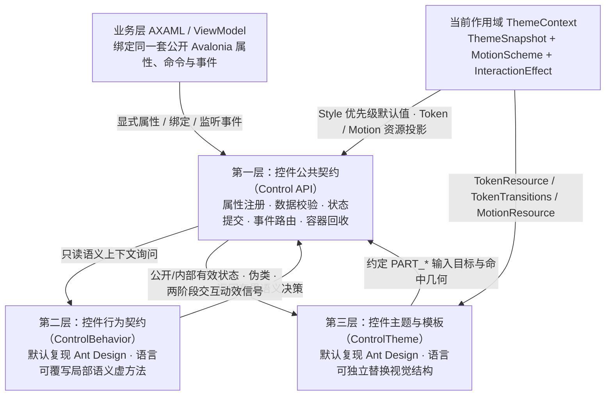
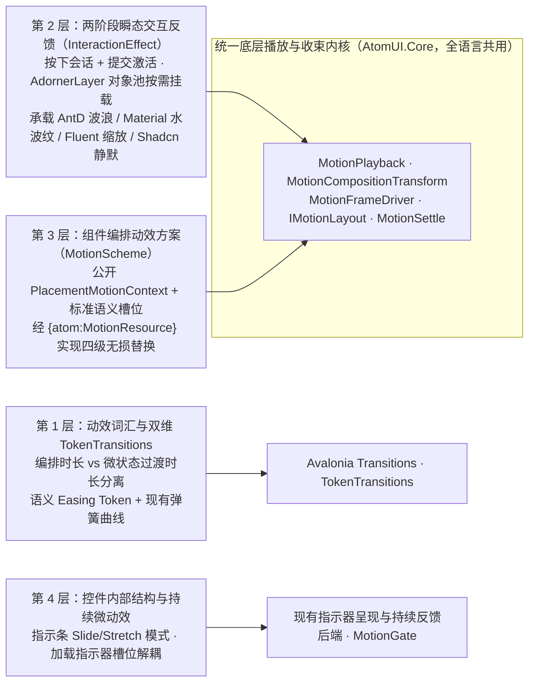

# AtomUI 多设计语言控件设计与实现规范

**正式规范 v1.0 · 2026-11-27 · 架构复审修订**
适用范围：`AtomUI.Core`、`AtomUI.Controls`、`AtomUI.Desktop.Controls`、`DataGrid`、`ColorPicker`、`Extras`、跨仓 `AtomUI.Mobile.Controls` 共享基元，以及所有第一方（Ant Design、Shadcn、PrimeNG 等）与第三方设计语言包。本文定义多设计语言目标架构与合规要求，现行已落地取值包架构见[设计语言架构](../../architecture/systems/theming/design-languages.md)。

关联规范：[主题系统运行时](../../architecture/systems/theming/runtime.md) · [Motion 动效系统](../../architecture/systems/motion/overview.md) · [视觉层规范](../../architecture/systems/rendering/visual-layers.md) · [Semantic Part 系统](../../architecture/systems/theming/semantic-parts.md) · [Control 注册契约](../../architecture/foundations/control-registration-contracts.md) · [AOT 与裁剪架构](../../architecture/foundations/aot-and-trimming.md) · [控件研发标准规范](control-development-guidelines.md)

---

## 一、总则与架构公理

AtomUI 在多设计语言架构下，将每一个控件严格解耦为 **控件公共契约（Control API）**、**控件行为契约（Behavior）**、**控件主题模板（ControlTheme & Template）** 以及横切后两者的 **多语言动效体系（Motion & Interaction Effects）**，并遵守以下四条架构公理：

1. **统一控件公共契约（One Control, One API）**
   同一控件在所有设计语言下共用同一 CLR 类型及第 2.1 节所列的适用契约。切换语言时，业务 AXAML、绑定和公开操作保持兼容。
2. **默认行为与动效兜底、语言按需覆盖（Default Behavior & Motion with Scoped Override）**
   控件本体唯一掌管公共状态机、数据校验、命令执行、事件触发次数与虚拟化生命周期。AtomUI 提供完整的默认行为与默认动效方案；设计语言可按需覆盖局部行为、瞬态交互反馈（波浪/水波纹/按压缩放/静默）与组件编排轨迹，可选贡献按第 4.2 节继承或采用默认实现。
3. **默认主题模板兜底与独立替换（Default Template with Scoped Override）**
   AtomUI 在控件包内为每个控件提供默认 `ControlTheme`（含 `ControlTemplate`、状态样式与动效绑定）。设计语言可直接复用默认模板并仅提供 Token / 动效方案，也可为存在真实结构差异的控件提供独立编译的语言级 `ControlTheme` 覆盖；应用层以设计语言为整体单元切换，不暴露跨语言半混搭公开配置。
4. **默认组合 100% 复现 Ant Design 体验（100% Ant Design Default Baseline）**
   **AtomUI 默认属性语义 + 默认控件行为 + 默认动效方案 + 默认控件主题模板 + `AntDesign` 设计语言取值包** 的组合，必须追求 **100% 复现锁定基线版本的 Ant Design 交互、动效与视觉体验**。同时保持平权架构：`AntDesign` 在 `AtomUI.Core` 与控件包中不享有硬编码分支或特权通道，其他设计语言通过完全对等的公开契约实现自身体验。

**正交可组合性不变量**：对于任意开放定制的控件，**（默认行为 / 语言行为）×（默认模板 / 语言模板）×（默认动效方案 / 语言动效方案）** 搭配当前语言有效 Token 时，均必须无需修改业务 AXAML 即可协同工作，且公共状态提交、事件触发次数与可访问性契约完全一致。

---

### 最小设计约束

满足公开语义、目标语言的真实设计和性能门槛后，优先保留最小实现。先核对已有属性、Token、模板、呈现器及播放入口；已有入口足够就直接复用。新增公共类型、状态或常驻订阅须说明具体消费场景、已有入口的可观察缺口，以及默认路径的成本。零覆盖时保持直接路径，按需生成和激活。单一控件的实现细节先留在其所属模块；通用层应有已经确认的共享消费者。

## 二、控件公共契约、行为与模板的职责边界



### 2.1 第一层：控件公共契约（Control API）

控件面向应用的公共契约按用途分为以下十类。

| 契约种类 | 范围 |
| --- | --- |
| 类型与接口 | 应用依赖的公开类型、接口及其身份 |
| 属性与绑定 | 配置输入、读写权限、默认值、校验、绑定与变更通知 |
| 事件 | 公开通知、参数、路由、取消及触发时序 |
| 命令 | 命令调用、参数、可执行条件及执行语义 |
| 公开方法 | 应用可调用的同步或异步操作、返回值、完成、取消与失败语义 |
| 内容与组合 | 内容槽、子元素、父子关系及应用提供的内容模板 |
| 数据源与集合 | 数据输入、项目身份、集合所有权及增删、替换与刷新语义 |
| 可观察状态 | 应用或样式可读取的有效状态、公开伪类及状态变化语义 |
| 输入与焦点 | 对外承诺的操作入口、键盘导航、焦点进入与恢复 |
| 无障碍与自动化 | 辅助技术和自动化客户端可读取的角色、名称、状态及可执行操作 |

各设计语言共用同一控件的适用类别及其公开语义。每一类只约束控件已经承诺的能力；分类本身不要求增加成员、接口或运行时层。模板协作部件、交互策略、动效及 Token 的扩展契约分别由对应章节和专项规范定义。

**公共属性与优先级硬约束：**

1. **同一注册字段与语言中性命名**：所有设计语言共享控件类上唯一注册的 `AvaloniaProperty` 与 `RoutedEvent`。公开属性与接口必须使用设计语言中性命名——原带 Ant Design 专名的 `IWaveSpiritAwareControl`、`IsWaveSpiritEnabled` 与全局种子 `EnableWaveSpirit`在本次重构中直接统一升级为 **`IInteractionEffectAwareControl`、`IsInteractionEffectEnabled` 与 `EnableInteractionEffect`**（不保留旧名转发别名，按[变更日志规范](../contributing/changelog-guidelines.md)记录破坏性迁移）。
2. **显式配置跨语言同义**：应用显式指定的交互与动效属性（如 `<atom:SplitButton TriggerType="Hover" />`、`<atom:Select OpenMotion="{x:Null}" />`）在任何设计语言与任何语言模板下语义完全一致。
3. **单一状态提交点**：程序写属性值、UI 自动化操作（`AutomationPeer`）与指针/键盘输入汇聚到控件受控的内部提交入口，严格区分触发源——代码修改选中值绝不能伪造一次用户 `Click` 或触发点击交互动效。
4. **原生属性优先级。** 对同一 StyledProperty，Avalonia 12.2 按 `Animation > LocalValue > StyleTrigger > Template > Style > Inherited` 选择有效值，最终使用注册默认值。普通应用 Style、普通 ControlTheme Setter 与框架普通 Style 都可能处于 Style 级；同级胜负还取决于样式宿主、帧和声明顺序。Semantic Part Style 的实际 selector 决定其优先级。语言默认必须放在应用可覆盖的位置，具体装载规则见第 5.1 节。不得用写入实例 LocalValue 修正优先级。

### 2.2 第二层：两级控件行为体系（Control Behavior）

设计值沿用既有 Token 分工：跨控件共享的值归 Global Token，单控件的稳定设计参数归 Control Own Token，语言私有的派生输入归 Language Token。

存量代码中类似 [ITreeViewInteractionHandler.cs](../../../src/AtomUI.Desktop.Controls/TreeView/ITreeViewInteractionHandler.cs) 仅暴露 `Attach` / `Detach` 并接管原始指针、单选分组与级联勾选的模式，**禁止**作为设计语言行为扩展口开放。采用 **“行为型 Token + 内聚语义 `<Control>Behavior` 基类”** 两级模型：

1. **第一级：行为型 Token（标量和有限选项优先）**
   布尔开关、有限枚举、悬停延时、形变比例等差异声明在 `[ControlDesignToken]` 中（先例见 [ButtonBehavior.cs](../../../src/AtomUI.Desktop.Controls/Buttons/ButtonBehavior.cs) 读取的 `DisabledByOpacity`、`PressMoves`、`UnderlineLinkOnHover`），由 `.Themes.<Lang>` 中的 `[ControlTokenRule]` 写全（受 `ATOMUIGEN050` 编译期完整性保护）。供控件逻辑读取的交互默认值通过主题作用域按 `Style` 优先级投射，确保仅换纯视觉模板不丢失当前语言的交互默认值。
2. **第二级：内聚语义行为类 `<Control>Behavior`（按需处理组合手势与上下文决策）**
   - 当相同显式属性下，合法决策同时取决于当次命中语义区、手势类型、修饰键与节点只读状态的组合时，控件包声明唯一的 `public class <Control>Behavior : ControlBehavior<TControl>`，其 `Default` 静态单例 100% 实现 Ant Design 默认行为。
   - 注册表为每个控件选取**一个完整行为对象**。该对象的方法按 CLR 虚派发。需要沿用父语言已修改的决定时，显式继承其公开行为类型，或由子类显式委托给父语言实现。直接继承控件默认行为即选择其默认方法。Token 类型继承不参与行为对象内部的方法派发。
   - **四不准与故障隔离**：行为实例必须**无状态、不可变、跨实例共享单例**；严禁直接改写控件属性/伪类、严禁执行命令或发路由事件、严禁订阅原始输入或持有控件/模板节点引用、严禁强转内部部件类型。行为方法抛异常或返回未定义枚举值时，控件记录结构化诊断并立即中止当次未提交输入、清理自身捕获与临时按下态，绝不二次重放默认操作。

语言贡献在策略类上声明 `[ControlBehaviorContribution(typeof(语言Token类型))]`，由控件语言包的启用入口调用生成的 `GeneratedControlBehaviorRegistration.Register`。生成器按实际使用的控件输出 TypeMap，策略实例在第一次成为有效策略时创建。作用域从已提交 Registry 依次读取本语言与其 Token 基类的策略。重复声明在编译或包注册时失败。

### 2.3 第三层：控件主题模板与自绘解耦（ControlTheme & Template）

1. **模板协作部件（`PART_*`）公开类型边界**：控件在 `implementation.md` 中明确列出 **必需部件（Required Parts）** 与 **可选部件（Optional Parts）**。语言模板不享有控件包的 `InternalsVisibleTo`，所有约定 `PART_*` 的目标类型、转换器与附加属性必须为 `public` 类型或 `public` 接口。`OnApplyTemplate` 重套模板时必须对称释放旧订阅、旧中继绑定与旧指针捕获。
2. **根控件自绘剥离强约束**：严禁在支持换模板的控件根类上通过 `public sealed override void Render` 硬编码特定设计语言的几何外观（如 [AbstractToggleSwitch.cs](../../../src/AtomUI.Controls/Switch/AbstractToggleSwitch.cs) 的胶囊轨道、[SplitButton.cs](../../../src/AtomUI.Desktop.Controls/SplitButton/SplitButton.cs) 的分隔背景、[TreeViewItem.cs](../../../src/AtomUI.Desktop.Controls/TreeView/TreeViewItem.cs) 的连接线）。特定语言几何外观必须下沉至默认模板内的轻量 `public` 呈现器基元，使语言替换 `ControlTheme` 时天然替换或移除原外观，彻底消除双重绘制。
3. **Semantic Part 跨语言模板同权校验**：正式分发的语言 `ControlTheme` 必须完整履行控件声明的全部公开 `[SemanticPart]`（保留 `.semantic-*` 标记、`ContractType` 兼容性、`Cardinality` 以及 `SelectorRoute` 的 `/template/` 边界跳数与 `.semantic-scope-*` 锚点），允许在锚点间自由重排布局容器。`AtomUI.Generator`（`ATOMUIGEN020-029`、`ATOMUIGEN041`）对语言包中的 `ControlTheme` 执行与主控件包同等的编译期阻断校验。

跨包模板的编译期证据来自**有效模板组合**。主控件包在已有资产构建契约中导出校验所需的最小事实：目标类型和导出键、BasedOn、参与公开路由的标记、类型、数量、嵌套锚点及依赖。语言主题包合并本地覆盖与引用包事实。只替换外层时沿锚点取有效内层；只替换内层时按已有路由依赖反查受影响的外层，逐变体验证。找不到必要证据须报来源与路由。构建期测试分别移除外层锚点和内层标记，合法组合则用实际生成的 Style 验证命中。复用现有生成输入与摘要，不向应用运行时加入扫描器。[现有模型入口](../../../src/AtomUI.Generator/SemanticParts/SemanticPartModelBuilder.cs) · [跨控件路由校验](../../../src/AtomUI.Generator/SemanticParts/SemanticPartTemplateValidator.cs)

---

## 三、多设计语言动效与交互反馈体系

各类动效的执行归属、作用域覆盖、反馈尾动画释放与异常恢复见[多设计语言动效与替换契约（草案）](../../architecture/systems/motion/design-language-overrides.md)。

### 3.1 底层播放内核定界：复用统一执行内核，解耦上层规格与反馈模型

现有的底层播放内核（[MotionPlayback.cs](../../../src/AtomUI.Core/Animations/Motion/Playback/MotionPlayback.cs)、[MotionCompositionTransform.cs](../../../src/AtomUI.Core/Animations/Motion/Playback/MotionCompositionTransform.cs) 合成器直写平移/缩放/旋转、[MotionFrameDriver.cs](../../../src/AtomUI.Core/Animations/Motion/Playback/MotionFrameDriver.cs) 呈现时间预测节拍、[IMotionLayout.cs](../../../src/AtomUI.Core/Animations/Motion/IMotionLayout.cs) 自然视口展开、中途打断 `FromCurrent()` 平滑衔接与主题切换单帧收束 `MotionSettle`）**继续负责各语言的显式有限动效**。状态过渡沿用 Avalonia Transitions，持续反馈沿用专用后端及 MotionGate。设计语言复用对应的播放、收束和释放能力，禁止另建全局帧循环。

在此执行内核之上，将多设计语言动效拆解为四个正交可定制层，消除曲线私有、弹层/对话框轨迹硬编码、微状态过渡与编排时长耦合，以及旧波浪装饰器单阶段常驻节点的限制：



### 3.2 第一层：动效词汇层与双维 `TokenTransitions`

1. **分离“微状态过渡”与“组件编排动效”时长**：
   - 全局总开关 `EnableMotion` 为 `false`（或跟随无障碍减少动画）时，所有编排时长与微过渡时长统一归零，所有瞬态交互反馈短路跳过。
   - 保留组件编排时长 `MotionDurationFast`（Ant Design 默认 `100ms`）、`MotionDurationMid`（`200ms`）、`MotionDurationSlow`（`300ms`）、`MotionDurationVerySlow`（`400ms`）。
   - **保留组件与通道配方。** `StateTransitionDuration`、`StateTransitionEasing` 是语言可选用的微状态基准。控件取值按组件、状态以及发生变化的属性通道确定时长、缓动及延迟。Ant Design 6.7.0 的横向 Menu 边框/背景用 Slow（300 ms），一般 Button 的普通状态用 Mid（200 ms），Button 的宽度等专用通道可用 Slow。按该通道上游声明匹配曲线。Nora 可对微状态通道统一给零，打开 Select、Dialog 仍分别采用对应编排时长。每个已声明可覆盖的显式通道保持原有优先级。
2. **公开语义缓动曲线 Token 与弹簧物理曲线（`SpringEasing`）**：
   - 在 `DesignToken` 中声明 `MotionEaseOut`、`MotionEaseIn`、`MotionEaseInOut`、`MotionEaseEmphasized`（允许超调，Ant Design 对应 `OutBack (0.12, 0.4, 0.29, 1.46)`）。
   - 物理参数须全有限，Mass 和 Stiffness 均大于零、Damping 大于等于零。有限动效要求平滑收口时，按受影响通道的实际位移/缩放/透明度检查终点残差，超过预定容差的配方须调整后才能发布。保留中途超调。复用 Avalonia 12.2 的 `Avalonia.Animation.Easings.SpringEasing`。动效快照按类型与质量、刚度、阻尼、初速度四个参数保存，并隔离可变实例。规范化字面量 `Spring(1,120,12,0.5)` 必须能在动态与编译主题两条路径读回同一曲线。先修通当前解析与编译链，再讨论是否有引入第二种公共类型的需求。无量纲曲线采样不承诺反向播放时保留物理速度。
3. **升级 `TokenTransitions` 与 `AbstractMotion` 的 Token 感知**：
   - 扩展 [TokenTransitions](../../../src/AtomUI.Core/Theme/Resources/TokenTransitions.cs) 的 Easing 投射。缓存使用通道有序时长及冻结后的曲线值身份（类型与参数），保留工厂有界缓存；不同参数不可误共享，相同参数不得因换了对象引用而持续开辟缓存。
   - 在 [AbstractMotion.cs](../../../src/AtomUI.Core/Animations/Motion/AbstractMotion.cs) 上提供可选的 `DurationToken` 与 `EasingToken`（`SharedTokenKind?`），未显式赋值时自动从目标元素主题作用域读取对应档位 Token。

### 3.3 第二层：两阶段瞬态交互反馈系统（`InteractionEffect`）

以公开、语言可插拔、零常驻节点的 **`InteractionEffect` 两阶段协议** 全面替代 `WaveSpiritDecorator`：

```csharp
public abstract class InteractionEffect
{
    public static InteractionEffect None { get; } = new NoneInteractionEffect();

    public virtual IInteractionEffectSession? OnPressStarted(in InteractionEffectStartContext context) => null;
    public virtual void OnActivated(in InteractionEffectActivateContext context) { }
}

public interface IInteractionEffectSession : IDisposable
{
    void Complete(bool activated);
    void Cancel();
}
```

两种回调上下文均向外部实现提供**公开的 `Playback` 入口**及只读操作身份、输入来源、有效圆角、可选局部位置和已解析画刷。`OnActivated` 可以继续返回 void。任何超出回调寿命的绘制、淡出或合成动画都须经此入口取得宿主登记的租约。下列装饰租约签名已由无友元权限的独立消费程序集在原节点上验证，作为 v1.0 的设计签名冻结。正式包仍须验证实现、裁切与释放。

```csharp
public interface IInteractionEffectPlayback
{
    IDecorationEffectLease PlayDecoration(Func<Control> createVisual, AbstractMotion motion,
        InteractionEffectClip clip);
    IDisposable PlayOnSurface(AbstractMotion motion);
}

public interface IDecorationEffectLease : IDisposable
{
    bool TryBeginExit(AbstractMotion exit);
}

public enum InteractionEffectClip { InsideShape, OutsideShape }
```

宿主在调用外部工厂前按操作和作用域代次登记租约。`OnPressStarted` 创建的装饰在入场完成后允许保持终值，按下会话持有返回的句柄。`Complete(activated)` 决定是否调用 `lease.TryBeginExit(exit)`。首次有效调用从**同一节点的当前呈现值**准备退出轨迹，成功接管后返回 true。迟到、已释放或重复调用返回 false，既不分配节点也不重播。非法定义沿现有准备失败规则报告并清理。退出轨迹可用 FromCurrent 同时继续扩散和淡出；已扩满时只剩淡出。原句柄在成功移交后 Dispose 不影响尾动画。未移交时 Dispose 提前结束。`PlayOnSurface` 与一次性反馈沿用原有播放所有权，无需再暴露一组阶段 API。

一次业务操作只提交一次。宿主对 `Complete` 和 `Cancel` 互斥处理，未返回按下会话的 `OnActivated` 效果也由宿主持有至结束。捕获丢失或切换作用域时先使旧代次失效并停止呈现，取消在途播放，待其结束后复位；只有仍拥有该租约的完成回调才能清理节点。不得对活动请求直接 Reset 或在其退出前复用节点。

第三方 `createVisual` 对每次新装饰调用一次，可安全携带本次位置和画刷；同一装饰的退出不再调用它。第三方节点默认按次释放。只有框架能完整重设并清除状态的内置节点可以进入有界池。暂不增加通用池化视觉接口。内外反馈均不参与命中，须按坐标变换与祖先可见区域求交；形状、滚动视口和提升表面验收见动效契约第 3 节。

| 设计语言范式 | `InteractionEffect` 实现 | 生命周期与渲染宿主（基于 [LayerLadder](../../architecture/systems/rendering/visual-layers.md)） | 静置视觉树节点数 |
| --- | --- | --- | --- |
| **Ant Design 6（默认）** | `AntDesignWaveEffect.Default` | `OnPressStarted` 返回 `null`；`OnActivated` 从 UI 线程有界池租借绘制节点，按需挂载至目标所在表面的 **`AdornerLayer`（T2 层，`IsClipEnabled=false`，`IsHitTestVisible=false`）**，经 `MotionFrameDriver` 播放外扩光环（支持连点多波叠加），结束后立即卸载归池。 | **0 个**（从所有默认模板移除 `PART_WaveSpirit`） |
| **Material 3 / PrimeNG Ripple** | `InkRippleInteractionEffect` | `OnPressStarted` 创建带 `(TargetSurface.Bounds, EffectiveCornerRadius)` 圆角裁剪的水波纹层，从 `PointerOrigin`（键盘取中心）扩散并在按住期间保持；`Complete(_)` 使用原租约接续至满圆并淡出，结束后卸载；并发波纹各持独立租约。 | **0 个** |
| **Fluent 2 / Apple 触感缩放** | `PressScaleInteractionEffect` | `OnPressStarted` 通过 `Playback.PlayOnSurface` 请求宿主驱动 `TargetSurface` 合成层 `Scale`（如 `1.0 -> 0.97`）；`Complete(_)` 经 `SpringEasing` 弹回 `1.0` 并释放通道。 | **0 个** |
| **Shadcn / PrimeNG Nora / 极简** | `InteractionEffect.None` | 空方法内联短路，零分配、零挂载。 | **0 个** |

`IsInteractionEffectEnabled=false` 使反馈短路。启用时按第 2.1 节读取实例上的有效 `InteractionEffect`。语言仅为框架默认层提供定义；缺席沿父语言链解析，显式 `None` 停止回退。应用清除本地来源后重新取当前有效值。

### 3.4 第三层：组件编排动效方案（`MotionScheme`）与 `{atom:MotionResource}`

1. **公开几何感知契约**：将 [PopupMotion.cs](../../../src/AtomUI.Desktop.Controls/Popup/PopupMotion.cs) 的私有准备逻辑升级为公开无状态 `PlacementMotionContext`（含 `Placement`、翻转标志、`FlowDirection`、`ContentBounds`、`AnchorBounds`、对话框点击坐标 `Point? TriggerOrigin`、`SurfaceCornerRadius` 与层级标志）与 `IPlacementAwareMotion`。
2. **标准组件编排语义槽位（`MotionSlot`）与公开入口对齐**：补齐 [DialogPlacementMotion.cs](../../../src/AtomUI.Desktop.Controls/Dialog/DialogPlacementMotion.cs)、[DrawerPanelMotion.cs](../../../src/AtomUI.Desktop.Controls/Drawer/DrawerPanelMotion.cs) 与 [FeedbackCardMotion.cs](../../../src/AtomUI.Desktop.Controls/Primitives/FeedbackStack/FeedbackCardMotion.cs) 所在组件的公开动效属性，建立全库标准 `MotionSlot` 集合：
   - **浮层与菜单族**：`SelectOpen/Close`、`DropdownOpen/Close`、`SubMenuOpen/Close`、`PopoverOpen/Close`、`TooltipOpen/Close`；
   - **模态与抽屉族**：`DialogOpen/Close`（Ant Design 取点击原点 `0.2↔1` 缩放；Shadcn/PrimeNG 可在各自 `MotionScheme` 中忽略 `TriggerOrigin` 切换为屏幕中心 `0.95↔1` / `0.7↔1` 缩放）、`DrawerOpen/Close`、`OverlayMaskOpen/Close`；
   - **展开与反馈族**：`InlineExpand/Collapse`、`MessageEnter/Leave`、`NotificationEnter/Leave`。
3. **`{atom:MotionResource}` 四级替换闭环**：
   默认 ControlTheme 通过 `<Setter Property="OpenMotion" Value="{atom:MotionResource SelectOpen}" />` 读取当前作用域槽位。语言内部依第 4.2 节逐槽解析，结果作为该 Setter 的默认来源。控件属性按原生优先级求值；本地显式 null 禁用对应方向，ClearValue 后从仍然有效的来源恢复。
4. **AOT 零反向保留保证**：`MotionScheme` 中的轨迹类型仅依赖 `AbstractMotion` 与值类型 `PlacementMotionContext`，**严禁引用 `Select`、`DatePicker`、`Dialog`、`DataGrid` 等具体控件 CLR 类型**，确保启用多语言 `MotionScheme` 在 NativeAOT 下对未使用控件零反向 root。

### 3.5 第四层：结构微动效与持续反馈解耦

1. **活动选中指示器运动模式（`IndicatorMotionMode`）**：为 `TabControl`、`Segmented` 与导航指示器提供可由 Token 驱动的 `None`（瞬切）、`Slide`（同速平滑滑动，Ant Design `Line` 页签与 `Segmented` 默认）与 `Stretch`（首尾异速拉伸滑动）模式。
2. **加载指示器槽位与有效可见性边界**：解除 [ButtonTheme.axaml](../../../src/AtomUI.Desktop.Controls/Buttons/Themes/ButtonTheme.axaml) 等模板对单一图标类的硬编码，通过主题可替换的加载指示器模板/资源提供；所有无限循环动画、骨架屏闪烁与忙碌进度条严格遵守[持续视觉工作生命周期](control-development-guidelines.md#持续视觉工作生命周期)，在自身或任意视觉祖先不可见时立即暂停。

---

## 四、包结构、静态登记、继承回退与 AOT 裁剪

### 4.1 统一四类包结构（不新增第五类包）

延续[设计语言架构 §3](../../architecture/systems/theming/design-languages.md#3-四类包与依赖规则)的四类包划分，**不拆分独立的行为包或模板包**：

| 包类别 | 命名约定 | 多设计语言架构下的完整职责 | 依赖方向 |
| --- | --- | --- | --- |
| 核心包 | `AtomUI.Core` | 全局 Token、语言/行为/动效核心抽象、单遍编译器、`MotionPlayback` 内核、`ThemeContext` 与五阶段事务 | 无上层控件/语言依赖 |
| 控件包 | `AtomUI.Controls`、`AtomUI.Desktop.Controls`、`DataGrid`、`ColorPicker`、`Extras` | 控件公共 API、状态机、`<Control>Behavior` 基类与默认实现、`AntDesignWaveEffect` 与 `AntDesignMotionScheme` 默认实现、Token 与 Semantic Part 声明、默认 `ControlTheme` | `AtomUI.Core` 及上游控件包 |
| 语言包 | `AtomUI.DesignLanguages.<Lang>` | `DesignLanguage<TLanguageToken>`、语言 Token、种子与全局推导（含语言默认动效时长/曲线）、具名主题、`Use<Lang>()` | `AtomUI.Core`（派生语言另引用基语言包） |
| 语言控件主题包 | `<控件包名>.Themes.<Lang>` | **必选**：该控件包全部控件 Token 的 `[ControlTokenRule]`；**可选**：该语言的 `MotionScheme` / `InteractionEffect` 覆盖、少量控件的 `[ControlBehavior]` 子类及语言级 `ControlTheme` 资产 | 对应控件包 + 对应语言包 + 上游控件包同语言 `.Themes.<Lang>` |

- **唯一接入心智模型**：**“启用了哪个控件包、用了哪种设计语言，就安装对应的 `<控件包名>.Themes.<Lang>`”**。
- **`ATOMUIGEN053` 边界演进**：继续严禁控件包引用语言侧、严禁语言包引用控件包、严禁在 `.Themes.<Lang>` 中声明新 `Control` 类型或新 `[ControlDesignToken]`；允许在 `.Themes.<Lang>` 中提供针对目标控件包既有控件的 Token 规则、行为子类、动效覆盖与 `ControlTheme` 资产。

### 4.2 各类登记的查找单位与缺省结果

同一个 `LanguageTokenType` 单继承链只决定查找登记的顺序。不同贡献采用下列终止规则。槽位冲突与协议不兼容在登记冻结或追加预检时诊断，结果不得取决于包加载顺序。

| 贡献 | 查找单位 | 查找到根仍缺失 |
| --- | --- | --- |
| 必需 Token 规则 | 当前控件 Token 类型及语言 Token 类型。派生语言可采用父类型规则，也可命中合法的语言无关规则 | 启用的控件有 Own Token 且无有效规则时，按现有覆盖校验报告缺少的取值包；候选失败，不借用独立 Ant 语言的数据。无 Own Token 的控件沿现有规则处理 |
| ControlBehavior | 按控件沿语言链选首个完整对象 | 采用控件默认对象。父语言行为改 A、子语言登记只改 B 的对象时，显式继承父行为应得到父 A / 子 B；直接继承默认行为应得到默认 A / 子 B |
| 模板、MotionScheme、InteractionEffect | 按模板身份/形态、MotionSlot 或反馈表面分别查找 | 采用控件包对该项声明的缺省实现。动效/反馈的显式 None 是已命中；其他槽位继续独立解析 |

取值全覆盖和摘要校验按[设计语言架构](../../architecture/systems/theming/design-languages.md)执行。有效配置不得因可选覆盖缺席而失败，也不得把已登记的无效贡献当作缺席。

### 4.3 NativeAOT 与精细裁剪硬门槛

1. **条件化 `TypeMap` 片段对齐**：`.Themes.<Lang>` 中针对具体控件 `TControl` 的 Token 规则、`<Control>Behavior` 子类与语言 `ControlTheme` 资产工厂，必须由 `AtomUI.Generator` 按目标 `TControl`（及其 Token/Semantic 触发类型）输出条件化 `TypeMap` 片段。
   独立可选的 `<控件包>.Themes.<Lang>` 沿用按包生成的具体 Group 与闭合 accessor。入口的**静态可达性**决定语言包的 map 是否进入最终闭包，组内再由 Control、Token 或 Semantic Style 的合法触发类型选择片段。语言取值登记不能继续用一张可达数组引用所有控件规则。只在运行时未激活但仍可被选择的语言，允许保留其可达代码，禁止因此提前构造资源。

2. **正、负保留双门槛。** 使用真实 NuGet 消费、相同 SDK/RID/编译选项运行第 6.2 节的最小发布样例。未进入真实可达闭包的控件及其语言片段应消失；仅由 Token、Semantic Style 等合法条件触发的 owner、注册和相应资产必须保留并可用。[注册保留条件](../../architecture/foundations/control-registration-contracts.md)
3. **运行期惰性加载**：未激活语言的 `DeferredControlThemeResourceProvider`、未触发槽位的 `Motion` 实例与未发生点击的 `InteractionEffect` 池化视觉节点在启动与空闲态保持**零构造**。

### 4.4 按实际使用付费

**先从登记信息确定有效来源，再物化胜出的实现及其真实依赖。** 区分发布包保留、程序集加载、描述符登记、资源工厂调用、视觉树创建和持续运行。已启用包的契约索引、必要的兼容校验和控件本身的状态机都可能被使用；它们的成本应单独计量。用最终视觉树中“看不见”某个功能，不能证明它的构造、绑定或帧回调为零。

| 场景 | 必须守住的冷路径边界 |
| --- | --- |
| 只启用 Shadcn，某控件有完整独立的语言模板 | 第一次创建该控件，默认主题工厂 0 次、默认模板构建 0 次、语言模板构建 1 次。显式 BasedOn 默认主题时，允许解析被引用的基础样式；派生模板完全覆盖 Template 时，默认视觉树仍为 0 次。只覆盖 Template 属性的应用仍可消费默认 ControlTheme 的其他 Setter。 |
| 已登记的其他语言、可选控件包和 Token | 注册与完整性校验使用声明信息。枚举语言、查询键是否存在或创建一个按钮，不得执行其他语言或无关控件的取值规则、构造其模板与动效。独立语言不启动 Ant 语言包来取得控件默认实现。已知导出键的 miss 不应物化无关资产；外部未声明键全集的资源提供者仍按原生优先级查询。 |
| 行为覆盖、动效覆盖、显式 None 或 null | 先确定有效策略或动效槽位。选中语言实现或明确关闭时，不创建被遮蔽的默认会话、轨迹副本、订阅或计时器。CLR 基类的通用实现和业务状态机按实际依赖复用。清除显式覆盖后，届时首次需要的缺省实现必须能正确接管。 |
| 可选图标、加载/完成反馈、弹层重内容和虚拟化容器 | 状态从未进入时，不求值可替换的具体图标/装饰工厂，不启动其专用监听、动画或候选数据视图。必要的模板壳、公开部件锚点和可访问性节点维持原契约。用声明式延迟内容或已有宿主承载具体实现；调整既有 Semantic Part 形态前先验证其生成样式、布局和交互。 |
| 实例、局部作用域和热切换 | 只更改 Token 或行为时，已选模板身份不变则不重建视觉树。等价作用域复用有效结果。未被该次变更影响的控件不重挂监听；旧目标、动作租约和已结束会话按生命周期释放。首次使用后是否保留缓存由已有所有权、容量与再次使用成本决定。 |
| 图标、字体、预设与 NativeAOT | 未启用的设计语言及可选包不因默认注册表产生反向保留。实际选中模板引用的字形、字体或共享字典是有效依赖，按资源归属计账。第 6.2 节的正、负可达性用例必须与运行时工厂计数分别通过。 |

每项验收复用同一个最小宿主，测试侧计数即可，不给生产热路径增加计数器。冷进程先测完全覆盖，再测缺省、显式关闭和首次启用；计数器应设在真实工厂、模板构建与活动订阅处。不能为消除一个廉价对象而给每个控件新增一套惰性服务、字典或永久监听。

---

## 五、作用域解析与运行时协调切换

### 5.1 在第一次消费时选定实现

**默认实现与语言实现都是候选资产。** 控件声明所需能力、拥有状态机。构建期记录每个候选的来源、身份和工厂；作用域在主题事务中选定身份；使用方在确实需要时执行选中工厂。应用只启用 Shadcn，且 Button 有独立 Shadcn 主题时，默认 Button 资产没有消费边。显式 BasedOn、用户直接请求基础主题或其他控件使用它时才产生这条边。

**具体实现落点**

1. **构建端生成真实依赖。** 在现有 Control 注册片段和资产导出索引中登记默认与语言候选、公开键、形态及显式依赖。索引项保留已有 AssetId/工厂入口，禁止登记时通过构造 ControlTheme、Behavior、Motion 或 icon 得知其身份。按键只读索引，从选中的片段才进入 GetRegistration 和资源工厂；开放资源提供者保留原有查询语义。TypeMap 的精细裁剪仍按真实引用闭包运行。[资产登记](../../../src/AtomUI.Core/Registration/ControlThemeResourceRegistration.cs) · [启动索引](../../../src/AtomUI.Core/Registration/StartupPackageIndex.cs)
2. **事务只提交有效选择。** 准备时在现有 ThemeContext/快照结构中记录各类贡献的有效条目标识，沿第 4.2 节规则处理缺省、继承与显式关闭。共享父结果的作用域只需记录差异，避免为每个子作用域展开整张控件表。冻结、完整性校验、NoOp 比较均无需逐项执行资产工厂。物化仍由现有按 Application 管理的资源设施负责，部件与播放会话归实际实例。无需新增跨控件服务定位器、每控件的选择字典或第二套资源缓存。
3. **使用方只消费有效条目。** 未参与 AtomUI 主题装载的类型保留原生路径。参与类型即使只有默认候选，应用完整主题胜出时仍须跳过默认工厂。冷启动、热切换、重挂载及清除显式值共用同一来源判定。有效主题身份不变时保留视觉树。切换结果为 None 时不进入效果工厂；清除覆盖后才按当前作用域重新选择。失败的候选按现有事务与诊断规则处理，不能通过先装好一套默认实例掩盖失败。

**模板的根问题在 Avalonia 的首次隐式查找。** Avalonia 12.2.0 的 StyledElement 在逻辑挂载时先执行 ReevaluateImplicitTheme，再执行 ApplyStyling；后者也先处理 ControlTheme，再处理普通 Style。TryFindResource 在每个宿主上调用 TryGetResource(key, variant)，应用级资源提供者的这个入口收不到起始控件。同一 Light 变体下两个语言作用域不能只靠 variant 区分。普通资源查询返回的是值，调用它来判断默认资产“是否存在”可能已经执行工厂。

目标顺序如下。此处是框架与 Avalonia 集成必须满足的语义，具体属性优先级和样式匹配仍由 Avalonia 执行。

~~~text
解析该元素 Theme 属性的有效来源，包括模板来源和适用的应用 Style
  有有效显式主题 → 交还原生来源，结束框架默认选择
  需要隐式主题   → 沿原生资源优先级查找其 StyleKey 或既有形态键
    命中用户资源       → 使用该资源
    命中 AtomUI 资产入口 → 从查找起点取得有效 ThemeContext
                         → 读取已提交的条目标识 → 只物化该条目及显式依赖
首次实际需要视觉内容 → 构建有效 Template
~~~

- **单语言最短路径。** Shadcn-only 的控件首次隐式取主题时，在框架导出的原有位置直接物化选中的 Shadcn 资产。公开类型键仍按其资源声明解析，编译 AXAML 的 `BasedOn="{StaticResource {x:Type T}}"` 可以取回原来的基础主题对象。使用基础 Setter 会产生基础主题依赖；只有最终有效的 Template 构建视觉树。
- **双作用域与应用覆盖。** 查找起点、公开键和当前上下文必须在框架资产原本应命中的位置共同参与选择。不得往每个局部 Provider 添加一个抢占用户同名资源的普通类型键字典。框架基线 Style 如用于响应热切换，仍须位于 Application.Styles 的应用普通样式之前，并且不能充当冷启动的第二次主题选择。显式用户 Theme/Template、StyleKey 资源、命名资源、清除覆盖及 TypeMap 保留语义都要保留；不得用 LocalValue、反射清缓存或卸载再挂载规避。
- **首次装载契约已确定。** 对参与解析的控件，由 Avalonia 在首次隐式取值前结算会影响当前 `Theme` 的既有来源，包括父模板对子控件的赋值和匹配的普通 Style。有效值非空时直接使用，框架隐式解析调用数为 0。有效值为 null 时，以控件和 StyleKey 发起隐式查找，在实际命中的框架导出位置读取已提交的 ThemeContext。显式 `Theme=null` 也进入这条路径；`ClearValue` 后重新服从当前有效来源。初始化批次中的隐式求值延至 `EndInit`。仅覆盖 `Template` 的控件仍可消费主题中的其他 Setter。零构造针对本次选择已被遮蔽的候选；随后变化的绑定或样式可以产生新的真实依赖。
- **接入边界。** 采用可选择启用的托管接入点，保留 Avalonia 的属性优先级、公开资源键、隐式缓存和样式失效机制。作用域及资产选择归 AtomUI.Core；控件开发者和设计语言作者无需另实现一套解析 API。优先使用上游可维护的接入点。若固定版本随应用适配，适配须在 JIT 加载和 ILC 编译前生效，核对目标程序集版本及身份，并为不匹配的版本给出构建诊断。未启用时沿用原生语义。禁止改写机器上共享的 NuGet 缓存。现有 AtomUI.Native 窗口钩子不经过此托管路径。
- **验证与发布分界。** 官方 12.2.0 原包对照在应用 Style 胜出时仍构造默认主题一次。在该版本的托管适配原型中，公开 BasedOn、应用 Style 优先、同窗双作用域及落选工厂零构造已经联合通过；最终版本同时保住了显式 null 和父模板来源。可据此确定选择时机和职责。实际包的导出位置与第三方资源优先级、可分发依赖和第 6.2 节的 Gallery 启动门槛通过后，才能采用具体适配实现。原型接口不进入控件公共契约。[原型、对照与适用范围](../../superpowers/specs/2026-11-27-multi-design-language-control-customization-design.md#43-首次装载联合验证)

**具名主题的 Token owner。** 选择工厂后，复用导出描述符里的 TargetType、注册 owner 身份及该资产在控件包中的用途作出归属决定。Type 键或字符串键的拼写均不能单独决定注入。对明确为注册 owner 实现的主题按现有精确 StyleKey 规则关联身份。例：CardTabItemTheme 的目标 TabItem 已声明 TokenOwnerTransparent，应继承宿主。其他透明子件同理，未注册部件和仅用于组合的同 TargetType 主题不能据 TargetType 硬塞 owner。有效 owner 缺失时继续按现行规则查全局 Token。验证具名 owner 命中专属覆盖、透明子件命中父覆盖，以及 BasedOn 后不污染派生部件。[导出信息](../../../src/AtomUI.Core/Theme/Schema/ControlThemeExportDescriptor.cs) · [现有注入](../../../src/AtomUI.Core/Theme/ThemeManager.cs) · [现有回退](../../../src/AtomUI.Core/Theme/Resources/OwnerTokenBinding.cs)

**同一机制在其他来源的落点**

| 现有早建来源 | 所有权与创建时刻 |
| --- | --- |
| 默认 Behavior 在控件构造或 attach 时先创建 | 控件直接执行公共交互流程。需委派的决定读取已选的完整行为对象；默认和覆盖对象都按所选条目取得。旧处理器承担的必要业务职责先归回控件，未选处理器不建立输入订阅。 |
| 静态预设表一次构造所有 Motion，Flyout 先创建默认值再设置 Style | 表中存静态工厂入口，各槽独立取用。把工厂留到有效默认值真实被读取或播放时执行，服从原有公开属性、GetValue/绑定、显式 null 和 ClearValue 语义。避免在 SetValue 的实参里提前调用工厂。 |
| 模板一次建好互斥状态的具体反馈、加载图标、完成图标 | 控件维护状态，模板保留必要语义锚点，以现有模板或内容工厂声明各状态的呈现。具体内容由当前可呈现状态或已有公共契约的真实读取触发。反馈为 None 时不建立波浪指标订阅；触发时由既有租约机制创建。保留第一次显示的布局与图标样式命中。 |
| 查询 miss、打开语言菜单或切换无关 Token 引发物化 | 生成资产以完整键索引排除无关工厂；菜单读描述符，Token 读已选控件的现有惰性槽。运行时只使有效依赖改变的消费者失效，清理或复用沿原有 owner 生命周期执行。 |

### 5.2 五阶段原子事务与进行中交互/动效交接

完整复用[主题系统运行时 §12](../../architecture/systems/theming/runtime.md#12-事务与发布顺序)的 `Capture -> Prepare -> CommitCore -> Publish -> Complete` 事务：

- **统一原子提交**：每个 `ThemeContext` 在 `CommitCore` 一次性原子交换 `(ThemeSnapshot, EffectiveThemeTable, EffectiveBehaviorTable, EffectiveMotionScheme, EffectiveInteractionEffects)` 引用。`NoOp` 相等性判据完整覆盖上述五项身份。
- **切换期动效与反馈收束。** CommitCore 只交换已准备好的引用，不调用用户代码、释放捕获或挂接部件。Publish 交接受影响控件，撤销旧按下会话与所有激活后租约，再接受新输入。MotionSettle 仅用于其支持的提交窗口内新动画，不替代租约注销。失败、NoOp、Superseded、Committed 沿用现有事务语义。
- **已开始的输入。** 模板或策略变更要使旧手势代次失效，取消相关捕获和延时，不能用旧的松开事件在新目标上合成点击。
- **IME 保护单位是编辑宿主的替换边界。** Prepare 识别当前 pre-edit 所依赖的编辑器、原生 IME client、presenter、焦点及其祖先模板链。凡本次替换会拆除其中任一对象的祖先，都必须纳入保护；多个嵌套替换点由覆盖全部拆除路径的最小边界统一交接。优先保持稳定编辑宿主身份。无法保持时，在该边界的有效呈现入口延迟破坏性重套，把旧模板、解析所依赖的 Token/作用域资源、策略和输入目标作为一个完整版本固定。仅冻结最内层 TextBox 或仅推迟 OnApplyTemplate 均不合规。
- **局部例外与追平。** 整窗事务按常规提交，不等待组字。首个可交互帧上，边界外使用新版本，受保护边界内继续使用完整旧版本。连续请求只保留最新待应用版本；原生确认或取消到达且文本更新完成后，在 UI 线程一次追平并释放保留的引用。失焦、卸载和主动关闭按正常平台/业务生命周期收尾，不以丢弃预编辑或伪造提交完成切换。只在有活动组字且确实会拆宿主时保留该边界所需的既有引用，普通控件无逐实例保留表。保护边界无法实现隔离的控件，须先把编辑宿主移出可替换子树再启用此能力。

- **IME 保护的资源与 Popup 边界。** 稳定编辑宿主优先。确需延后破坏性重套时，准备阶段保留旧的不可变快照、选择身份及有效明暗变体；提交时只交换准备好的引用，在首次发布新资源或变体通知前使受保护边界可读取旧版。单持将被原地更新的 ThemeContext 引用不足以隔离。复用现有资源/变体宿主或专用编辑宿主，通过同一有效来源同时服务 Token 读取、模板依赖的动态资源与 ActualThemeVariant。应用显式资源继续按原生优先级解析。无法安全隔离的控件先稳定编辑宿主，该家族的破坏性热切换不认证。只在有活动组字且确需保护时付费。
- 属于同一次筛选/键盘选择的已开应用 Popup 与编辑宿主一起交接，输入、结果列表和选中项具有相同代次。普通 Popup 先验证逻辑继承，独立根沿用 owner 资源桥接入同一保护期。系统输入法候选窗口仍由平台持有。原生确认、取消或合法关闭后只应用最新配置，释放边界及 Popup 的保护引用；其他窗口继续正常提交。

---

## 六、Ant Design 100% 复现标准、验收门禁与迁移路线

### 6.1 Ant Design 6.7.0 对标与分母冻结口径

1. 每个在 Ant Design 存在对应物的控件在 `implementation.md` 锁定上游参考基线（当前 **Ant Design `6.7.0`**），建立 **API 映射表、交互状态机表、视觉度量表与动效轨迹/曲线对照表**（含 `Wave` 触发条件、弹层原点与曲线控制点）。
2. 验收前先冻结全部适用场景分母（尺寸档、紧凑密度、亮/暗色、各交互伪类、受控/非受控、键盘流、入离场与波浪动效）；未实现、未验与失败项均保留在分母中，仅全部适用项通过证据齐全时方可声明 100% 复现。

### 6.2 必败红灯（Red-Green）验收门禁

开放多语言定制的控件家族与运行时底座必须通过以下可失败场景验证（具体控件临时测试按[测试价值与生命周期规范](test-value-and-lifecycle.md)在验收后清理，框架核心契约测试永久保留）：

| 验收维度 | 注入场景与故障条件 | 必须满足的判定标准 |
| --- | --- | --- |
| **正交替换（行为×模板×动效）** | 同一份业务 AXAML 分别运行默认与语言覆盖的行为、模板、`MotionScheme` 与 `InteractionEffect` 组合 | 业务事件次数、命令执行与受控绑定结果完全一致；显式属性（含 `OpenMotion={x:Null}`、`IsInteractionEffectEnabled=False`）始终优先，清除后回落当前作用域。 |
| **交互反馈零常驻节点与多形态** | 实例化 100 个静置 `Button` / `CheckBox` / `ToggleSwitch`；分别在 Ant Design（外扩波浪）、Material/PrimeNG（指针坐标水波纹，含连点双波）、Fluent（按压缩放）与 Shadcn（无反馈）下触发点击/按住取消 | 静置态视觉树中 **0 个波浪/水波纹装饰节点**；Ant Design 仅在有效激活后挂载 `AdornerLayer` 并在结束后完全回收；水波纹准确从按下局部坐标扩散并在取消时淡出回收。 |
| **状态过渡与编排时长解耦** | 用锁定的 Ant 6.7.0 对照横向 Menu 的背景/边框与普通 Button 状态过渡；切到 Nora 后触发按钮悬停与 Select 开闭 | Ant Menu 为 Slow（300 ms），Button 的普通状态为 Mid（200 ms），曲线/延迟逐通道匹配上游。Nora 微状态为 0 ms，Select 仍按其编排配方播放；显式关闭开启动效只影响对应方向。 |
| **同窗多作用域与内层回退** | 同一窗口内根作用域为 Shadcn（中心缩放 Dialog + 锚点微移弹层 + 自定义模板），局部 `ThemeConfigProvider` 为 Ant Design（点击原点缩放 + 外扩波浪 + 默认模板） | 两个局部区域各自呈现对应语言的模板、行为、弹层轨迹与点击反馈，内层默认模板与默认动效不向上穿透残留外层覆盖。 |
| **交互中切换与 IME** | LineEdit 活动组字时分别替换自身及包含它的复合祖先模板，连续请求 B、C；分别覆盖确认、取消、失焦与卸载 | 边界外按常规提交，边界内旧宿主、焦点、client、pre-edit 文本/光标及读到的呈现版本一致。确认只写回一次、取消不写入临时串，只追平 C；无旧请求重放或引用残留。原生输入法必须实测，Headless 注入只验证树和交接逻辑。 |
| **原生优先级** | 外层框架默认、应用普通 Style、局部语言切换、应用局部/触发 Style、模板输入、显式绑定与 ClearValue | 逐次断言 Theme 对象身份、实际模板部件与绑定是否存活；移除覆盖回到当前有效来源。另验按 StyleKey 覆盖的用户资源、同窗双作用域及追加语言包。 |
| **未使用路径的成本** | 冷启动分别测独立覆盖、无覆盖、显式 BasedOn、应用普通 Style 指定完整主题、效果 None。另测同窗外层 Shadcn/内层默认，在 Window 或 Application 提供用户类型键，再移除用户覆盖 | 先断言源、再断言工厂和树：独立覆盖为默认 0/0、语言 1/1；用户完整主题胜出且无显式依赖时，框架默认与语言均 0/0。移除覆盖后两区首次实际用到的资产分别构建。BasedOn 允许基础主题工厂 1 次，替换 Template 时基础树仍为 0。按 §4.4 另断言未选行为、效果和状态内容无专用运行资源；只变 Token 不重建同一模板。 |
| **三类回退** | 独立语言缺必需 Token 规则；派生语言省略模板/动效；父行为改 A、子行为只改 B | 缺规则须报语言与取值包并拒绝候选；可选槽逐项继承，None 不穿透；分别断言未登记子行为、显式派生父行为、直接派生默认行为的 A 和 B。 |
| **尾动画租约与祖先裁切** | 无友元包在 OnActivated 经 Playback 启动淡出，不持有返回值；切语言、归池、同节点再租、注入旧完成回调；反馈跨滚动视口边缘 | 新效果继续播放，旧回调无效。最终活跃租约、订阅与装饰子节点回到基线。内外反馈都不得绘到祖先不可见区域或影响命中。 |
| **跨包与具名形态** | 发布包只换外层或只换内层，分别使一个跨模板路由失效；在正确组合中分别读取注册 owner 及透明部件的覆盖 | 构建期能定位两种失效边，正确组合的生成 Style 实际命中；具名主题获得所属 owner 的值，透明部件保持宿主身份。 |
| **IME 与已开筛选弹层** | Light 中启动组字并打开筛选 Popup，切 Dark，连续切换后按方向键与 Enter；覆盖原生与 overlay 宿主的适用场景 | 编辑器、关联 Popup 的 Token、变体、活动项与输入代次一致；提交一次，取消零次写回，结束后旧快照与资源桥可释放。 |
| **弹簧往返** | 动态主题读取规范化字面量、快照冻结、真实主题包编译后独立加载，同一组参数走完三种路径 | 按动效替换契约的弹簧门禁核对类型、参数、采样、缓存与可变对象隔离。任何一条路径拒绝合法字面量都未通过。 |
| **NativeAOT 正负保留** | 用下述同配置消费样例运行真实发布产物 | 必须同时满足合法引用生效和无关片段裁除。 |
| **无泄漏** | Gallery 反复切语言 50 次，包含编辑、弹层与池化装饰 | 旧窗口和控件可回收，活跃订阅/租约和 AdornerLayer 活跃子项回到基线；允许有界池留下不持有旧目标的空闲节点。 |

**NativeAOT 发布样例的判定。** 使用相同版本、SDK、RID、构建配置与启用的语言包，用真实 NuGet 独立消费。记录包身份、生成片段、最终 ILC 可达性证据和可执行产物的运行结果。托管 DLL 大小或对二进制搜索类型名字不能独立证明保留关系。

- **负例**：最小 Button 应用中运行其默认与语言覆盖行为/模板/反馈。选择确实无任何直接或间接合法引用的对照控件，核对 ILC 闭包内无其专属控件片段、规则与工厂。不可分割的共享资产按真实依赖计入预期。
- **正例**：对一个目标控件建立两份隔离输入，一份只引用其强类型 Token 资源入口，另一份只引用生成的 Semantic Style。两者均不得用显式 `typeof(T)`、`new T()` 或测试反射人为保根。分别运行发布产物，通过公开登记/资源入口断言正确 owner、专用片段及可用资源。只发出裸整数的枚举不构成 Token 引用。
- **语言包隔离反例**：引用两个可选语言主题包，只有一个包的 map accessor 在发布时可达，两个包都为同一被用控件声明覆盖。在真实 ILC map 与运行结果中同时核对已查询组保留、未查询组专属代理裁除、已查询组中无控件触发的专属代理裁除。不得用在运行时跳过回调代替静态可达性检查。

- **实际呈现正例**：在另一个允许创建目标控件的消费场景中，用第三方 NuGet 贡献真实模板、动效和专用部件样式，在 NativeAOT 产物里切换语言，断言有效部件、样式命中与播放终态。此场景证明功能可用；前两份隔离输入单独证明仅靠相应条件即可保留。

#### 启动性能准入

首次装载机制合入前必须通过[启动系统既有验收线](../../architecture/systems/startup/verification.md#2-验收线)。Release JIT Gallery 从启动到**完整 Shell 首个渲染批次**的配对中位差（候选减基线）须 ≤ 0 ms；NativeAOT Gallery 按同机交错采样须不劣于上一正式版本。保留既有完整首帧、内核 Commit 和响应性门槛。工厂调用为零、内存下降或 Splash 提前出现都不能代替完整窗口的耗时证据。

- **设计约束。** 在构建期生成导出键和条件依赖。启动只登记必要元数据、执行既有完整性校验、准备当前使用的语言。不得为了实现回退而在启动期构造所有候选、为所有控件安装主题绑定，或在 UI 线程遍历窗口补套主题。启动阶段与控件首次使用共用同一选择结果。
- **成对比较。** 在实施前固定基线产物和场景，以同机、相同 SDK/RID、窗口树及渲染后端比较基线和候选。复用[原生启动采样器](../../../tools/performances/AtomUI.StartupPerformance/README.md)，各变体至少 10 轮独立进程交错运行，预热不计，保留全部样本。用 Ant-only、三语言已启用但只使用 Ant、Shadcn-only 三种配置分别做同场景前后对照，禁止用不同语言之间的绝对时间判断重构收益。现有 `--all-languages` 仍以 Ant 启动；Shadcn-only 复用同一工具的临时配置，两侧确认实际启用语言。
- **防止延迟转移。** 原生基准记录 `Launch.ToFirstRenderedBatch`、`Launch.ToFirstUiPump` 与 `Mark.MaxUiGap`；Gallery 用 `Launch.ToShellFirstBatch` 验收。Shadcn-only 首屏放一个真实使用的代表控件，两侧保持等价内容，并确认首个完整批次已经呈现目标内容。若改动把工作移到首次输入或首次打开，则只对该操作补测。超过既有验收线，或出现超出同基线噪声且可重复的首次使用退化，应先按 `Phase.*` 和控件首次物化记录定位，修正后再推广。噪声不足以作出判定时记录为待验。

### 6.3 渐进式落地路线

1. **阶段一：核心运行时与动效底座（`AtomUI.Core` + `AtomUI.Controls` + `AtomUI.Generator`）**
   按第 2.1 节迁移中性命名。接通组件状态过渡配方、两维 TokenTransitions 及现有 SpringEasing 的动态/编译值链。按第 3.3 节实现双阶段效果与宿主租约，按第 4.2 节区分规则和可选覆盖。默认主题层按第 5.1 节已验证的先后顺序接入实际包，按第 6.2 节验收 TypeMap 正负闭包与启动成本。
2. **阶段二：存量硬编码清债与典型控件试点**
   - 清理按钮、开关、复选/单选框与步骤条模板中的常驻 `PART_WaveSpirit`，接入统一 `InteractionEffect`；
   - 为 `Dialog`、`Drawer`、`Notification`/`Message` 补齐标准动效槽位接入，退役硬编码内部轨迹类，移除 `PrimeNGMotion.Restore` 补丁；
   - 完成 `SplitButton`（双目标交互 + 模板替换）、`ToggleSwitch`（剥离根 `Render` 胶囊自绘）与 `TreeView` / `TabItem`（状态机内聚 + 消除 `Theme` 本地值写入）三组试点验收。
3. **阶段三：多设计语言真实包对照与分批家族认证**
   在 `AntDesign`（100% 6.7.0 基线核验）、`Shadcn`、`PrimeNG` 及独立外部无友元包上完成端到端渲染、动效帧率与 NativeAOT 体积棘轮验收，按控件家族分批开放认证。
