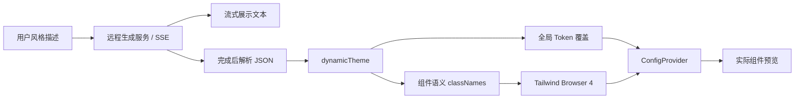

# AtomUI 精确主题定制审计与 Ant Design 源码研究

审计日期：2026-10-22。AtomUI 基线：`19eef870b9db62b1eb1c3b0897619ee8d466af46`，审计采集分支 `release/6.0`；方案及后续工作已依用户授权迁入`feature/custom-theme`。
性质：源码调研、全范围静态扫描、重点消费链核对与改造建议；不是修复交付或已经批准的系统设计。

## 1. 目标与结论

目标来自用户的三张截图：切换品牌预设后，颜色、按钮形态、输入框、圆角、字体、边框、阴影、密度、弹层和交互状态形成统一的设计语言；同时支持可编辑、可预览、可导出的主题，以及 AI 生成配置。

Ant Design 的实现包含四个协作层：Token 派生、组件有效 Token、语义部件样式、预览及配置工具。首页的 shadcn/MUI/Bootstrap 预设是完整的 `ConfigProviderProps` 配方，AI 生成器则还使用语义 classNames 与 Tailwind 浏览器运行时。两条路径不是同一种配置格式。

AtomUI 已经具备 Seed/Map/Alias、控件 Own/Effective Global、快照编译、局部主题、动态提交、Semantic Part、编译主题包等基础。当前最大的差距在消费端：部分模板绕过控件 identity，部分公开 Token 没有视觉消费者，C# 本地值与绘制代码占有外观，部分缓存/快照没有随主题更新，以及缺少完整品牌配方和编辑工作台。

本次产物：

| 文件 | 用途 |
| --- | --- |
| 本文 | Ant Design 源码链路、能力差距、范围、建议顺序和验收要求 |
| [findings.md](findings.md) | 按阻断类型和控件家族整理的源码证据与改造方向 |
| [coverage.csv](coverage.csv) | 本轮扫描的全部 2,736 个 C#/AXAML 文件及逐文件统计 |
| [candidates.csv](candidates.csv) | 5,632 条未去重规则命中，保留路径、行号和源码片段供继续筛选 |
| [rules.json](rules.json) | 候选扫描的精确正则表达式 |
| [token-consumption.csv](token-consumption.csv) | 95 个 Own Token 类型、1,195 个直接声明属性的 typed key/AXAML 消费引用清点 |
| [custom-size-candidates.csv](custom-size-candidates.csv) | 45 个模板文件中58处把 Custom 与 Middle 合并的 selector 及其直接Setter |
| [官网截图](evidence/ant-design-shadcn.png) | 实际在官网选中 shadcn 后的预览；浏览器窄视口 |

## 2. 参考来源与证据边界

按项目的本地优先规则，检查 `.referenceprojects` 后，在 `/Users/chinboy/Projects/ReferenceProjects/ant-design` 找到参考源码；源码分析以此为唯一默认来源，没有改为下载 GitHub 版本。

- 本地 commit：`211c6ed29b0d2abd18485e293681f8a4e415240b`，提交日期 2026-10-18，`package.json` 版本为 **6.6.6**。
- 实际访问的 [Ant Design 官网](https://ant.design/) 与 [主题文档](https://ant.design/docs/react/customize-theme/) 显示 **6.6.7**。本地源码与在线站点有版本差异；本文不宣称所有在线内部实现与本地快照逐字一致。
- 在官网实际完成 Ant Design → shadcn 切换，选中状态及黑色主按钮、红色实心危险按钮、输入框形态的变化可见。没有调用 AI 生成接口或发送用户配置。
- AtomUI 的问题属于静态消费链确认或明确标出的待运行风险，没有运行控件复现、视觉验收、构建、GC 测试或回归测试。

## 3. Ant Design 如何形成精细主题

以下源码路径均相对参考仓库根目录；行号对应上述本地 commit。

### 3.1 全局设计语言按依赖层次派生

`components/theme/themes/default/index.ts:12-49` 从 Seed 生成颜色梯度、中性色、字号/行高、尺寸、控件高度和圆角等 Map 值；`components/theme/util/alias.ts` 再形成通用语义值。Dark/Compact 有各自算法，算法可以组合。官方说明见 [Design Token 与算法](https://ant.design/docs/react/customize-theme/#design-token)。

`components/theme/useToken.ts:63-103` 执行 derivative、合并覆盖，并对启用组件算法的配置递归计算；`:135-150` 通过 `useCacheToken` 接入缓存及 CSS 变量投影。

因此品牌色、基础字号、基础高度等输入可以系统性地影响状态色和尺寸梯度；精细配置还能覆盖 Map/Alias 的个别结果。

### 3.2 组件得到自己的有效值，状态样式消费同一组变量

`components/config-provider/hooks/useTheme.ts:49-79` 合并父子 Token 和各组件配置；`components/config-provider/index.tsx:708-745` 处理组件算法和覆盖。

以 Button 为例：

- `components/button/style/token.ts:13-239` 定义字重、阴影、默认/悬停/按下状态、文字色、边色、尺寸和图标等语义输入。
- `components/button/style/index.ts:202-233` 将 Small/Large 的高度、字号、padding、圆角、图标组织为完整尺寸配方；`:248-280` 统一组合 shared、size、variant、group 样式。
- `components/button/style/variant.ts:8-77` 用一组 CSS 变量映射 normal/hover/active/disabled 的 border/text/background；后续 variant 规则设置这组变量。这里仍有合理 fallback 常量，不能把“源码里出现常量”当作不可定制的证据。
- `components/button/style/index.ts:20-36` 实际消费 `fontWeight`，不是只声明 Token。

对应 AtomUI 的要求是：有效 Token 必须进入真实渲染节点和每个状态分支；资源字典里值已变化不等于视觉生效。

### 3.3 超出 Token 的风格由语义部件样式承担

`components/button/button.tsx:338-365` 将最终 props 传给 `useMergeSemantic`，合并 ConfigProvider 的组件 classNames/styles 与实例设置；`:369-390` 输出形状、颜色、variant、尺寸、loading 等状态 class。

`components/_util/hooks/useMergeSemantic/index.ts:14-46` 合并语义 classNames，`:57-67` 按部件合并样式，`:88-124` 允许基于最终 props 的函数式配置。样式可表达“危险按钮用实心红”“有图标/不同尺寸采用不同留白”等条件。

AtomUI 对应工具已经是生成的专用 Semantic Part Style、属性 selector/伪类和 ControlTheme。需要补的是命中真实节点、优先级可覆盖，以及 Render 对相关属性的实际消费；不需要为了形式一致引入 CSS 引擎或运行期反射。

### 3.4 用户截图中的 shadcn 是完整手工配方

`.dumi/pages/index/components/ThemePreview/previewThemes/index.ts` 注册 Ant Design、MUI、shadcn、Bootstrap、Cartoon、Dark、Illustration、Glass、Geek、LobeHub、Document、Blossom、V4、Serene 等预设。

`previewThemes/shadcnTheme.ts` 同时提供：

1. 全局主色、成功/错误/警告/信息色及其梯度，文字、中性色、边框、圆角、间距和阴影。
2. Button、Input、Select、Progress、Switch、Checkbox、Slider、Modal、Layout 等组件的独立覆盖。
3. `button.classNames` 按 `type/danger` 选取 root 样式；输入框区分 root/input/error；通知区分 root/title/description。

例如全局基础圆角是 10，Button/Input 各自覆盖为 6；主按钮样式使用 `#18181b`，危险按钮使用 `#dc2626`；通知有独立边框和阴影。最终效果不能从“只配置一个黑色 ColorPrimary”推导出来。

Bootstrap 配方进一步使用渐变、inset shadow、文本阴影及 hover/active 样式；Glass/MUI 也有自己的表现手法。这些是需要逐效果评估 Avalonia 表达能力的风格内容，不能承诺所有 CSS 效果天然等价。

### 3.5 首页切换、复制与编辑有完整接线

- `.dumi/pages/index/components/ThemePreview/index.tsx:230,266-268,325-374`：选择预设、找到完整 config，并传给 ComponentsBlock。
- `.dumi/pages/index/components/PreviewPane/Components.tsx:373-388`：分离 theme 与其余组件配置，使用 `ConfigProvider {...restConfig} theme={mergedTheme}`，外层 `inherit` 默认 false，避免站点主题干扰预览。
- `ThemePreview/index.tsx:372,379`：用 `key={activeThemeKey}` 重建预览子树。首页效果不能单独证明“保持已有控件状态的原地热切换”正确。
- `ThemePreview/themeCodeUtils.ts:42-60`：手工预设复制完整 hook 源码及其使用文件，保留语义部件 CSS；不是只导出 Token JSON。
- `.dumi/pages/theme-editor/index.tsx`：加载 `antd-token-previewer` 的 ThemeEditor，以 `onThemeChange` 更新配置，以 localStorage 保存。编辑器包内部实现未在本轮展开。

### 3.6 新截图中的 AI 生成器是另一条数据链路

- `.dumi/theme/common/ThemeSwitch/usePromptTheme.ts:12-93`：POST 风格描述到 `api.x.ant.design` 的生成服务，以 `XStream` 消费 SSE；`:123-143` 管理取消；`:145-160` 在完成后去代码围栏/注释、JSON.parse、回调或显示错误。流式中途文本不会逐段应用成主题。
- `SiteContext.ts:21-24`：数据是 `{ algorithm?, token, ...SimpleComponentClassNames }`，包含组件语义 class 字符串。它不是标准 `ThemeConfig.components` 的同义字段。
- `.dumi/theme/layouts/GlobalLayout.tsx:239-265`：取 `token`；把其余组件字段转成 `{ classNames: ... }`；**忽略 AI 返回的 algorithm**，保持用户选择的明暗偏好；`:309-312` 应用到 ConfigProvider。
- `.dumirc.ts:244-247` 加载 `@tailwindcss/browser@4`；`.dumi/theme/plugins/build-assets.ts:7-11` 明确 `theme, base, global, antd, components, utilities` 层序，使 utility 样式可以覆盖组件基线。这解释了 AI 返回 class 字符串为何也能改变具体部件形态。
- `PromptDrawer.tsx:439-499`：左侧真实组件预览，右侧流式配置/输入；`:128-130` 恢复默认；`:143-151` 的复制路径仅取 token 和暗色算法，**没有保留动态语义 classNames**。这是参考快照的导出边界，不应在 AtomUI 重复。

公开前端只展示 JSON 解析及错误处理，没有看到严格的运行期 Token/部件 schema 验证；本地仓库没有生成服务后端，无法验证服务的模型、系统提示词、约束 schema 或质量保证。不能把这些未知环节当成已经研究清楚的实现。

## 4. 与 AtomUI 的能力差距

| 维度 | AtomUI 当前证据 | 差距/决定 |
| --- | --- | --- |
| Seed → Map → Alias | `ThemeCompiler.cs:721-729` 分阶段覆盖与计算 | 基础已具备，重点修消费端，不重写编译器 |
| 组件有效 Global + Own | `ThemeCompiler.cs:464-531`；`XxxTokenResource`、ControlTokenAccessor | Shared 读取绕过 identity；Own 无消费/别名提前派生，见问题表 |
| 根/嵌套/动态主题 | ThemeConfigProvider、ThemeScopeGraph、ApplyThemeAsync | 已有机制；必须验证已有实例、缓存、自绘对象及跨根值同步 |
| 状态与尺寸配方 | 各 ControlTheme、Theme Variables、SizeType | 部分状态未使用相同 owner；Custom 合并进 Middle；固定字体/边宽/几何 |
| 语义精调 | 生成专用 Part Style；Desktop 有 99 个 SemanticParts 文件、498 个显式声明 | 某些真实 frame/运行期标签/图标/导航按钮缺入口，或 Setter 被本地值压过 |
| 完整品牌预设 | Core 默认主题 + Gallery 四个 XML 颜色主题 | Gallery 四个 XML 只覆盖 ColorPrimary/ColorLink；缺多维品牌配方 |
| Token 与样式一并交付 | XML v1 和编译主题包负责 Token/算法；ControlTheme 资产另有注册机制 | 未发现“选择主题 ID 就原子切换一组品牌 Part Styles”的现成契约；应验证现有装配后再设计最小扩展 |
| 主题编辑工具 | Global Token 目录、Own 表格、Part 高亮、局部主题示例 | 缺通用编辑/保存、完整导入导出、配置 diff、并排状态矩阵 UI；不代表 Core 没有文件加载 |
| AI 生成 | 未发现对应 Gallery 流程 | 可在消费链修通后接现有 schema；不能让 AI 生成无法生效的 Token 或无法命中的部件样式 |
| 视觉效果集合 | Avalonia Brush、BoxShadows、Transform、自绘及平台能力 | CSS 渐变可有对应实现；文字阴影、backdrop blur 等需要独立可行性和跨平台证据 |
| 算法扩展 | ThemeAlgorithm 为 Default/Dark/Compact 的闭合枚举 | 不等同于 Ant 的任意函数算法；精确 shadcn 类配方通常可由现有覆盖表达，暂不为此扩展算法系统 |

当前架构所有权以 [主题运行时](../../../architecture/systems/theming/runtime.md)、[Semantic Part](../../../architecture/systems/theming/semantic-parts.md)、[定制指南](../../../guides/theming/customization.md) 为准；本文不修改这些已批准契约。

## 5. 全范围扫描与统计

文件清单使用 `rg --files`，遵守仓库 ignore，限定以下根目录的 `.cs/.axaml`；不计 bin/obj/忽略的 GeneratedFiles，不包括图标生成包、Native 平台代码、测试源码和参考项目。四个 Gallery XML、Core/Generator 的关键接线另作定向阅读。

| 模块 | C# | AXAML | 文件合计 | 候选规则命中 |
| --- | ---: | ---: | ---: | ---: |
| Core | 313 | 0 | 313 | 172 |
| Controls.Shared | 160 | 0 | 160 | 2 |
| Controls | 206 | 10 | 216 | 96 |
| Desktop.Controls | 1,003 | 333 | 1,336 | 2,475 |
| Desktop.Controls.DataGrid | 129 | 18 | 147 | 89 |
| Desktop.Controls.ColorPicker | 50 | 18 | 68 | 128 |
| Desktop.Controls.Extras | 2 | 0 | 2 | 0 |
| Toolkits.GalleryBase | 74 | 18 | 92 | 214 |
| AtomUIGallery | 285 | 112 | 397 | 2,456 |
| Gallery Desktop/Browser host | 5 | 0 | 5 | 0 |
| **合计** | **2,227** | **509** | **2,736** | **5,632** |

候选来自七类规则：C# Brush/Color 字面量、外观直接赋值、SetValue/SetCurrentValue 字面量、AXAML 固定 Setter、AXAML 固定属性、共享 Token 读取、静态 SharedTokenResourceValue。规则不覆盖所有多行表达式/计算/间接调用，因此同时阅读了布局、自绘、字体传递、Own 消费和资源发布路径。

同一行可以命中多类规则；共 553 个文件有命中。候选含合法默认值、结构尺寸、透明色、演示设置以及 Core 类型声明，不是 5,632 个缺陷。`candidate-unverified` 是原始候选标签；人工核实结论单独在 findings 中维护。

公共与桌面三包合计有 1,849 条 `SharedTokenResource/CreateGlobalTokenBinding` 命中；另有 173 条静态 Value 命中。Shared 是否错误必须逐 owner 判断，不能全局文本替换。

另做 Own Token 消费清点：扫描 `[ControlDesignToken]` 类型中直接声明的可读写属性，查找 `XxxTokenKind.Name` 与 `{XxxTokenResource Name}`/`Kind=Name`；1,195 个声明来自95个类型，其中137个public属性没有这种直接引用。这不等于137个缺陷：可能在默认计算中间接派生、明确为兼容保留、由外部自定义主题消费，或确实未接内置渲染。此清单不展开继承schema，也不是Roslyn语义证明；已对重要候选继续核查定义、间接依赖、实际模板和控件文档。

Custom尺寸另做结构清点：Desktop49处、DataGrid6处、ColorPicker3处，共58处selector/45文件把Middle和Custom放入同一分支，CSV附带该分支直接Setter。已重点核对的9处可选包实例之外，主包还涉及输入共享框体、ButtonSpinner、TextBox/TextArea、Select/TreeSelect/Cascader、列表、分页、Expander/Collapse、Segmented等。是否违反Custom接管合同仍需按属性/模式判断，不能只凭selector文本删除整个分支。

## 6. 改造路径建议

整套工程目标、90组条目逐项处置、规范和验证统一见[自定义主题完整解决方案](../../specs/2026-10-22-custom-theme/overview.md)。本审计保留当时事实与取证边界，不代表已经实施。

后续依据用户的三条主线形成了独立的[精确主题定制与渲染闭环方案](../../specs/2026-10-22-precise-theme-customization-design.md)，进一步明确基础求值、品牌样式作用域与激活、逐控件合同和验收门槛。该方案仍供评审，未实施；以下保留审计阶段的分期建议。

本轮建议采用“补通现有编译、消费与 Semantic Style 链路，再形成完整配方”的路径。

| 方案 | 收益 | 代价与缺口 |
| --- | --- | --- |
| 只替换字面常量 | 可以减少局部不一致 | 解决不了 identity、无效 Token、本地值优先级、自绘能力和动态缓存 |
| **补通现有架构，推荐** | 复用 AOT、事务、快照、专用 Style，直接解决实际定制断点 | 需要按家族核对 public owner、形态、状态和生命周期 |
| 重建 CSS-in-JS/任意样式脚本系统 | 表达形式更接近 Web | 新增运行期、安全、AOT、性能和平台成本；目前没有必要性证据 |

建议实施顺序：

1. **消费正确性**：Button/输入家族的 Effective Global，DataGrid 公开 Token 别名，Button行高、Skeleton渐变、ColorPicker尺寸的提前派生，悬空 Own Token；静态动效读取另立生命周期验证。
2. **优先级与动态正确性**：Button Round→Default、Timeline/CircleProgress 的本地值、Arrow 缓存、Rate 字体、Gradient 文本快照；保证已有实例切换。
3. **表现能力**：root/frame 投射、专用 Part 缺口、自绘半径/边框/指示线；保留圆形控件和色谱的数据语义。新 API/Token/Part 属兼容性评审范围。
4. **完整品牌配方**：先交付 Ant 默认、shadcn、Bootstrap 三套差异明确的配方，包含 Token、控件覆盖、条件 Part Styles 与使用方式；验证整套预设切换与局部嵌套。
5. **Gallery 工作台**：组合现有目录/Token/Part 工具，加入编辑、预览、恢复、完整导出/导入、并排状态页。导出必须同时保留 Token 与语义样式。
6. **AI 入口**：只在已支持的 schema/部件/值类型内生成，先编译诊断再应用，保留旧主题以便失败回滚；不直接照搬 Web 的 Tailwind/任意代码执行路径。

这只是审计后的分期建议；尚未进入产品代码实施或创建提交。

## 7. 后续验收合同

- 配置维度：主色及语义色、字号/行高/字重/字体、零/小/大圆角、线宽、阴影、间距/高度、动效时长/禁用开关。
- 作用域：全局、组件 identity、嵌套、单实例 Part Style；验证兄弟控件不被错误影响，公开子控件保持自己的身份。
- 状态：normal/hover/pressed/focus/selected/loading/disabled/error/warning/dragging；可用状态逐控件定义，不机械做无意义的笛卡尔积。
- 更新：首次显示前配置；已有控件 A→B→A；resize；re-template；容器回收；已打开 Native/Overlay popup；明暗和 Compact 组合。
- 断言终点：同时检查有效 Token、Setter 来源、实际目标节点值与可见渲染；增加原始交互、命中区、滚动/裁剪和焦点检查，不能通过删减结构隐藏问题。
- 资源：新动态订阅有对称释放，非 Visual AvaloniaObject 使用 scoped resource host；必要时做 WeakReference/对象计数验证。
- 工程：按项目临时测试生命周期先证明失败、修复后通过并清理；最终仅运行受影响模块 focused 验证。没有用户请求不运行 full regression。

本轮仅交付审计文档与静态清单；没有修复、运行控件验收或证明“所有差距已穷尽”。完整文件清单保证静态扫描范围可核对，未人工核实候选和跨平台视觉效果仍需后续针对性验证。
