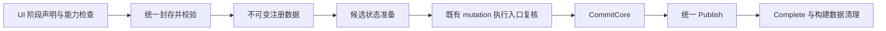

# AtomUI.Core 源码质量与启动链路审查

日期：2026-10-13。基于 `release/6.0`、HEAD `4fab9a043` 及当前未提交工作树，包含两阶段重构、REG009 配置和主题目录通知修复。

本轮是分析与临时复现，没有修改产品实现，没有提交。以下建议尚未实施，不能当作已经满足的架构保证。

后续用户已授权实施；修复、方案取舍和验证见[本次重构验证记录](2026-10-13-core-quality-refactor-validation.md)。本文保留审查时的原始事实。

## 1. 总体判断与覆盖

排除 GeneratedFiles/bin/obj 后，Core 有 281 个 C# 文件、34,255 行；Theme 占 154 个文件、18,954 行。
ThemeManager 为 2,292 行，ThemeCompiler 985 行，ThemeManagerBuilder 543 行。
文件长度只是定位入口；本次判断依据是数据所有权、生产调用和已复现的状态错误。

检查范围包括启动/注册、主题事务、Schema/Compiler/Catalog/缓存/资源，以及 Data、Reactive、Collections、
Reflection、Utils、Animations、MotionScene、Media、Icon 和平台入口；重点跨模块调用链逐项追踪。
这不等于逐条证明所有分支、平台和并发行为。未重新进行原生 UI、AOT 发布或完整性能采样，未运行全量回归。

可以保留的基础：生成式注册和实际裁剪闭包、不可变配置、独立 lazy cell、根 Token 与静态资源分层、
已知/未知键按原顺序合并、公开通知的异常隔离，以及后台纯准备与 UI 回调的线程边界。

主要问题是启动协议尚未统一：初次启动、Stage 2、主题切换、目录刷新和作用域更新分别拥有部分 prepare、
校验、提交、发布和清理逻辑。最近修复的目录事件与主题来源遗漏，以及本次发现的重入/失败状态问题，
都说明应优先收敛操作协议和数据所有权，再增加更多按需计算。

## 2. 已通过临时用例确认的问题

六个不同的审计用例均复现了当前缺陷；普通主题事务的既有重入用例作为对照通过。
临时用例用正确契约作断言，因此当前实现的失败正是审计证据，不是修复完成证明。

### 2.1 P1：Stage 2 绕过常规事务执行与重入排队

入口：[StageTwoEvolutionPlan](../../../src/AtomUI.Core/StageTwoEvolutionPlan.cs)、
[注册演化发布](../../../src/AtomUI.Core/Theme/ThemeManager.cs#L367)、
[常规执行门](../../../src/AtomUI.Core/Theme/ThemeManager.cs#L791)。

普通 ApplyThemeAsync 使用 `_activeTransaction`、队列和 `_transactionExecutionGate`；目录刷新和 scope 更新
也进入执行门。Stage 2 直接调用 Validate/Commit/Publish，未进入同一执行与释放协议。

复现：Stage 2 的第一个 ThemeChanged 订阅者调用 ApplyThemeAsync 改 ColorPrimary。
新事务同步嵌套完成，后续订阅者收到旧事件：事件 TransitionId=2，当前 Manager TransitionId=3。
普通事务的对应重入测试通过，说明缺口位于 Stage 2 的独立路径。

影响：观察者可用旧事件覆盖刚更新的 UI 状态；部分事件看到的 State 与当前 Manager 不一致。

建议：将 registration evolution 纳入既有 mutation 执行协议，尤其覆盖 Validate→CommitCore→全部 Publish→Complete。
后台准备期间仍允许响应输入，但准备结果必须按 generation 复核；有效用户操作使结果过期时，应重新准备或重基，
不能靠忽略通知、禁用菜单或直接把普通交互变成启动失败。

### 2.2 P1：被标记失败的注册仍可在第二阶段提交

入口：[Register 的 Add/complete/Fail 顺序](../../../src/AtomUI.Core/Registration/ControlRegistrationRuntime.cs#L130)、
[Freeze 与 CloseStageTwoWindow](../../../src/AtomUI.Core/Registration/ControlRegistrationState.cs#L42)。

包先加入 Builder，再执行 complete 回调。回调抛错会将 registration state 标记失败。
单阶段 Freeze 会拒绝它；Stage 2 的 CloseStageTwoWindow 仅关窗，后续 merge 没有复核失败或未完成包。

复现：Deferred 内捕获 complete 的异常。期望不提交、触发失败、资源不可查；实际为：
`Completed=true, Failed=false, 部分包资源可查=true`。

建议：区分“成功封存并验证”和“异常路径无条件关闭”。两阶段都经过同一个成功封存校验，
finally 只做幂等清理，不能把会抛错的成功校验直接塞进多个 finally 调用点。

### 2.3 P1/P2：Deferred 接受了执行链路不会消费的配置

入口：[AddOwnedService](../../../src/AtomUI.Core/AtomUIBuilder.cs#L68)、
[只在 Stage 1 创建服务](../../../src/AtomUI.Core/ApplicationExtensions.cs#L38)。

复现：Stage 1 未注册该服务，在 Deferred 内登记新的 owned-service factory。
实际 `Completed=true, factory calls=0, attach calls=0`。生产入口 UseImageLoading 使用同一登记机制，
见 [ImageLoadingBuilderExtensions](../../../src/AtomUI.Controls.Shared/ImageLoading/ImageLoadingBuilderExtensions.cs#L10)。

同类源码缺口：WithInitialTheme、WithFollowSystemThemes、WithDefaultFontFamily、WithApplicationId 的字段仅在
BuildCore 消费；在 Deferred 中修改会被接受但不生效。AddThemeDefinitionResolver 也没有统一阶段检查，
终态后继续添加只改变已经退出运行链路的 Builder。

建议：集中声明并检查 mutation 能力。启动专用参数、服务和 Deferred 声明只在初始配置窗口可用；
包、主题来源、本地化只在其合法注册窗口可用。当前不支持的操作应立即明确拒绝。
无需为消除警告或满足任意 Action，扩展 Stage 2 去承担未经设计的服务 attach/rollback。

### 2.4 P2：原生资源字典挂载失败没有完整回滚

入口：[StaticThemeResourceProvider.PrepareTable](../../../src/AtomUI.Core/Theme/Resources/StaticThemeResourceProvider.cs#L28)。

先 AddOwner，成功返回后才加入 `_attached`；异常回滚只遍历 `_attached`。
原生 ResourceDictionary 的 OwnerChanged 抛错时，Owner 已赋值，失败对象却未被登记。
临时用例确认回滚后 raw.Owner 仍指向 ThemeResourceOwnerBridge。

这和此前已修的 Deferred wrapper 的 AddOwner 失败路径不同。raw provider 的重试及解绑仍有缺口。
解绑循环也可能因某个 RemoveOwner 抛错而跳过其他对象与 bridge 的清理。

建议：明确“尝试挂载的对象”的所有权，失败对象也参加回滚；每个对象独立释放，内部状态在 finally 中清理，
最后汇总异常。不要用弱引用代替应完成的解绑。

### 2.5 P2：ItemCollection 被长寿命集合反向保留

入口：[ItemCollection 的订阅](../../../src/AtomUI.Core/Collections/ItemCollection.cs#L111)。

外部 ObservableCollection 强引用 OnSourceCollectionChanged，只在换源时解绑。
保持源存活、丢弃 ItemCollection 后，临时 GC 用例确认弱引用仍存活。

生产调用链已追踪到 Select/Cascader：选项集合→ItemCollection→控件的 CollectionChanged 处理器。
例如 [Select 构造订阅](../../../src/AtomUI.Desktop.Controls/Select/Select.cs#L294) 与
[detach](../../../src/AtomUI.Desktop.Controls/Select/Select.cs#L326) 没有成对释放 OptionsSource 订阅。
本轮未做整棵 Select 视觉树的 GC/原生页面测量；Core 保留边与实际消费者链分别有运行和源码证据。

建议：在共享集合适配层使用弱事件，或定义可对称 attach/detach 的订阅机制并在重挂载时同步。
保留 OptionsSource 数据与重挂载行为，不能用清空用户选项的办法规避保留。

### 2.6 P2：Transition Motion 吞掉取消状态

入口：[AbstractMotion.RunTransitionsAsync](../../../src/AtomUI.Core/MotionScene/AbstractMotion.cs#L225)。

WhenAny 等到取消的 Delay 会正常返回；代码未观察获胜任务，也没有再次抛出取消。
临时 FadeOutMotion 用例在启动后取消，实际正常完成，未向 await 调用者传播 OperationCanceledException。

生产风险链：[Badge hide await 后直接隐藏/卸载](../../../src/AtomUI.Controls/Badge/AbstractCountBadgeAdorner.cs#L400)。
Count 1→0→1 可取消旧隐藏过程，但旧调用者仍继续执行隐藏；同一 adorner 被复用，实例身份比较不足以过滤旧执行。
Core 取消语义已复现，完整 Badge 像素/输入时序尚未验证。

建议：动画与 transition、Run 与 RunAsync 共用完成/失败/取消和清理协议；同步入口包装异步内核并观察异常。
每次执行的清理应只释放自己的状态，避免旧 finally 清掉新动画的 transform；保留具体 Motion 的起止值配置。

## 3. 启动过程中仍存在的重复工作

| 位置 | 当前成本/冗余 | 优先方案与边界 |
|---|---|---|
| ThemeManagerBuilder.BuildCore / MergeStageTwoInto | 两份贡献遍历、资产/资源去重、排序与状态更新逻辑 | 一个贡献累积器输出不可变注册数据；两阶段传入不同批次。必须保留包顺序、资源排序和冲突语义。 |
| ThemeManager.InitializeApplication / PrepareRegistrationEvolutionCore | 两套 registry、config、catalog、scope 和资源准备流程 | 共用候选状态构建及提交协议，阶段仅决定输入；避免再次漏掉 Resolver、事件或有效性检查。 |
| ValidateSemanticContracts 与演化 Prepare | staged SemanticPartRegistry 被构建用于验证，之后再从相同集合创建提交版本 | 构建一次候选 Semantic registry，验证并提交同一不可变对象。 |
| ThemeCacheKey.Create | 已 normalized 的 Token 又复制、排序，definition/config 的结构 key 多次重建 | 在规范化边界固定顺序并缓存相应 registry 的结构 key；保留内容比较，不能仅依赖 hash。 |
| CompileGlobal 的 reuse 分支 | 即使复用全局值，仍遍历 globals/palettes 创建可变 builder | 真正首次 Own 编译再恢复 builder；避免 K=0 的工作，计入首次消费成本且不能恢复历史 snapshot 父链。 |
| Stage 2 Own Token | 完整 registry revision 变化导致旧 chrome cell 也不复用 | 当前拒绝跨代复用是正确安全边界。将计算结果与 slot 分离后才可按 exact identity/schema/global input 细化复用。 |
| 物化后的 cache 计费 | 每次物化遍历有界 snapshot 集和全部 cell，约 O(K×S×C) | 当前有界扫描简单可靠；先测再决定增量计费，不能为少量遍历新增会累积的弱订阅图。 |
| Icon 的 DrawPens | 初始化 5 次 Pen 构造，刷变化再次创建；内置绘制另行 BuildPen | 确定有重复分配，但 protected 字段属于派生契约；需兼容方案再收敛实际绘制与缓存。 |

参考：[结构 key](../../../src/AtomUI.Core/Theme/Compilation/ThemeCacheKey.cs#L346)、
[再次排序](../../../src/AtomUI.Core/Theme/Compilation/ThemeCacheKey.cs#L472)、
[global builder 重建](../../../src/AtomUI.Core/Theme/Compilation/ThemeCompiler.cs#L201)、
[Icon 初始化](../../../src/AtomUI.Core/Controls/Icon/Icon.cs#L179)、
[实际 BuildPen](../../../src/AtomUI.Core/Controls/Icon/DrawingInstruction.cs#L56)。

上表是算法/结构分析，没有新测耗时。Own 名称查找 O(T×O) 可以用按需索引优化，但小 schema/稀少覆盖未必值得。
不建议在没有 profile 的情况下为所有控件增加更多常驻字典。

## 4. 保留内存与预算

1. CompleteStartupRegistration 全仓仅由 RunStageTwoAsync finally 调用。非 staged 成功启动会继续保留 Manager 的
   构建列表、provider 集、staging 字典和包指纹，直到 Dispose；等待期间取消的同类问题已是前轮明确记录的 Minor。
   应由统一终态负责“完成构建后退休构建数据”，不让不同启动模式自行决定是否清理。
2. [EstimateSnapshotBase](../../../src/AtomUI.Core/Theme/Compilation/ThemeRetainedBytesEstimator.cs#L33) 没有计入
   EffectiveConfig、Definition、cache key、lazy source/global builder。大型冷 Own 配置会在尚未物化时被强持有，
   但只按固定 cell 开销计费。entry 限制仍有效，32MiB 不能解释为整个保留图的硬上限。
   应补框架可知输入/键的估算，并明确任意自定义对象的计费边界。本轮未运行大输入字节压力测试。
3. `_startupControlThemeAssetManifest` 只写不读，但其 descriptor 列表与 registry 共享；可删除冗余持有，
   必须保留校验。不能宣称删该字段能明显提速或释放一份完整 schema。

## 5. 可确定收敛的残留

已做全仓引用核查：

- ThemeManager.UpdateThemeDefinitionResolvers：无调用，还是一个绕过演化提交的直接 setter，应删除以减少误用。
- ThemeManagerBuilder.UsesUserThemeDirectory / UserThemeDirectory：无调用。
- StartupEventsOrNull 的唯一消费是 `OrNull ?? StartupEvents`，可直接用 StartupEvents；非 staged 的 if 边界仍保留。
- ThemeManager._rootTokenResourceProvider：只有赋值/清空，没有读取。
- Builder 的 `_controlThemeAssetDescriptors` 只积累引用并读取 Count，真正遍历来自 contributions。
- CompileControlsEagerForTest 约 80 行，在生产程序集内但无测试调用；文档不能继续据此声称有差分测试保障。
- GetControlSharedResourceKey 的 bound-key 路径只有两个测试调用，生产使用 unbound key；性能测试应先对齐真实路径。
- Core/Reactive 下三个内部类型互相引用，但无生产/测试入口；TypeHelper.GetIsReadOnly 及专属缓存也无调用。

这些清理主要减少维护面，不应直接换算成启动时间收益。TypeHelper 其他动态数据路径、固定成员反射兼容边界、
ColorPicker 使用的 PooledList 仍有真实消费者，没有依据整块删除或重写。

## 6. 其他边界

- StartupEvents 只有边沿事件，没有公开终态读取。较晚创建的消费者会错过完成；当前 Gallery 默认只创建一次主窗，
  因而应作为迟订阅/多窗口设计缺口处理。公开状态/完成结果的增量需单独评审兼容性。
- 就绪等待对象在构造中同步 ready/cancel，所有者字段在构造返回后才赋值。已关闭宿主的同步取消可能早于登记，
  后续又保留等待对象。更清晰的形态是构造、登记，再显式 Start；本轮未做该分支运行复现。
- 已排队 compositor 批次之后 Hide 的可见性复核、请求激活被平台拒绝的策略，需要独立原生验证。
- Icon 初始化的 strokeIndex 写成了 Fallback，影响 DrawBrushes/DrawPens 的初始化槽；需要自定义描边场景复核。
- MoveMotions 复用公开实例时可能累计 Animations，UnFollow 将目标置为 this。内置前者使用新实例，后者无生产调用，
  不把这些附加边界当作当前 Gallery 启动热点。

## 7. 推荐的重构方向

保持 ThemeManager 为唯一有效主题状态所有者，不新增一套镜像 Manager，也不只靠拆 partial 文件掩盖重复协议。

关键约束：

- Stage 1/Stage 2 是输入批次与就绪时机的差别，共用成功/失败协议。
- 不可变准备与有效状态分开；builder 不反复向运行中的 Manager 构建列表回填半成品。
- Commit/Publish 序列受同一个操作所有权保护，观察者请求排队；后台准备仍允许 UI 响应，并复核代际。
- 服务、初始参数、注册、语言和主题来源的阶段能力明确；不支持的变更在入口失败。
- 部分 attach/完整 attach/释放分别有可靠回滚；所有终态使用同一清理入口。
- 优先在 internal 层完成上述收敛，保留现有公开入口和 AOT 静态可达性。

建议顺序：先处理 2.1–2.4 与阶段能力/清理；再处理集合、Motion 的共享生命周期；随后删除残留和重复准备；
最后按最新正确版本量化 key、builder、图标分配等候选。完整静态 schema/稳定 slot 表仍是条件实验，
必须证明不会保留全部 Type/factory、破坏裁剪或排除第三方贡献，再考虑新生成协议。

## 8. 对两阶段性能的判断

前轮 2026-10-12 的 10 进程/模式样本可作为趋势线索：JIT 的仅后置 Shell→staged 根 Render 中位数
约 1.406s→1.092s；AOT 对应 rendered batch 约 359.5ms→357.4ms，额外收益很小。
完整同步 AOT 的 Shell batch 中位数约 371ms，而 staged 约 537ms。

这些样本早于后续目录事件/主题来源等修复，尤其完整业务就绪应重新核对五款主题等相同功能状态；
不能作为当前工作树已达标或当前收益百分比的证明。本轮没有重新计时。

因此保留 opt-in、由宿主选择策略有依据；将两阶段扩大为所有宿主默认机制没有足够证据。
下一轮要同时报告完整首帧、框架完成、业务就绪、UI 长任务、分配与保留内存，优先减少实际总工作。

## 9. 临时验证与处置

执行了 Core 的精确过滤用例，覆盖六个审计条件：重入事件代际不一致、poisoned 包仍提交、owned service 未执行、
raw ResourceDictionary 部分挂载未回滚、长寿命集合保留 ItemCollection、Motion 取消正常返回。
常规事务重入测试作为对照通过。输出保存在 `.superpowers/audits/core-quality-2026-10-13/`。

临时源文件位于 `tests/AtomUI.Core.Tests/Temporary/CoreQualityAudit20261013/`，审查后删除；
未新增常驻用例，未修改产品实现，未运行全量回归。删除后重新运行常规重入对照以更新测试产物，
结果为 1/1 通过；文档本地链接与 `git diff --check` 检查通过。
不能将删除复现用例表述为缺陷已经修复。
