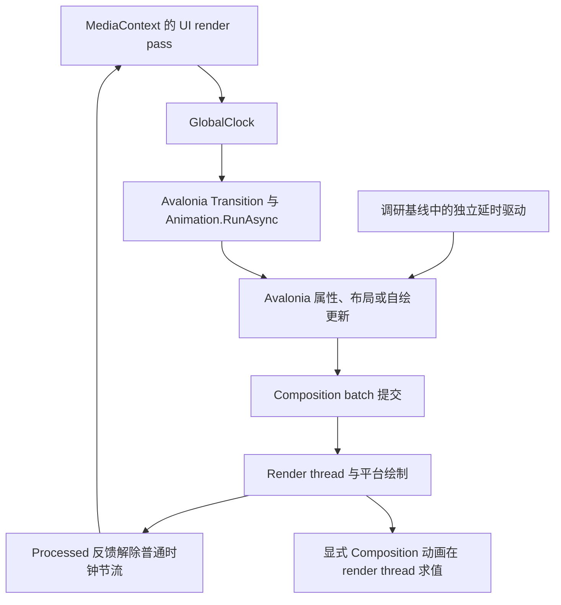

# AtomUI 动画流畅度调查

日期：2026-10-27。AtomUI 源码：`1ff58411026b2782a04a3b92d0faa5d895b43cec`。
本文描述调研基线；后续P0/P1实现和验收见[交付记录](2026-10-27-animation-p0-p1-results.md)。

当前没有证据证明 AtomUI 动画系统被统一限制为 30 FPS。本机真实 Gallery 的侧栏动画通常按约 16.6–17.1ms 更新，
子菜单开合存在少量长间隔。源码确实暴露了值得专项验证的调度、布局、分配和视觉连续性问题。
优化方向包括保留速度的重定向、视口外循环暂停、限制布局失效和缓存绘制资源；具体实施与收益须在相同动效合同下逐项验证。

## 证据范围

- 用户视频：1280×720，H.264，533 帧，17.7667s，固定 30 FPS。已查看抽帧，包含 Windows 应用启动、侧栏收缩与展开、导航和页面状态变化。视频自身无法表达超过 30 FPS 的运动，也不能据此排除应用实际掉帧。
- 已审阅 Core Animations 全部 25 个文件、MotionScene 全部实现、Icon、动效 Token、平台选项，以及 Controls/Desktop/DataGrid/ColorPicker/Gallery 的动画入口与消费链。
- 消费端扫描：Desktop 的 76 个 AXAML 文件有 168 条显式 Transition 声明；DataGrid 为 3 文件 4 条，ColorPicker 为 2 文件 3 条。此计数不包含所有 C# 创建和 Composition 动画。
- 当前 AtomUI 声明和已还原 Avalonia 均为 12.1.4。上游源码先从 `.referenceprojects/Avalonia` Git 对象核验，再核对本地 `/Users/chinboy/Projects/ReferenceProjects/Avalonia`；生产源码与 tag `12.1.4`、commit `2d79ba55fae1b1e71c69f93a668080c9029e6a31` 一致。

本次是调查，未调整产品代码、API、动效时长、曲线、尺寸、裁剪或交互，也未创建分支、worktree 或 commit。

## 执行链路



普通 AXAML 的 Opacity/RenderTransform 过渡仍通过 UI 线程逐帧插值、更新属性并提交；使用这些属性并不自动成为合成线程动画。
显式 CompositionAnimation 是另一条路径，当前 Icon、Spin 和 Overlay Dialog 等已采用。
源头见 Avalonia `Animation/Transition.cs:27`、`Animation/AnimationInstance\`1.cs:156`、
`Media/MediaContext.cs:134`、`Media/MediaContext.Compositor.cs:64`。

上一合成批次未 Processed 时，普通动画时钟不 Pulse。这里没有固定 33ms 上限；UI 工作、合成处理和平台等待都可能影响节奏。
Processed 也不是显示器 present 完成。`Task.Delay` 超时、关闭等待和动画完成通知，须与实际逐帧驱动分别分析。

## 基础算法盘点

| 基础设施 | 当前算法与边界 | 对流畅度的含义 |
| --- | --- | --- |
| 标量及几何插值 | Double/Float、Point/Vector/Size/Thickness/Rect/CornerRadius 按分量 `a+(b-a)×E(p)`，常量维度 | 未发现复杂搜索或数值积分；重点在取值后的布局/绘制消费者 |
| 颜色 | 预乘 alpha 后插值，再反预乘、clamp、转 8 位通道 | 算术量小；普通 brush 每次创建新 immutable brush |
| 渐变 | 按最多色标数逐项插值；纯色与渐变混合先转换色标再插值 | O(色标数) 对象构造；不能把所有颜色过渡都当零分配 |
| 阴影 | 按旧层数插值，到终点才改成新层数 | 已确认层数变化有终点跳变，属于视觉离散问题 |
| TransformOperations | 委托 Avalonia，匹配操作逐项插值，必要时矩阵分解 | 操作数通常很少，但每帧有 Builder/List/结果对象；不等同纯 Matrix 算术 |
| BaseMotionActor | TransformOperations 转 Matrix，线性矩阵分量舍入四位，缓存 MatrixTransform | 无逐帧复杂矩阵求解；微小尾部变化会被舍入 |
| BaseLayoutAwareMotionActor | 根据变换计算布局占位，默认变换变化 InvalidateMeasure | 最大可用变换尺寸算法为常量分支；主要风险是布局传播而非公式运算 |
| ContentExpansionAnimator | 同一 Animation 驱动进度与透明度；按进度计算占位和 viewport，动态目标变化时重定位起点 | 保留真实布局和裁剪/命中合同，但逐帧存在布局工作；重定位仍沿原截止时间完成 |
| AbstractMotion | 每次运行创建 Transition/关键帧，actor 版本独占、取消旧运行；并行等待各 Transition 完成 | 创建/Rx/CTS/数组主要是启动和收尾成本，不能算作每帧成本 |
| StateMotionSession | 在加载/重挂载/初始化边界抑制 Transition，再提交完整 baseline | 生命周期机制；未发现逐帧反射或逐帧 target 快照 |
| RunInfiniteAsync | 每轮执行一次 RunAsync，再重新开始；OnlyIfVisible | 循环边界反复建立 Animation 运行对象，可能有周期边界成本 |
| Token/曲线 | 默认 Fast/Mid/Slow 为 100/200/300ms；Cubic/Circular/Quintic/Spline 等 | 短动画和快速前段本就只有少量明显位移帧；不同曲线不代表不同 FPS |
| PulseEasing | 8 级阶梯，每圈 45° 跳进 | 是刻意的离散动效，不能当作平滑 Spin 掉帧 |

入口：[插值](../../../src/AtomUI.Core/Animations/InterpolateUtils.cs)、[运行协调](../../../src/AtomUI.Core/MotionScene/AbstractMotion.cs)、
[布局 actor](../../../src/AtomUI.Core/MotionScene/BaseLayoutAwareMotionActor.cs)、[展开算法](../../../src/AtomUI.Core/MotionScene/ContentExpansionAnimator.cs)、
[动效 Token 派生](../../../src/AtomUI.Core/Theme/Algorithms/CalculatorUtils.cs)、[Pulse](../../../src/AtomUI.Core/Controls/Icon/PulseEasing.cs)。

## 需要验证的模块与设计

下表按与反馈的相关性及潜在影响排序。“待测”表示成本或控制流已从源码确认，尚未证明它占用了显著帧预算。

| 模块 | 已确认的机制与可能影响 | 主要入口 |
| --- | --- | --- |
| NavMenu 侧栏宽度 | 16ms Task.Delay → UI continuation → Dispatcher.Post → Width/MinWidth coercion；与渲染节拍独立，可能增加等待、陈旧值投递及约束变化。当前 macOS 轻载样本未复现持续半刷新率 | [NavMenu.cs](../../../src/AtomUI.Desktop.Controls/NavMenu/NavMenu.cs):345、848、897、677 |
| Collapse/Expander/NavMenu 子级 | ContentExpansionProgress 每帧 InvalidateMeasure，计算实际占位与裁剪；大型内容或父级重排时有成本。本次子菜单观测到偶发长间隔，未定位因果 | [ContentExpansionAnimator.cs](../../../src/AtomUI.Core/MotionScene/ContentExpansionAnimator.cs):27、183、197 |
| TreeView 展开 | LayoutAwareMotionActor 默认通过布局表达 Scale；每个打开节点及父级占位变化可能放大布局工作 | [BaseLayoutAwareMotionActor.cs](../../../src/AtomUI.Core/MotionScene/BaseLayoutAwareMotionActor.cs):48、78、136；[TreeViewItem.cs](../../../src/AtomUI.Desktop.Controls/TreeView/TreeViewItem.cs):675 |
| 尺寸与滚动动画 | SplitView Width/Height、ScrollBarThumb Width/Height、MessageManager Width、Carousel indicator Width，以及 BackTop ScrollViewer.Offset 都会进入相应布局/滚动消费者 | [SplitView.cs](../../../src/AtomUI.Desktop.Controls/SplitView/SplitView.cs):155；[ScrollBarThumbTheme](../../../src/AtomUI.Desktop.Controls/ScrollViewer/Themes/ScrollBarThumbTheme.axaml):20；[BackTop](../../../src/AtomUI.Controls/FloatButton/AbstractBackTopFloatButton.cs):254 |
| ProgressBar | Value 既是动画值，又影响 Measure、百分比字符串、进度 body Arrange；圆形进度刷新多份 Geometry，步进圆按 StepCount 构造弧段 | [AbstractProgressBar.cs](../../../src/AtomUI.Controls/ProgressBar/AbstractProgressBar.cs):270、372；[AbstractCircleProgress.cs](../../../src/AtomUI.Controls/ProgressBar/AbstractCircleProgress.cs):464 |
| StatisticCountUp | 每帧 AnimatingValue → object/string → 新 CultureInfo → 多轮 TryParse → 格式化字符串 → FormattedValue(AffectsMeasure) | [StatisticCountUp.cs](../../../src/AtomUI.Desktop.Controls/Statistic/StatisticCountUp.cs):78、97；[StatisticUtils.cs](../../../src/AtomUI.Desktop.Controls/Statistic/StatisticUtils.cs):7 |
| BorderBeam | Progress 每帧触发 Render，重建内外 StreamGeometry/CombinedGeometry、path metrics、渐变 brush/stops，并按 Count 绘制；Normalize 会排序色标 | [BorderBeamPresenter.cs](../../../src/AtomUI.Desktop.Controls/BorderBeam/BorderBeamPresenter.cs):150、211、327、386；[BorderBeamColorStops.cs](../../../src/AtomUI.Desktop.Controls/BorderBeam/BorderBeamColorStops.cs):26 |
| Brush 与 Transform 插值 | 渐变 O(色标数) 分配，TransformOperations 有运行对象分配。普通颜色声明覆盖 112 处/60 文件；大量并行时需要测真实分配率与 GC，单例不能据此认定瓶颈 | [InterpolateUtils.cs](../../../src/AtomUI.Core/Animations/InterpolateUtils.cs):193、223、289、363、380 |
| Icon 颜色/重绘 | brush 改变重建 Pen，DrawingInstruction.Draw 创建 MatrixTransform，描边另建 Pen。纯 Spin 已在 compositor，不能把这些自绘成本算到纯旋转的每帧 | [Icon.cs](../../../src/AtomUI.Core/Controls/Icon/Icon.cs):267、304；[DrawingInstruction.cs](../../../src/AtomUI.Core/Controls/Icon/DrawingInstruction.cs):24、38、63 |
| 无限循环与离屏 | SwitchKnob/BorderBeam 采用 RunInfiniteAsync；Marquee 自绘滚动文字。有效可见不等于在 viewport 内，附着但滚动离屏的动画仍可能工作。需按真实离屏实例数计量 | [AnimationExtensions.cs](../../../src/AtomUI.Core/Animations/AnimationExtensions.cs):10；[SwitchKnob.cs](../../../src/AtomUI.Controls/Switch/SwitchKnob.cs):244；[AbstractMarqueeLabel.cs](../../../src/AtomUI.Controls/MarqueeLabel/AbstractMarqueeLabel.cs):211 |
| Masonry | 每 child 独立入场/glide/CTS；重排遍历所有 child。运行中再次变位时，调用方的已有 motion 检查可能阻断内部续滑分支，需验证连续 resize/插删，不能只测一次 | [MasonryPanel.cs](../../../src/AtomUI.Desktop.Controls/Masonry/MasonryPanel.cs):320、354、415、447 |
| Tab 拖拽 | ApplyLivePreview 建 HashSet/List、扫描项及邻接容器，自动滚动 timer 又重算 target；大 tab 数时交互成本与指示器动画叠加 | [TabReorderHelper.cs](../../../src/AtomUI.Desktop.Controls/TabControl/TabReorderHelper.cs):227、470、560、705；[BaseTabControl.cs](../../../src/AtomUI.Desktop.Controls/TabControl/BaseTabControl.cs):1251 |
| Slider marks | Arrange 后创建两个列表并遍历 marks，Render 又遍历标记和文本；大量 marks、Range handles 和 hover 动画叠加时待测 | [SliderTrack.cs](../../../src/AtomUI.Desktop.Controls/Slider/SliderTrack.cs):943；[SliderMarksElement.cs](../../../src/AtomUI.Desktop.Controls/Slider/SliderMarksElement.cs):79 |
| Message/Notification 堆叠 | 展开转收起时可一次性 RenderTargetBitmap.Render(content)；高 DPI、大卡片产生转场起始突刺候选。后续帧只 DrawImage，不能称每帧截图 | [FeedbackStackTransitionSnapshotHost.cs](../../../src/AtomUI.Desktop.Controls/Primitives/FeedbackStack/FeedbackStackTransitionSnapshotHost.cs):25、43、87 |
| Popup/Drawer/快速反转 | 部分 Motion 固定设置起止状态，取消后重开/反向时须检查是否跳回预设端点、速度突变或多次挂载；普通 Avalonia transition 本身能从当前值衔接，不能混为一谈 | [AbstractMotion.cs](../../../src/AtomUI.Core/MotionScene/AbstractMotion.cs):228；[Popup.cs](../../../src/AtomUI.Desktop.Controls/Popup/Popup.cs):247、343；[DrawerContainer.cs](../../../src/AtomUI.Desktop.Controls/Drawer/DrawerContainer.cs):365 |
| Gallery 与业务页面构建 | Desktop ShowCase 默认同步 Mount 所有 item 并 Build DeferredContentTemplate，会与 UI 动画争用；浏览器650ms渐进挂载仅是另一条策略。页面复杂度必须纳入同场景比较 | [ShowCasePanel.axaml.cs](../../../src/AtomUI.Toolkits.GalleryBase/Controls/ShowCasePanel.axaml.cs):128、214、248；[ShowCaseItem.axaml.cs](../../../src/AtomUI.Toolkits.GalleryBase/Controls/ShowCaseItem.axaml.cs):230 |
| 平台回退与合成反馈 | 软件渲染、驱动、GPU等待、跨窗口合成都可能影响节奏；未取得反馈机器的实际后端日志，不能认定命中某个回退路径 | [AppBuilderExtensions.cs](../../../src/AtomUI.Core/AppBuilderExtensions.cs):82；Avalonia `MediaContext.Compositor.cs:64` |

`InvalidateMeasure` 只使当前元素布局失效并入队，**不是自动递归重测整棵子树**。
Avalonia `Layoutable.cs:374` 对有效且约束未变的子项复用缓存；DesiredSize 实际变化才向父级传播（399–406、480–485）。
因此上表的布局风险必须结合约束变化、实际 Measure/Arrange 次数与耗时验证，不能只计 API 调用次数。

### 已确认的视觉离散与条件性风险

- 阴影层数切换：真实 CardGridItem 默认 5 层、hover 3 层；第 4/5 层保持原值至最后才删除，反向最后才新增。[CardToken.cs](../../../src/AtomUI.Desktop.Controls/Card/CardToken.cs):172、198，[CardGridItemTheme](../../../src/AtomUI.Desktop.Controls/Card/Themes/CardGridItemTheme.axaml):24、45、52。
- null brush、不兼容 brush、不同 RelativeUnit 在中点切换；普通非 TransformOperations brush transform 保持旧值，部分差异在绑定结束时显露。一侧渐变色标为空时还存在索引边界风险。[InterpolateUtils.cs](../../../src/AtomUI.Core/Animations/InterpolateUtils.cs):175、238、270、294、400。是否符合具体效果合同须逐场景判断。
- Notifiable 完成判断依赖 eased progress≈1，而非原始时间完成；自定义提前返回 1 的 easing 有提前收尾风险。Subject 是一次性完成对象，但当前 AbstractMotion 每次执行重建并释放它们，因此不能直接推断所有默认动画复用出错。[AbstractNotifiableTransition.cs](../../../src/AtomUI.Core/Animations/Transitions/AbstractNotifiableTransition.cs):23、37。
- AbstractMotion 的 fallback timeout 依据 Duration，不包含自定义 Transition.Delay；当前内置默认 Delay=0。这是扩展边界风险，不是默认动画锁帧证据。
- Move 家族存在方向实现差异，例如 MoveUpIn 起始 ScaleY=0.01、MoveRightOut 中段 opacity=1，而其他方向不同；这可能改变观感，但不能当 CPU 性能结论。旧调查 spec 提到的方向 scene-size/position 方法当前无生产调用，不列为实际帧率原因。[MoveMotions.cs](../../../src/AtomUI.Core/MotionScene/MoveMotions.cs):230、731。

### 已排除的笼统归因

- 没有发现全局 30 FPS、33ms tick 或每两帧更新的 AtomUI 配置。
- Icon/Spin 已用 Composition；OverlayDialog 优先 Composition，不应统一归为 UI 逐帧缩放。
- Skeleton 明确 OnlyIfVisible；Carousel indicator 有 effective visibility 管理。隐藏和滚出视口应分别检查。
- MotionGhostControlUtils.BuildMotionGhost、MotionBitmapGhostControl 当前没有生产调用，不能把其中截图路径当作当前弹层掉帧原因。
- AbstractMotion 的完成超时及 Drawer 的 Task.Delay 是收尾等待，不是逐帧驱动。
- 一次页面加载耗时、Headless 手动推进、静态截图和 SceneInvalidated 事件数都不能直接等同上屏 FPS。

## 当前产物的算法验证

临时项目直接引用当前 Release 的 AtomUI.Core/Avalonia.Base，通过强类型 delegate 调用实际 InterpolateUtils，未复制算法。
阴影层数结果：

| progress | 5→3 返回层数 | 3→5 返回层数 |
| --- | ---: | ---: |
| 0 | 5 | 3 |
| 0.5 | 5 | 3 |
| 0.99 | 5 | 3 |
| 1 | 3 | 5 |

单线程分配采样：先预热 10,000 次，再做 5 轮、每轮 100,000 次；输入预建，delegate 在测量外创建，结果被保留以避免死代码消除。
下面仅表示单次算法的托管分配，不包含属性系统、布局、渲染、GPU，也不是页面速度基准。

| 单次算法 | 托管分配 |
| --- | ---: |
| Double 插值 | 0 B |
| 普通纯色 brush | 64 B |
| 2 个色标的渐变 | 224 B |
| 纯色转 2 个色标渐变 | 448 B |
| 10 个色标的渐变 | 544 B |
| 纯色转 10 个色标渐变 | 1088 B |
| 本次 2 项变换输入插值 | 352 B |

未据此声称 GC 已触发卡顿，也不报告优化收益百分比。

## 真实 Gallery 原生采样

环境：macOS 26.6.2、M1 Max、60Hz 外接屏、窗口 1300×900 DIP、RenderScaling=2、Release/net10.0、
Avalonia.Native.WindowImpl、CompositingRenderer，EnableMotion=true。
实际启动二进制为当前仓库 `.artifacts/bin/Release/net10.0/AtomUIGallery.Desktop`，已核对 PID/命令/程序集。
场景保留 Overview 页面和真实侧栏；初始窗口共 440 个 Visual，导航初始实现 10 个菜单容器。

临时驱动通过公开 IsInlineCollapsed/INavMenuItem.IsSubMenuOpen 执行开合，每方向预热 2 次、正式 10 次，共 40 次正式动作。
这验证 API 动画路径，不代替鼠标命中/输入延迟验收。侧栏终点为 280↔48 DIP；被测子菜单终点为 308↔0 DIP，终态可见性断言通过。

观测 Width/Bounds、LayoutUpdated，以及**不请求额外帧**的内部 AfterCommit 只读探针；给已有 batch 的 Processed/Rendered 任务附加同步时间戳。
正式样本没有漏取 batch。统计在每次动作内计算相邻间隔，再合并同方向样本；排除同一完成时刻不足0.1ms的重复通知。
它测的是已有合成批次的完成节奏，仍不是显示器 present 或光学采样。

| 正式场景（各10次） | 属性/几何间隔 中位/P95 | Batch.Rendered 间隔 中位/P95 | Batch.Rendered 最大间隔 |
| --- | --- | --- | --- |
| 侧栏收缩 | Width 17.08 / 17.20ms | 16.61 / 17.67ms | 20.94ms |
| 侧栏展开 | Width 17.07 / 17.22ms | 16.60 / 17.76ms | 19.06ms |
| 子菜单展开 | Bounds 16.61 / 19.69ms | 16.61 / 22.52ms | 30.24ms |
| 子菜单收起 | Bounds 16.66 / 19.48ms | 16.65 / 24.13ms | 55.16ms |

侧栏两个方向的 Width 间隔均没有超过25ms；子菜单收起出现2个超过25ms的 Bounds 间隔。
子菜单的长间隔需要进一步分解 UI 工作、GC、合成和系统调度；本轮没有 CPU trace，不能据此锁定具体控件算法。
本机没有复现持续30 FPS，亦不证明反馈者的 Windows 环境没有问题。

原生截图已审阅：当前 Gallery Overview、侧栏收缩态和完整内容区确实存在；没有用截图证明动态过程平滑。

### 33ms 通知的测量陷阱

本次 SceneInvalidated 通知中位间隔约33.3ms，但同批次 Rendered 约16.6ms。
Avalonia `CompositingRenderer.cs:197–205` 在 `_queuedSceneInvalidation` 为 true 时合并事件，并于 Rendered 后以 Input 优先级投递通知。
因此不能用该事件计数宣称只有30 FPS；已有逐batch探针对照排除了这次“半帧率”假象。

执行命令（其中 /tmp 文件为本次临时工具，调查结束删除）：

```bash
dotnet run --project /tmp/atomui-motion-analysis-20261027/AlgorithmProbe/AlgorithmProbe.csproj -c Release
dotnet build controlgallery/AtomUIGallery.Desktop/AtomUIGallery.Desktop.csproj --framework net10.0 --configuration Release --no-restore -p:CustomAfterMicrosoftCommonTargets=/tmp/atomui-motion-analysis-20261027/Probe.targets -v:q
ATOMUI_MOTION_PROBE=1 .agents/skills/atomui-gallery-local-debug/scripts/launch-gallery-debug.sh --configuration Release --no-build
```

## 动画优化点与适用边界

以下为系统性优化候选，P0/P1的实际完成范围与数据见[交付记录](2026-10-27-animation-p0-p1-results.md)。
后续能力不是已经实现的事实，须按控件合同和性能证据选择。

| 优化点 | 设计方向 | 验证边界 |
| --- | --- | --- |
| 可中断运动 | 频繁改目标时从当前呈现位置接续；必要时保留速度，避免反复从静止起步 | 普通过渡已有位置接续，速度连续性是独立体验变化 |
| 数值求解 | 需要弹簧语义时使用阻尼振子解析解，避免多次积分substep | 解析解含exp/trig运算，不能当作比线性插值更便宜；曲线调整单独review |
| 帧调度 | 手工动画按TopLevel合并RAF，同目标去重，空闲停止请求 | 复用Avalonia时钟，不重复包装全部声明式Transition |
| 时间与收尾 | 单调时间推进，有限动画保留真实截止点，明确末帧与绑定释放边界 | 不固定首帧60Hz，不无条件截掉长帧；退出后立即清空driver引用 |
| 持续循环 | 同时考虑attach、有效可见和viewport交集，离屏暂停并按原语义恢复phase | 业务倒计时与装饰绘制分开，不能因离屏丢失业务完成 |
| 内容尺寸 | 正常内容约束与动画占位/clip分离；等价像素结果跳过重复布局请求 | 真实Width/Height、滚动范围、命中和文字排版必须保持 |
| 进度呈现 | 绘制比例、文字格式化和自然测量分别处理；相同显示结果去重 | 保留公开Value通知、格式和实际测宽；固定读数区域须另行批准 |
| 数字反馈 | 缓存格式配置和稳定字形，目标不变不重启，仅在显示文字改变时更新 | 保留当前逐值递增效果，不默认替换数字表现形式 |
| 自绘资源 | 按尺寸/DPI/主题失效规则复用Geometry、Pen、Clip、色标与文本资源 | 缓存有界、owner明确，可变资源继续响应更新 |
| 执行路径 | 纯视觉通道按实测收益选择Composition；布局和UI观察值保留相应路径 | 同一通道唯一写入owner，首开/取消/重定位和自定义Motion兼容 |
| 视觉连续性 | 独立修正阴影层数、插值离散、空色标和完成信号边界 | 先取得可失败证据，保持默认时长/振幅，不以删除动画换性能 |

## 后续验证顺序

1. 针对反馈的 Windows 机器记录实际渲染后端、UI属性更新、逐batch完成与present节奏；保留原窗口、内容、滚动、裁剪和开合历史。
2. NavMenu以单变量对照验证 RAF 调度、投递层数及物理像素去重，保留真实宽度变化、文字和内容区布局；当前仅证实设计风险，尚未证实它导致30FPS。
3. 独立验证阴影层数变更的视觉合同；再对 ProgressBar/Statistic/BorderBeam 分别采集分配、布局和CPU耗时，不批量套同一重构模式。
4. 大量持续动画页面比较视口内/外实际活跃数量；验证 viewport gate 的节省是否超过监听和生命周期成本。
5. 对快速反转/拖拽追随单独验证位置与速度连续性；若采用 spring，仅覆盖需要该运动语义的场景，避免统一更改 Ant Design 动效时长、振幅与曲线。

## 调研阶段的交付与清理

该调研阶段的正式改动仅为本调查记录。临时算法项目、Gallery注入探针、媒体与专用输出已在完成审查后删除；
原始用户视频不删除。Gallery进程已自动退出，正常源码的Release Gallery重新构建通过，0 warning、0 error，
并检查程序集不含 GalleryMotionProbe。没有新增常驻测试，未运行全量回归，不声明已修复反馈问题。

媒体清理审计返回 clean、findings=[]、removed=true、audit_error=null；本文件源链接检查通过。
正常程序集不含 GalleryMotionProbe，AtomUI仅新增本文件；文档空白检查和 git diff --check 通过。
