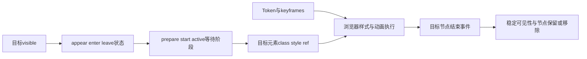

# MotionScene 算法与机制审查

日期：2026-10-27。AtomUI基线：`6c647fef191d25d3e697b6e77db922b2eb907aa7`。

结论：当前MotionScene不能称为完整、等价且已证明高效的Ant Design动效实现。
差距同时存在于动效规格、运行协议和抽象边界。最重要的问题不是文件多，而是定义、单次运行、actor投影、布局策略和业务owner之间没有完整一致的交接合同。
当前代码也保留了正确且有价值的能力，不宜整体推倒后再造补间引擎。

本轮重点覆盖截图中的 `src/AtomUI.Core/MotionScene` 全部14个C#文件，并追踪实际消费者、插值完成协议与精确依赖的Avalonia实现。
只做研究与诊断，没有修改产品代码、创建分支/worktree或提交。

## 版本与来源

- 官方最新稳定版为[Ant Design 6.6.8](https://github.com/ant-design/ant-design/releases/tag/6.6.8)，发布时间2026-10-26，提交 `984592267de88fbf9cdaecc96a56629e721c709d`；npm latest和GitHub release元数据一致。
- 按本地优先规范找到 `/Users/chinboy/Projects/ReferenceProjects/ant-design`，HEAD `211c6ed29b0d2abd18485e293681f8a4e415240b`，package版本6.6.6。
  本地没有最新提交对象；没有切换/更新参考仓库。逐文件读取官方最新固定提交，对八个motion定义文件、seed/map token、collapse运行回调及十个消费者文件核对，21个文件均与本地逐字节一致。
- 运行机制锁定 `@rc-component/motion@1.3.3`、提交 `595a9ccd66d6739ceeca335edb9dd2c1dbb5a76f`。
  依赖util锁定当前1.14.0、提交 `e12854b74d5e15e01f04f3710bc2d2a81383f806`。
  按同样查找顺序未找到本地rc源码，采用官方固定提交文件，未clone或安装依赖。
- AtomUI精确依赖Avalonia12.1.4；对应源码提交 `2d79ba55fae1b1e71c69f93a668080c9029e6a31`。

这里研究的是antd组件实际使用的CSS动效与rc协调机制，不混用独立宣传站点或其它动画框架的算法。

## Ant Design 实际怎样执行动效

其通用机制分为三层：Token和CSS定义端点/时长/曲线；rc-motion协调节点可见性和启动阶段；浏览器求值并执行样式变化。
数值插值不由React每帧自行计算。



### 阶段、反向与完成

- `none/appear/enter/leave` 是可见性状态，内部另有prepare/start/active/activated步骤。
  activated常量值为end，但只表示激活后等待，不等于动画已经完成。
- `useNextFrame` 默认双RAF，为前后样式建立帧边界；prepare可异步。新安排取消旧RAF，异步continuation核对请求身份。
  这里没有每帧 `a+(b-a)×Ease(t)` 数值循环。
- 正常完成来自目标元素的transitionend/animationend；过滤子元素冒泡。属性级结束可由onEnd返回false拒绝。
  不默认读取CSS时长来推测结束，只有配置motionDeadline时才设置watchdog；它也走同一完成入口。
- visible中途改变会替换方向和步骤，但通用层没有保存速度或读取当前计算数值的通用反向补间算法。
- 卸载取消排队RAF及deadline；节点在离场期间保留，完成后按removeOnLeave/forceRender/离场class决定移除或隐藏。
  列表按key保留待离场项，完成后移除；这不是位置插值或FLIP。

源码：[状态与结束](https://github.com/react-component/motion/blob/595a9ccd66d6739ceeca335edb9dd2c1dbb5a76f/src/hooks/useStatus.ts#L71-L110)、
[步骤](https://github.com/react-component/motion/blob/595a9ccd66d6739ceeca335edb9dd2c1dbb5a76f/src/hooks/useStepQueue.ts#L15-L79)、
[帧屏障](https://github.com/react-component/motion/blob/595a9ccd66d6739ceeca335edb9dd2c1dbb5a76f/src/hooks/useNextFrame.ts#L8-L38)、
[节点保留](https://github.com/react-component/motion/blob/595a9ccd66d6739ceeca335edb9dd2c1dbb5a76f/src/CSSMotion.tsx#L180-L253)、
[列表](https://github.com/react-component/motion/blob/595a9ccd66d6739ceeca335edb9dd2c1dbb5a76f/src/CSSMotionList.tsx#L91-L190)。

这也有边界：通用层不监听transitioncancel/animationcancel，不自动按propertyName过滤，也不保证连续反向或所有效果都在合成线程执行。
transform/opacity与height布局动画的成本不能混为一谈。

### 内容展开是不同的算法

Ant的collapse用start/active回调读scrollHeight、offsetHeight，设置height和opacity；结束只接受height事件或deadline。
不是把文字缩放成小块。默认deadline500ms是watchdog；样式动效自身是Mid200ms、InOut曲线。
源码：[运行回调](https://github.com/ant-design/ant-design/blob/984592267de88fbf9cdaecc96a56629e721c709d/components/_util/motion.ts#L11-L41)、
[展开样式](https://github.com/ant-design/ant-design/blob/984592267de88fbf9cdaecc96a56629e721c709d/components/style/motion/collapse.ts#L6-L17)。

## 动效规格是否等价

基础时长的计算一致：Ant的0.1秒单位对应AtomUI100ms，Fast/Mid/Slow均为100/200/300ms。
但无参Motion默认时长及具体消费者选择并不总是采用同一规格；AtomUI也没有对应Ant八种motionEase的统一Token契约。

| 项目 | Ant Design 6.6.8 | AtomUI当前算法 | 判断 |
| --- | --- | --- | --- |
| Fade基类 | opacity0↔1、linear、Mid200ms | 相同端点/linear；AbstractMotion无参默认300ms | 参数部分对齐，默认时长不同；消费者可能覆盖 |
| Slide | scaleX/Y .8↔1与opacity；入场OutQuint、离场InQuint | 同端点/方向原点；入场CubicEaseOut、离场CubicEaseIn | 端点正确，曲线不等价；.8不是平台妥协 |
| Move | 两个端点，纯translate±100%与opacity，无scale；入场OutCirc、离场InOutCirc | 加Cue .8中段；纵向偏移1/4、横向1/2；通常opacity .1，RightOut为1；UpIn单独scaleY=.01；默认Quintic | 轨迹、曲线及方向一致性均有确定差异 |
| Zoom | 普通.2↔1，big/方向.8↔1；入场OutCirc、离场InOutCirc | 普通.2；Big开场.35/.01、关闭.85/.01；多个Out仍用CircularEaseOut | 家族名不等于同一规格 |
| Collapse实际控件 | height/opacity、InOut(.645,.045,.355,1)、200ms | ContentExpansion相同Spline，实际300ms | 新展开算法方向合理，时长不同；不是旧scale版本 |
| NavMenu Inline子菜单 | collapse曲线、200ms | ContentExpansion相同Spline和200ms | 已合理对齐 |
| Select实际消费者 | 默认slide-up | PopupUtils默认选择ZoomBig | motion家族已经不同 |
| Drawer实际消费者 | 自定义平移±100%，opacity .7↔1、CSS ease、300ms | Move家族+CubicEaseOut，继承其额外中段，300ms | 时长相同，运动轨迹不同 |
| Modal/Dialog实际消费者 | Modal用普通zoom .2；入场300ms、离场200ms | 有anchor时Big .35→1→.85，200ms；入CircularEaseOut、出CubicEaseIn；无anchor用fade | 必须按分支对照，当前未等价复现 |

官方固定版本定义：[Slide](https://github.com/ant-design/ant-design/blob/984592267de88fbf9cdaecc96a56629e721c709d/components/style/motion/slide.ts)、
[Move](https://github.com/ant-design/ant-design/blob/984592267de88fbf9cdaecc96a56629e721c709d/components/style/motion/move.ts)、
[Zoom](https://github.com/ant-design/ant-design/blob/984592267de88fbf9cdaecc96a56629e721c709d/components/style/motion/zoom.ts)、
[Drawer](https://github.com/ant-design/ant-design/blob/984592267de88fbf9cdaecc96a56629e721c709d/components/drawer/style/motion.ts#L29-L71)、
[Modal调用](https://github.com/ant-design/ant-design/blob/984592267de88fbf9cdaecc96a56629e721c709d/components/modal/Modal.tsx#L300)、
[Modal开场覆盖](https://github.com/ant-design/ant-design/blob/984592267de88fbf9cdaecc96a56629e721c709d/components/modal/style/index.ts#L137-L150)。

对应本地入口：`SlideMotions` (`src/AtomUI.Core/MotionScene/SlideMotions.cs`, baseline `6c647fef1`)、`MoveMotions` (`src/AtomUI.Core/MotionScene/MoveMotions.cs`, baseline `6c647fef1`)、
`ZoomMotions` (`src/AtomUI.Core/MotionScene/ZoomMotions.cs`, baseline `6c647fef1`)、`ContentExpansion` (`src/AtomUI.Core/MotionScene/ContentExpansionAnimator.cs`, baseline `6c647fef1`)、
[PopupUtils](../../../src/AtomUI.Desktop.Controls/Popup/PopupUtils.cs)、[DrawerContainer](../../../src/AtomUI.Desktop.Controls/Drawer/DrawerContainer.cs)、
[DialogMotions](../../../src/AtomUI.Desktop.Controls/Dialog/DialogMotions.cs)。

### 直接计算曲线的差异

CSS cubic-bezier以参数u表示x/y，必须先解 `BezierX(u)=t`，再取 `BezierY(u)`。
命名为Circular/Quint/Cubic的框架函数不能仅凭名字替换CSS控制点。
诊断程序读取官方[八条seed曲线](https://github.com/ant-design/ant-design/blob/984592267de88fbf9cdaecc96a56629e721c709d/components/theme/themes/seed.ts#L48-L58)，
用60次二分求参考值，并直接调用当前Avalonia easing实现；在1001个归一化时间点比较。

| 默认曲线比较 | t=.25：Ant / Atom | t=.5：Ant / Atom | 最大绝对差 |
| --- | --- | --- | --- |
| Slide进入 | .775382 / .578125 | .965983 / .875000 | .198039 |
| Slide离开 | .018424 / .015625 | .054947 / .125000 | .267552 |
| Zoom进入 | .838078 / .661438 | .957912 / .866025 | .186903 |
| Zoom离开 | .088074 / .661438 | .609393 / .866025 | .590854 |
| Move默认进入 | .838078 / .762695 | .957912 / .968750 | .187718 |
| Collapse/NavMenu的相同Spline | .087230 / .087225 | .516875 / .516861 | .001028 |

这是曲线输出差，不是FPS损失或性能比例。Slide的scale振幅为.2，输出差应乘振幅后才能解释实际尺寸差。
相同Spline的约千分之一残差来自当前数值求解实现与高精度参考的差异，不应放大为主要设计问题。
Move的真实差异还包括新增中段，不能从这张只比较easing的表推导完整轨迹。

诊断直接调用编译产物的ConfigureAnimation，确认UpIn首帧M22=.01、RightOut中段opacity=1等实际关键帧；没有仅凭文件名推断。

## MotionScene 核心机制的问题

### 运行替代只保护旧清理，没有完成后端交接

`ActiveMotionRun`的引用身份能阻止旧finally清理新任务，这是应保留的改进。
但两个transform通道及不对称清理仍会产生公开API可达的错误：

1. Transition播放中改为Move：新run先取得身份再取消旧run；旧finally跳过清理，新Animation分支也不清旧MotionTransform/Transitions。
   Move写Operations，但Actor优先使用MotionTransform，新位移会被遮住。
2. MoveRightOut完成后再播放Zoom：Forward将偏移100填入Operations；Zoom暂时遮住它，最后清MotionTransform后旧偏移重新生效。
   这个方向顺序执行就足够，不依赖并发。

证据：`AbstractMotion.cs` (`src/AtomUI.Core/MotionScene/AbstractMotion.cs`, baseline `6c647fef1`):79–131、150–170；
`BaseMotionActor.cs` (`src/AtomUI.Core/MotionScene/BaseMotionActor.cs`, baseline `6c647fef1`):126–150；
MoveRightOut终点和精确Avalonia12.1.4的AnimationInstance final-fill实现。

Popup打开和Drawer打开会显式清两个通道，FloatButtonGroup结束也有稳定态清理，所以不能扩大为这些默认控件必现。
TreeView公共OpenMotion/CloseMotion允许跨家族配置，但普通离场只隐藏actor，存在该组合风险。
这是源码控制流推导，尚未运行完整控件复现。

### 完成协议依赖插值值和正常timeout

通用Transition分支创建opacity与transform两个通道，每个Notifiable在 `Ease(t)≈1` 时发出一次性完成通知，再由Rx等全部结束。
这把视觉函数值与生命周期完成混在一起：非单调easing可能提前经过1，部分自定义easing可能不产生该值。
timeout只计Duration、不计Delay，超出余量的延时自定义过渡会被提前清理。

Fade只改变opacity，未变化的transform没有完成通知，因此正常Fade也会等到 `T+min(.1T,100ms)`；300ms配置采用330ms边界。
这不是实际完成事件，也不是总能推导出的帧率瓶颈，但确实多建了通道/Subject并延后正常生命周期。
Ant也有watchdog，问题在于它是否成为正常路径，以及到底等待了哪些真实启动的通道。

证据：`AbstractMotion` (`src/AtomUI.Core/MotionScene/AbstractMotion.cs`, baseline `6c647fef1`):235–263、297–316；
`src/AtomUI.Core/Animations/Transitions/AbstractNotifiableTransition.cs`（基线6c647fef1，现已删除）:21–39。

### 公共属性 ownership 没有可撤销边界

执行开始直接把actor.Transitions设null再装自己的集合；结束写null，清MotionTransform，origin按旧数值写回。
CLR setter使用本地SetValue，不能恢复最新底层绑定/样式及原集合的ownership。
默认模板通常给actor专用职责，因此不能据此断言当前默认Popup已经坏；公开actor的组合使用合同确有缺口。
既有[TransitionSuppressionScope](../../../src/AtomUI.Core/Animations/Transitions/Initialization/TransitionSuppressionScope.cs)已展示可释放覆盖的做法。

### 全局 animator 注册的层次与顺序风险

Core公开Move需要TransformOperations animator，唯一精确注册却在Desktop启动；Common公开MotionActor可以在不引用Desktop时使用。
独立诊断进程未初始化Desktop注册，实际执行公开Move，得到：

```text
InvalidOperationException: No animator registered for the property MotionTransformOperations
```

随后按Desktop精确型注册、Masonry宽泛ITransform注册的顺序，使用实际两个animator类型，再执行Move，实际得到：

```text
InvalidCastException: StyledProperty<TransformOperations> cannot cast to AvaloniaProperty<ITransform>
```

精确框架的注册条件是IsAssignableFrom，后注册项插到表头。Masonry因此可能遮蔽强类型handler，泛型绑定不匹配。
实验在隔离诊断进程修改注册表，没有修改产品。生产是否触发取决于初始化先后，不能称每次浏览Masonry必现。
修复方向是能力注册归属及精确handler选择；自定义animator有真实用途，不能简单删除。

入口：[Desktop注册](../../../src/AtomUI.Desktop.Controls/ThemeManagerBuilderExtensions.cs):28、
[Masonry注册](../../../src/AtomUI.Desktop.Controls/Masonry/MasonryPanel.cs):219、
[Masonry animator](../../../src/AtomUI.Desktop.Controls/Masonry/MasonryItemTransformAnimator.cs)、
`Core animator` (`src/AtomUI.Core/MotionScene/MotionTransformOptionsAnimator.cs`, baseline `6c647fef1`)；
Avalonia12.1.4 `Animation.AnimatorRegistry.cs:55–78`、`ICustomAnimator.cs:19–28`、`Animators/Animator`绑定实现。

### Actor 投影与旧布局职责过宽

- Content在模板应用后替换时，HandleContentChanged给presenter安装同一个MatrixTransform，actor自身也使用它，形成父子重复变换。
  内置模板通常保留稳定wrapper，尚未找到默认生产路径直接替换actor.Content；列为公开API确定风险，不当作所有弹层当前故障。
- MotionTransform声明接受ITransform，但插值层把非TransformOperations降为identity，显示与插值合同不一致。
- BaseLayoutAware保留一般矩阵最大可用矩形算法，同时又过滤scale对角线；实际还由TreeView使用，不能按死代码删。
- 纯opacity完成也调用通用InvalidateMeasure；operations→matrix在UI投影，循环转换与包装是否值得应实测，不能凭O(1)计算次数判为严重瓶颈。

入口：`BaseMotionActor` (`src/AtomUI.Core/MotionScene/BaseMotionActor.cs`, baseline `6c647fef1`):126–190、
`BaseLayoutAwareMotionActor` (`src/AtomUI.Core/MotionScene/BaseLayoutAwareMotionActor.cs`, baseline `6c647fef1`):48–159、
`src/AtomUI.Core/Animations/InterpolateUtils.cs`（基线6c647fef1，后续已归位为 TransitionInterpolation）:193–204。

## 消费者协议没有统一接住取消与替代

| 路径 | 具体触发与源码结论 | 证据状态 |
| --- | --- | --- |
| BackTop | fade-in未结束就触发fade-out，旧RunAsync传播取消；show方法没有finally，guard一直true，后续show提前返回。反向同理 | 源码确定路径，未运行交互复现；[入口](../../../src/AtomUI.Controls/FloatButton/AbstractBackTopFloatButton.cs):194–235 |
| TreeView | 动画中相反IsExpanded请求因_animating直接返回，旧continuation仍写旧_isRealExpanded；模板替换后lambda跨await读取新actor字段 | 源码确定路径，未运行控件复现；[入口](../../../src/AtomUI.Desktop.Controls/TreeView/TreeViewItem.cs):655–744 |
| Popup/Drawer/FloatButton | 各自补上部分变换清理与可见性收敛 | 默认路径有防护，不能从通用漏洞推导默认全部失败 |
| ContentExpansion消费者 | 有当前请求/actor/版本与新状态核对，取消前捕获呈现值 | 边界更清晰，应保留，不倒退到旧scale-layout |

该类问题要求共享执行协议与消费者一致，单改缓动函数无法修复。

## 14 个文件的职责判断

以下是设计审查意见，不是删除公共API或开始重构的授权。

| 文件 | 当前职责 | 建议 |
| --- | --- | --- |
| IMotion.cs | 定义接口同时暴露可变backend、动画集合和一次性transition资源 | 保留兼容入口，分离定义与run资源；当前无真正接口多态消费 |
| AbstractMotion.cs | 定义重建、双执行路径、取消、回调、timeout及属性清理 | 主审重点；收敛一次运行的资源与交接，保留现有身份保护 |
| IMotionActor.cs | actor接口与属性注册holder | 保留注册能力；接口未解耦具体BaseMotionActor，不因类型短就机械删 |
| BaseMotionActor.cs | Content宿主、双变换投影、事件、订阅、Follow及layout委托 | 收紧为单一变换投影边界和明确ownership，保留必要宿主/委托 |
| BaseLayoutAwareMotionActor.cs | 一般矩阵布局与render/layout开关 | 作为TreeView兼容路径审慎收缩，不能直接合并新展开策略 |
| IMotionActorLayout.cs | 自然测量、实际视口约束、完整内容排列 | 保留，三个职责对应真实几何/输入合同 |
| ContentExpansionAnimator.cs | 四方向内容占位/裁剪/opacity及请求替代 | 保留独立能力，可复用基础生命周期原语 |
| MotionExecutionState.cs | owner的Idle/Pending/Playing/Completing词汇 | Popup/Feedback实际使用，保留，不让Core接管其业务完成 |
| MotionTransformOptionsAnimator.cs | TransformOperations关键帧适配 | 保留必要适配，修正注册层级与匹配范围 |
| FadeMotions.cs | opacity定义 | 保留定义，只等待真实opacity通道，减少无关变换副作用 |
| SlideMotions.cs | 四方向轴缩放/opacity定义 | 公共家族保留，内部定义可共用，按Ant规格校准曲线 |
| ZoomMotions.cs | 缩放/opacity/origin及部分Out恢复状态 | 分离轨迹定义与通用状态恢复；校准实际消费者而非只看类名 |
| CollapseMotions.cs | 公开scale型Expand/Collapse | TreeView仍依赖，保留兼容并明确区别于内容视口展开 |
| MoveMotions.cs | 八种关键帧与旧scene几何 | 合并重复定义、校准真实轨迹，保留内置animation原位替换 |

不应据此误报的事项：

- 当前run在await前快照资源，每actor独立持有MotionRun，旧finally有引用保护；内置Motion共享不必然互相dispose。
- Move的SetBuiltInAnimation会替换自身槽位，不会每次播放累计一条内置animation。
- CalculateSceneSize/Position当前仅定义/override，无生产调用。轴混用虽是静态错误，不能解释当前Drawer帧率。
- Follow没有生产调用；detach未自动UnFollow是公共API生命周期风险，不是当前Gallery泄漏结论。
- ContentExpansion的InvalidateMeasure不等于全子树每帧重测；框架缓存仍生效。
- Dialog已有Composition主路径；通用AbstractMotion属于fallback，不能把所有Dialog帧都算作UI属性补间。

## 设计上应保留与应收敛的边界

建议把五个职责明确分开：规格定义、一次运行、actor投影、布局策略、业务owner。
先解决资源交接、真实完成和注册ownership，再校准端点/曲线/消费者映射。
不以统一为目的把全部Motion塞进新RAF数值循环，也不将布局占位动画一律改为RenderTransform。

应保留：现有MotionRun引用保护、异常观测、Move内置槽位替换、状态初始化基线、ContentExpansion自然内容与真实视口策略、
以及Dialog等已存在的Composition/兼容fallback分工。

主要收敛点：两个transform通道、定义暴露run-owned disposables、从eased值猜结束、未启动通道参与正常等待、
属性SetValue覆盖缺乏撤销、消费者各自不兼容的guard/取消协议，以及注册顺序影响能力可用性。
改变公共接口、默认曲线/时长或控件交互前，仍需要独立设计、兼容方案和用户评审，本轮没有开始实施。

建议按以下顺序评审缺陷，优先处理可能留下错误状态或直接抛异常的问题：

1. 一次运行的交接、取消及稳定态收敛；同时检查BackTop/TreeView如何消费取消结果。
2. Core所需animator的注册归属与宽泛类型遮蔽；两种失败已有实际运行证据。
3. 完成协议与属性ownership；不应让未启动通道的timeout承担正常完成，也不应把easing输出当作时间终点。
4. Actor重复投影及旧布局合同；保留TreeView当前依赖，先证明新的几何与输入行为。
5. Ant规格一致性；曲线、关键帧、时长和组件映射一起评审，避免只替换同名easing。

效率结论限于已知多余通道/等待、UI投影与布局副作用；本轮没有跨平台帧时基准，不给出FPS或速度收益百分比。
上一轮NavMenu独立延时驱动的移除，不等于上述通用MotionScene问题已经解决。

## 诊断与清理

临时.NET10控制台直接引用当前编译产物：实际计算easing、读取配置后的真实关键帧、复现无注册与宽泛注册遮蔽异常。
没有复制产品算法作测试，也没有修改参考仓库。曲线参考值来自官方参数的高精度数学求解。
BackTop、TreeView、跨执行家族交接及公开actor投影问题明确标为源码推导，未混作已运行重现。

临时源码快照、诊断项目与专用输出在记录结果后删除，只保留本调查文本。最终检查包括源码工作树、参考仓库状态、链接与空白。
