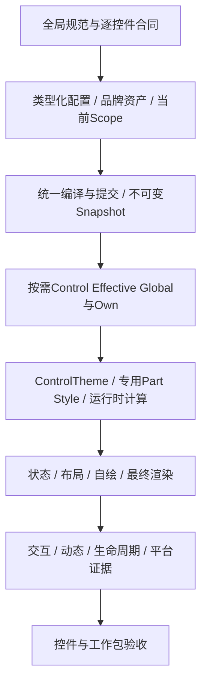

# AtomUI 自定义主题完整解决方案

日期：2026-10-22。状态：供用户审查的整体方案；产品改造尚未实施。
工作分支：`feature/custom-theme`。源码基线：`19eef870b9db62b1eb1c3b0897619ee8d466af46`。

本方案统一回答：本次要达成什么、已经发现什么、需要哪些规范、按什么顺序优化、怎样证明有效、何时能够交付。各专题只维护其职责内的内容，本文是整体方案入口。

## 1. 本次工作的目标

应用开发者可以定义完整品牌主题，并对单类控件、局部作用域和单个实例继续精细定制；所有纳入范围的控件按照有效配置渲染，已有实例更新时保持业务状态和原有交互合同。

| 目标 | 应具备的结果 | 完成证明 |
| --- | --- | --- |
| O1：基础设施完整 | 确定的求值、覆盖、继承、作用域、资源、样式装配、诊断与失败语义 | 机制合同、故障与兼容验证 |
| O2：消费正确 | 有效Global/Own到达正确owner及真实视觉输入 | 每个Active Own、实际使用的Global语义及适用分支证据 |
| O3：精细定制 | 颜色、排版、尺寸、留白、描边、圆角、阴影、图标和动效有适当入口 | Token、公开属性、专用Part Style与模板的实际效果 |
| O4：动态可靠 | 已有实例、回收容器、自绘和已打开弹层同步更新 | A→B→A、重挂载、跨根、状态保持及释放证据 |
| O5：完整使用闭环 | 多套品牌配方、编辑预览、诊断、恢复和完整导入导出 | 配方可复用、导出再导入等价 |
| O6：持续约束 | 正式规范、作者示例、生成诊断与聚焦验证共同约束新增改动 | 规则有所有者、可执行检查及交付证据 |

AI是O5之上的受限生成入口，独立分期：先证明手动配置和完整渲染链正确，再接生成服务。核心主题能力完成、编辑器完成与AI完成分别验收，不能互相替代。

## 2. 范围与成功边界

- 覆盖Core、Generator/相关Toolchain、Controls、Desktop.Controls、DataGrid、ColorPicker、实际存在的Extras能力、GalleryBase和Gallery主题使用路径。
- 从公开产品Control及生成式注册目录建立逐控件基线，没有Own Token的Control同样纳入。内部primitive、非Visual描述对象、运行时容器与独立host归属真实owner。
- Extras目前没有可验收的Control；Mobile以实际产品源码和Host证据为准。原生效果、固定形态和CSS特有效果按能力明确边界，不能把无实现的平台算作通过。
- 精确指公开合同内的配置、数值、语义命中、几何与状态正确；字体栅格化、平台阴影等使用明确容差，不承诺跨OS逐像素相同。
- 保留合理默认、数学几何、色谱和内容数据。不能为消除常量而扩大Token，也不能降低尺寸、滚动、裁剪或输入体验来规避问题。

## 3. 阅读入口与文档归属

| 资料 | 内容与所有权 |
| --- | --- |
| 本文 | 整体目标、范围、阶段依赖、交付门槛与当前状态 |
| [问题与优化映射](problems-and-remediation.md) | 根因、优先级、规范对应、优化策略和具体反例 |
| [90组问题处置矩阵](problem-matrix.csv) | 逐审计ID对应受影响对象、源码证据位置、规范、工作包、优化方向、验证要求与当前状态 |
| [交付与验证方案](delivery-and-verification.md) | 工作包、源码边界、逐控件迁移、验证场景和命令 |
| [正式主题设计](../../../architecture/systems/theming/overview.md) | Own、品牌、渲染与验证按模块维护；[过程记录](../2026-10-22-precise-theme-customization-design.md)只保留选型收敛 |
| [全局主题研发规范](../../../engineering/development/theming/overview.md) | 研发与验收要求，引用正式目标设计并区分实现状态 |
| [审计与Ant Design研究](../../audits/2026-10-22-theme-customization/overview.md) | 参考版本、源码证据、文件覆盖、原始候选及研究边界 |
| [问题证据](../../audits/2026-10-22-theme-customization/findings.md) | S/L/T/V/G各组的源码位置、语义、兼容项和待运行风险 |

规范属于`engineering`，当前系统架构属于`architecture`，协议属于`reference`，具体控件合同属于`controls`；本目录承载整改方案、阶段与追踪，不作为正式运行合同的第二来源。

## 4. 已经掌握的事实

静态扫描覆盖2,736个C#/AXAML文件，产生5,632条未去重候选；Own直接声明清点有95个类型、1,195项属性，其中137个public属性没有所扫描形态的直接引用。Custom与Middle合并候选为58处、45个文件。

问题证据整理为90组：S01–S06跨控件根因，L01–L11本地值/缓存/框体问题，T01–T37 Token消费与合同项，V01–V25视觉能力项，G01–G11配方/工具/设计项。这些是混合证据条目，包含源码确认、待运行风险和合同待决项，不能称为90个已复现Bug；原始候选也不是缺陷数。

Ant参考源码为本地`/Users/chinboy/Projects/ReferenceProjects/ant-design`，commit `211c6ed29b0d2abd18485e293681f8a4e415240b`，版本6.6.6；先前网站取证为6.6.7。其精细效果由全局派生、组件覆盖、条件语义样式及工具接线共同组成。首页预览会重建子树，不能据此证明原地更新状态保持；AI前端没有提供本轮可验证的服务后端。

现有AtomUI已经具备重要基础：Seed/Map/Alias、Effective Global/Own、Compiler/Snapshot、ScopeGraph、动态资源、Semantic Part和生成资产。推荐补齐现有体系，修通消费链，完成品牌表达；逐字面量替换或新建CSS/主题脚本引擎都不能代替这项工作。

## 5. 整体优化结构

ThemeManager继续统一提交，Snapshot继续是有效Token值的真源，Control槽继续按需计算。Avalonia执行原生样式与优先级；公开子Control保持自身identity。

先修复跨控件机制，再修共享消费，最后逐家族迁移。修复单个家族时必须同时核对Global/Own、Part、状态、自绘、动态和资源释放，避免“资源已变化”却未到达像素。

## 6. 工作包与依赖

| 工作包 | 工作内容 | 出口 |
| --- | --- | --- |
| W0：规范与基线 | 审定规范、核对冲突，建立Control主目录、语义分类和当前视觉/性能基线 | 每个Control有owner、入口、状态和证据位置；保留项及平台边界明确 |
| W1：基础机制 | Own新求值、别名兼容、品牌样式scope/接线及结果语义的独立规格和原型 | 机制有版本、失败/通过及AOT证据，禁止未经证明批量接入 |
| W2：共享消费 | owner-aware输入框体、排版、图标、动效、波纹和Popup/Overlay | 共享修复不污染public子Control身份，代表家族原始UX保持 |
| W3：逐控件迁移 | 普通控件、输入/选择/导航、反馈、日期时间、复杂列表、自绘与可选包 | 所有纳入范围Control逐项处置和运行验收，文档/示例同步 |
| W4：完整品牌 | Ant默认、shadcn、Bootstrap及边界配方 | 同一有效配置链可复用，状态/尺寸/弹层一致，完整往返导出 |
| W5：工作台与生成入口 | 有效值编辑、预览、诊断、恢复、导入导出；最后接受限AI | 手动闭环与AI分别有实际产品证据，无旁路运行时 |
| W6：交付核对 | 清理迁移与临时验证、受影响模块确认、平台/发布及兼容说明 | 交付门槛逐项有据，无虚报通过与未归属问题 |

主依赖为W0→W1→W2→W3→W4→W5→W6。W4的小规模样本从W1开始贯穿验证；合同独立的控件问题可在其前置机制就绪后推进。每个工作包内部再形成可审查规格与文件级任务，不把本总方案直接当作全库批量改码指令。

## 7. 前置设计决策与风险

| 决策/风险 | 要求 |
| --- | --- |
| Own求值版本 | 现行整体计算与新版逐Token依赖显式区分；不得重复调用旧Calculate覆盖用户值 |
| 别名与历史schema | 导出的internal字段也有兼容影响；旧新输入冲突、弃用与迁移必须明确 |
| 品牌样式隔离 | 重置子scope时父规则不得串入；原生应用Styles的通常行为仍保留 |
| 品牌激活失败 | 可恢复样式接线/预激活放在Token提交前，结果协议版本化并故障验证；现行Token Publish后不可回滚，品牌表现完整性另行报告 |
| 选择器与跨根 | 原型验证资格判断对BindingPriority、Setter/Binding/Template更新及已打开host的影响 |
| 排版与形态变化 | 改变测量、命中、滚动和裁剪的风险必须用原始场景验证；新增API/Part先完成兼容性决策 |
| 平台效果与性能 | 效果集合和预算按真实Host确定；不得以单平台、编译或截图代替其余证据 |

以上决策由W0/W1前置闭合。不能因为方案已经列出目标，就把候选机制标为已实现或可无损回滚。

## 8. 最终交付门槛

1. 全部纳入范围Control都有目录和明确处置；没有未审计却标为完成的控件。
2. 每个Active Own及其适用分支有消费者证据，每条Own派生边有上游/下游覆盖验证，Global保持完整合法配置空间。
3. 每条Part route和替代节点实际命中；所有示例使用生成专用Style，框架默认不压制合法定制。
4. 已有实例A→B→A、嵌套/兄弟scope、回收、re-template及已打开Native/Overlay弹层正确更新并释放资源。
5. 三套品牌和边界配方到达实际渲染，编辑/导入导出保留生效表达；交互、输入状态和原始UX维持合同。
6. 机制与改动模块的最终验证、所需平台/AOT/性能及迁移说明齐全；未验证范围明确，临时测试和工具已清理。

## 9. 当前进展与下一交付

已完成源码研究、静态覆盖与重点链路核对，并把最新设计分别写入主题架构、Generator、Gallery及工程规范。实现差异由正式验证边界维护；本目录保留整体方案与追踪。分支/worktree已按用户明确授权创建，工作位于`feature/custom-theme`。

目前没有产品修复、逐控件运行验收或新机制可行性通过证据，W0的完整Control主目录也尚未完成。下一交付先是规范与机制规格的审定、主目录及代表失败基线，再按W1–W6推进；本次文档检查不算产品验收。
