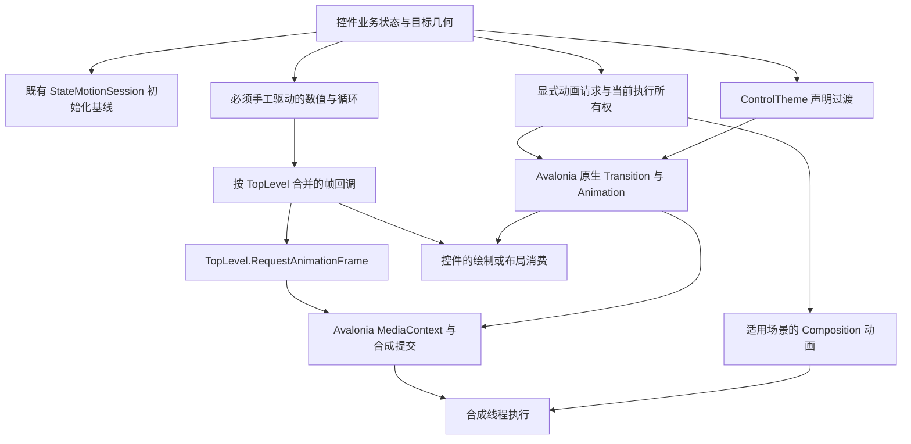

# AtomUI 动画动效系统优化方案

状态：用户已批准推荐B方案；P0、P1实施完成并获用户提交授权，后续阶段尚未实施。日期：2026-10-27。

本方案基于[本次源码调查与原生 Gallery 采样](../progress/2026-10-27-animation-smoothness-analysis.md)。
目标是降低动画对 UI 线程、布局和分配的依赖，统一必要的执行与生命周期规则，并解决视觉连续性缺陷。
不以“统一锁在30FPS”为前提：本机已测侧栏通常约16.6–17.1ms更新，Windows反馈环境尚未完成同条件采样。

用户明确指出的 NavMenu `Task.Delay(16ms)` 循环及逐帧 Dispatcher 投递，列为必须移除项。
删除的是这套独立帧驱动，侧栏展开收缩、宽度变化和内容区联动全部保留。

## 目标和评审边界

主线要求：

1. 手工动画跟随 Avalonia 渲染帧，空闲时不调度；消除通过延时任务或周期 UI timer 制造帧的独立循环。
2. 将视觉变化的工作限制在所需的绘制、排列或测量范围，减少没有可见结果的重复工作。
3. 持续动画有明确的可见性、视口和释放策略，有限动画有确定的完成、取消和请求所有权。
4. 逐帧路径复用可复用资源，缓存具有边界和正确的失效条件；不以无界缓存换取局部速度。
5. 以原生 Gallery 的帧间隔、布局/绘制耗时和分配量证明收益，保留当前业务与视觉合同。

主线保持 public/protected API、Avalonia属性与通知、绑定优先级、事件时序、Template Part、Semantic Part、Token、
现有时长/曲线/振幅、主题和布局语义。行为缺陷修正必须单独列明前后差异并给出可失败的证据。

以下不包含在主线的默认授权中：全库改成弹簧、把 Push 改为 Overlay、把 CountUp 改为数字滚轮、
缩短动画或减少循环次数、统一固定数字区域宽度、修改渲染平台默认选项、替换 Avalonia 时钟或引入依赖库。
这些会改变用户可感知行为，须在后面的可选项中单独决定。

本方案作为设计基线；P0/P1已在当前目录实施，改动与验证见[交付记录](../progress/2026-10-27-animation-p0-p1-results.md)，后续阶段仍按独立评审执行。

## 方案选择

| 方案 | 做法 | 收益与代价 |
| --- | --- | --- |
| A 逐控件局部修补 | 分别替换 NavMenu timer、缓存 BorderBeam 资源、优化 Progress/Statistic | 易验证、回退小；持续循环和取消等共性问题仍可能重复出现 |
| B 渐进收敛共享能力，推荐 | 保留 AXAML/Avalonia 原生过渡；补足手工动画的帧批次和生命周期；将布局、绘制、过程反馈分开优化 | 覆盖架构问题，同时可按场景证明收益；需要明确哪些职责共享、哪些仍归控件 |
| C 全量重建统一引擎 | 所有 Transition/Animation 都迁到自建 MotionValue、spring 或 Composition | 改造面大，容易改变外观、绑定和扩展合同；目前缺少足以支持全量替换的性能证据 |

推荐 B，第一步采用 A 中最小可验证的改动。共享能力由真实重复消费驱动，不预建动画注册中心、通用后端插件或全库适配层。
用户已批准B方案，并将当前研发范围限定为P0和P1。

## 架构与所有权

这张图描述职责，不要求每个框都新建一个类。优先扩展既有内部执行对象和布局策略。

| 层 | 负责 | 不承担 |
| --- | --- | --- |
| AtomUI.Core/Animations | 既有初始化协议；必要的手工帧批次、循环注册与释放；基础插值算法 | Desktop选择模型、菜单路径、控件Token、全局视觉树扫描 |
| AtomUI.Core/MotionScene | 现有Motion兼容入口、单次执行资源、内容展开布局策略 | 接管全部主题过渡；维护第二套业务状态 |
| AtomUI.Controls | 自绘与布局原语、控件内部呈现值、资源缓存和失效 | 网络/平台渲染策略；通用业务状态仲裁 |
| AtomUI.Desktop.Controls | Popup/Dialog/Drawer及具体控件接入、事件和模板生命周期 | 各自新建周期帧timer、复制一套全局动画框架 |
| Gallery与性能工具 | 真实场景驱动、时序/分配/布局观测和证据输出 | 为了测量而修改产品默认行为或保留常开探针 |

项目依赖方向保持 Core → Controls.Shared → Controls → Desktop；不新增运行时项目。
普通模板状态继续在 ControlTheme 中声明；仅运行期目标、计算值或跨视觉根等 AXAML 无法等价表达的关系允许代码实现，
按项目约束记录原因与释放 owner。Transitions 仍位于 ControlTheme style setter。

## 第一项必须完成的修改

### NavMenu 移除独立延时帧驱动

范围：[NavMenu.cs](../../../src/AtomUI.Desktop.Controls/NavMenu/NavMenu.cs) 的 Inline Collapsed 宽度执行。

- 删除 `InlineCollapsedWidthMotionFrameInterval`、Task.Delay逐帧循环、逐帧Dispatcher.Post及仅为该循环存在的时间戳/投递辅助代码。
- 优先用公开的 Avalonia `Animation.RunAsync` 驱动现有内部 `InlineCollapsedLayoutWidth`，沿用其 Width/MinWidth coercion关系。
- 起止值、`CubicEaseOut`、有效 `MotionDurationMid` 和现有最终恢复规则保持一致；Animation目标是内部布局值，不能覆盖应用的Width绑定。
- 创建请求时同步确定起点；零时长、未加载或禁用动效直接收敛，不创建播放任务。
- 新请求先取得所有权，再取消旧请求；仅当前请求能清理内部布局值。取消后的旧continuation不得重设宽度。
- 播放中修改InlineCollapsedWidth、Mode、Width绑定或IsMotionEnabled时，沿原合同取消/重新定向/收敛；不同入口不各自保留第二份播放状态。
- 同一时刻只保留当前运行；不保留“旧timer路径”作为永久开关或备用分支。

此处不依赖后续手工帧批次，也不以新增通用 MotionValue 为前置条件。
同样不通过改变父布局、隐藏文字、缩短内容、改Overlay或取消宽度动画来规避成本。

验收至少包括：相同实例反复280↔48或应用实际配置宽度；中途反转；Width/MinWidth绑定更新；选中项与展开路径；
展开后恢复自然约束；detach/重挂载；内容区真实连续跟随。保留视频中的侧栏使用方式。

## 必要的共享执行能力

### 手工动画按帧合并

仅覆盖不能用现有AXAML或原生Animation自然表达的持续自绘循环、运行期追随和必要的计算动画。
普通Transition已经共享Avalonia时钟，不重复包装它们，也不为每个颜色过渡注册手工driver。

- 一个TopLevel最多一个待处理RAF回调；由宿主渲染时间戳推进，不固定假设60Hz。
- 稳态tick不创建Task、LINQ数组或新快照；复用有界缓冲，并在当前遍历结束时清空残留引用。
- driver退出、Dispose、模板替换、owner分离时立即解除集合所有权；不能靠弱引用或“等下次动画帧”代替清理。
- 已排队RAF可能无法撤回，回调使用代次核对；宿主/owner失效后不再触碰旧视觉对象。
- 无活动driver时不请求下一帧；处理回调中的重入、注册、注销和异常，不让单个失败driver阻断其他owner。
- 曲线按累计单调时间求值。有限动画默认按完整经过时间追赶并对齐截止点，不能静默截掉超过250ms的时间。
- 循环恢复使用明确定义的phase策略；受控手动时钟仅供测试，不能把其1/60推进结果称为原生FPS。

实现前先确认至少两个实际消费者需要相同机制；若只有一个，保留局部最小实现并记录原因，不强建通用层。

### 执行与完成所有权

继续复用 `AbstractMotion.MotionRun`、ContentExpansion当前Execution以及控件既有协调器，各自拥有真实的目标集合。
统一的是“新请求覆盖旧请求、旧回调失权、完整清理”的协议，不引入全局属性仲裁表或第二份 IsOpen/Selected 状态。

- 每个执行明确目标、模板/宿主代次、取消源、起点、终点和完成结果；相关通道成组开始/收敛，避免mask和surface异步脱节。
- 复用StateMotionSession建立初始基线；不通过Dispatcher.Post猜测首帧就绪，不让普通选择/定位变化补播初始化过程。
- 采用原生Animation的路径以其任务完成为执行信号；取消结果与正常完成分开处理。
- Composition路径建立首批挂载与开始动画的有效提交边界，沿用现有Dialog已验证策略；保留最终呈现到稳定值提交之间的合法帧。
- 当前Notifiable以eased progress判断完成的问题单独修正；不能假设受保护API提供了原始完成observable。
  上游Transition的关键钩子为internal，主线不为此新增反射、私有Clock访问或修改Avalonia。
- 旧 public `AbstractMotion`、`SpiritType`、`Animations`、`Transitions`、回调及自定义子类保持兼容路径。
  对无法获得可靠原始完成信号的旧自定义Transition，保留既有协议并明确fallback边界，不宣称完成模型已被全量替换。
- fallback超时与动画驱动分离，核对Delay、Duration、未产生过渡的通道和取消；超时只承担有界收尾，不产生帧。

### 持续动画的统一运行策略

默认装饰循环只在attached、有效可见、有效viewport相交且动效开启时运行；必要时考虑祖先clip。
此策略首先服务现有手工循环，当前Spin/Icon的Composition路径保留。

| 类型 | 离开viewport | 再次进入 | 禁用动效/分离 |
| --- | --- | --- | --- |
| 装饰循环，如Beam、loading自绘、Marquee | 停止请求帧，保留可恢复phase | 按原语义恢复，不从零强制重启 | 提交确定静态帧并释放运行注册 |
| 业务计时，如自动关闭、倒计时 | 继续计算业务截止点，停止无用绘制 | 以业务时间刷新当前值 | 计时仍由业务owner按原合同处理 |
| 有限布局/状态过渡 | 默认保持原有完成合同；不因离屏随意丢弃事件或终态 | 展示正确当前状态 | 当前owner决定取消或收敛 |

只给活动循环订阅有效视口；优先使用宿主已经具备的可见区域信息，避免每个item永久监听全窗口LayoutUpdated。
没有可观测viewport的临时阶段采取保守可见策略，不把未知当作离屏。
不以任意遮挡推断停止，跨Popup视觉根使用实际宿主；生命周期开销一并计入性能比较。

## 布局与绘制的消费架构

### 内容几何和动画占位分开

以[既有内容展开合同](../../architecture/systems/control-infrastructure/content-expansion.md)为基础完善实现，
不另建一套与ContentExpansionAnimator竞争的“智能尺寸控件”。

- 内容按正常展开时的有效约束排版，动画改变视口/占位；不按缩小中的宽度重排文字。
- 优先复用Avalonia原有Measure有效性缓存；内容、字体、padding、边框、方向和真实宿主约束变化才重测受影响内容。
- 对外真实需要重排的Width/Height仍参与布局；不能用RenderTransform代替它，导致相邻内容或滚动范围停在旧位置。
- 可等价降为Arrange或仅绘制的通道才降低失效等级；是否等价以DesiredSize、Bounds、clip、命中和滚动合同验证。
- 仅当UseLayoutRounding开启，且本次输出在现有量化规则下确实不变时，跳过重复布局请求。使用同一宿主缩放、相同取整及锚点规则，不能另加统一0.5DIP误差。
- UseLayoutRounding关闭、实际像素/命中边界变化或内容约束失效时继续更新；最终目标始终准确提交。
- clip、opacity、内容偏移和公开属性通知分别处理，不能用布局去重吞掉仍有可见结果的变化。

### 业务值与呈现工作分开

概念上区分目标业务值、当前动画呈现值和用户实际看到的文字/几何；只在已有内部边界内实现这种分离。
Progress.Value等公开属性的有效值和通知可能已被应用观察，不能直接把原来的公开Value动画改为私有值动画并称为兼容优化。

| 控件 | 主线改动 | 保留的合同 |
| --- | --- | --- |
| ProgressBar | 分别统计Value引起的文字、Measure、Arrange、Geometry工作；先去掉实际重复结果，再将绘制输入与自然尺寸计算分开；稳定轨道/clip可复用 | Value通知、百分比格式、默认实际测宽、各种圆形/分段/状态布局 |
| StatisticCountUp | 缓存有效格式配置；内部数值走强类型格式化，避免每帧object→string→多轮TryParse；显示舍入结果未变时不替换文字 | 仍逐值计数，保留分隔符、精度、文化和动态排版，不改滚轮效果 |
| BorderBeam | 缓存bounds/圆角/边框对应几何、path metrics和规范化色标；帧内仅推进位置与绘制；输入变化时精确失效 | Beam数量、形状、颜色、速度、clip及主题响应 |
| Icon与其他自绘 | 按实际重绘路径缓存稳定Pen/几何/字形，复用局部矩阵；不修改共享Geometry造成跨实例污染 | 多色图标、描边、缩放、颜色过渡及自定义资源 |

缓存属于控件或模板实例，定义尺寸/DPI/字体/文化/主题/画刷/内容变更的失效入口，并在owner释放时解除资源。
用户传入的可变brush等继续响应变化；共享不可变结果与实例可变状态分开，不引入按全部历史输入增长的全局字典。
一般Brush/TransformOperations插值允许框架必要的结果对象，目标是去掉重复构造，不要求全库“每帧零分配”。

## Composition 扩展策略

适合的是无需每帧改变布局、业务观察值或输入几何的纯opacity/平移/缩放效果。
先以既有Icon/Spin/OverlayDialog为对照，测量Popup/Flyout/Drawer具体路径，证明UI插值或提交成本值得迁移再扩展。

- 控件内部显式选择已知内置动效；不扫描public Motion子类、不按类型名反射识别能力。
- 自定义Motion、用户提供的过渡、依赖UI逐帧状态的路径沿用原协议。
- 明确一个视觉通道只有一个写入owner；Composition运行期间，UI属性同步、主题更新和外部改值不得与之争写。
- 暂停/取消/模板替换时正确处理最终基础值与最新绑定，不把启动时的旧值无条件写回。
- 相关通道可以共同迁移才采用该路径；否则整个编排使用现有路径，避免时钟和完成边界不一致。
- 逐项验证首开、重开、中途关闭、重定位及独立Popup视觉根。缺后端证据时保持该阶段待验，不自动修改平台默认后端。

此阶段以少量消费者证明共享价值；不创建“所有动画自动选择GPU”的通用能力承诺。

## 动效连续性与算法正确性

主线先处理不合理的跳变与边界，且与纯性能重构分开评审：阴影层数5↔3、空渐变色标、不兼容brush的明确离散策略、
完成信号与自定义Delay，以及运行中反转的当前呈现值接续。每项先建立原问题失败证据，再决定与现有合同相符的修正。

阴影新增/删除层可按相同索引向透明中性层渐变，保留几何并处理inset等不可连续差异；中性层的颜色/模糊/位移规则需在该项专项中固定。
这改变现有错误的视觉跳变，不能夹在缓存改造中无说明地发布。

可选扩展：在拖拽追随、选中指示器等频繁改目标的场景引入保留位置与速度的内部数值运行能力。
如果采用弹簧，使用解析阻尼解、可控时钟与明确停止阈值；相同目标不重启，临时缓冲复用，运行结束立即清空引用。
时间推进、停止阈值与释放策略单独定义，保留真实累计时间，并及时清除退出driver的快照引用。

该扩展会改变反转速度、缓尾或振幅，属于单独的动效体验设计。默认主线保持现有Ant Design时长和曲线，
不为实现这项可选能力把主题绑定搬到代码，也不把所有Tween替换为Spring。

## 消费端覆盖与页面负载

系统性优化不等于让所有控件换同一个API。覆盖清单用于确认职责和消费关系，只有测出问题的路径进入改造。

| 控件家族 | 默认处理 |
| --- | --- |
| Button/Input/CheckBox/Radio/List等主题状态，DataGrid/ColorPicker颜色过渡 | 保留ControlTheme与原生Transition；共享插值修正后验证真实直接消费者，不统一搬到C# |
| NavMenu根宽度、子菜单，Collapse/Expander及继承的ColorPicker展开 | P1与P4；区分根宽度和内容展开，不把两个owner合为一个状态机 |
| Icon/Spin、Skeleton/Carousel过程反馈，SwitchKnob/Beam/Marquee等循环 | 保留正确的Composition路径；P2按既有循环语义接入，不以全局隐藏策略影响业务计时 |
| Progress/Statistic/BorderBeam与其他自绘原语 | P3分别优化呈现消费者，记录格式、几何和资源失效 |
| Popup与Select/TreeSelect/Cascader/DatePicker/TimePicker等直接消费者，Dialog/Drawer/Message/Notification | 分别验证共享运行协议、P5后端适配及现有堆叠/一次性snapshot边界；自定义Motion保留兼容 |
| TreeView、SplitView、ScrollBar尺寸、Carousel进度宽度、BackTop滚动 | 布局或滚动确有必要时继续走UI；按实际消费者和约束判断能否减少工作 |
| Masonry重排、Tab拖拽、Slider marks、反馈堆叠snapshot | P7按实际热点验证并发执行数量、重复目标、重排复杂度和捕获起始突刺，不只测空场景中的一个动画 |

页面构建与动画共用UI线程，也是原生体验的一部分。P0同时区分首次构建、首次操作和已经稳定的重复操作。
若Gallery物化确实挤占关键帧，P7优先核对既有延迟机制及首页/当前示例的物化边界；
任何分批挂载都必须有明确的内容就绪和取消合同，不减少示例、不延迟用户已请求的必要内容、不把工作挪出计时窗口制造收益。
原始复现保留完整内容，另设单变量对照定位构建成本；不得只用清空页面后的结果代表真实Gallery。

## 分阶段交付

| 阶段 | 输出与范围 | 进入下一阶段的证据 |
| --- | --- | --- |
| P0 基线与取证入口 | 复用/扩展现有性能工具，增加按场景启用的原生交互采样；先覆盖侧栏、子菜单、Progress/Statistic/Beam、Popup与离屏循环 | 同版本A/A噪声、来源/后端/刷新率/场景可核对，能够区分属性更新、batch完成与present |
| P1 移除NavMenu独立驱动 | 使用原生Animation，删除延时帧循环和Dispatcher逐帧投递；保持现有宽度与业务语义 | 原始场景及快速反转验证，旧驱动确实消失，布局/输入/帧时无回退；已有平滑场景可用CPU或分配改善证明收益 |
| P2 持续循环治理 | 两个实际手工循环试点共享帧批次和viewport策略，再评估扩展；保留现有Composition Spin路径 | 无活动任务时零请求，离屏绘制减少，重入phase正确，取消/分离无保留，监听成本计入比较 |
| P3 消费端减负 | 分别优化BorderBeam、Statistic、Progress；每个控件独立前后测量与评审 | 同等视觉/格式/排版下，已定位的CPU、布局或分配主指标改善，复杂度可接受 |
| P4 布局策略完善 | ContentExpansion及直接消费者的约束、缓存复用、等价失效与像素去重；TreeView自定义Motion另保兼容 | 四方向、嵌套、动态内容、命中与滚动合同通过，Measure/Arrange工作降低或长帧改善 |
| P5 纯视觉Composition扩展 | 仅迁移基线证明确有价值且满足前述条件的内置Popup/Flyout/Drawer路径 | 原生后端首尾帧、取消、基础值恢复、扩展合同和实际帧时/CPU证据 |
| P6 视觉缺陷修正与收敛 | 已复现的阴影/插值边界/完成缺陷分别修正；更新稳定文档、移除被替代私有路径 | 每项红绿与视觉证据、临时工具处置、清理后的模块验证；未复现项保持调查状态 |
| P7 复杂交互与页面负载 | 基线证实的Masonry/Tab/Slider/堆叠或Gallery构建热点逐项处理，各自独立评审与测量 | 保留完整内容、输入历史、重排/滚动语义和首次可操作时间，收益归属于实际减少的工作 |

P2–P4可按测量结果调整先后；P5只在收益门槛满足时执行。P6的高影响正确性缺陷可提前单独修复，不等待全部性能阶段。
P7只处理已定位的热点，不预先承诺所有复杂控件都重构。保留速度/弹簧不包含在P1–P7的默认视觉变更范围，选择后另出该场景设计与验收。
同一模式先小范围试点；连续三轮测量没有主指标改善就停止并回退纯性能改动；同模式扩到第5个控件前先审计前4个的收益与正确性。

## 验收与性能门槛

每项变更先确认现实实例数、触发频率和主要成本。达到实测约1ms/帧或场景成本约5%的候选优先；
用户明确要求删除的独立帧驱动仍按P1处理，但不预报FPS提升。

交互基准建议每方向5次预热、30次正式动作，并在至少3个独立进程核对可重复性；同一前后对照保持相同配置和完整操作历史。
涉及页面构建才额外采10个独立进程的首次导航，避免用页面加载时间替代动画测量。

| 指标 | 口径与通过条件 |
| --- | --- |
| 帧间隔 | 报告中位/P95/P99、超过1.5B及2B的次数，B=1000/实际刷新率；受控轻载目标为P95≤1.25B且超过2B比例<1%，属于待验证目标而非当前保证 |
| UI工作 | 分开记录动画采样、格式化、布局和自绘耗时；不能将回调间隔当CPU执行时间 |
| 合成与显示 | 记录已有batch的Processed/Rendered；实际present用平台可用的呈现追踪，不能用SceneInvalidated计数代替FPS |
| 分配 | 每次操作及稳定每秒的托管分配、GC次数；缓存预热和首次物化分开记录，必要结果对象不强求清零 |
| 布局 | 记录实际Measure/Arrange次数和耗时、约束变化及缓存命中；不能把InvalidateMeasure等同整树重测 |
| 连续性 | 捕获首tick前、中间帧、终tick后continuation前、反转和取消；任务完成和终态截图不能独自证明平滑 |
| 生命周期 | 无任务后停止调度、driver/订阅/缓存释放、模板替换和owner分离后无迟到写入；弱引用检查在清理后执行 |
| 收益判定 | 前后差异须超过同版本A/A噪声；稳定60Hz场景允许以少做工作证明收益。P95/P99或主指标可重复劣化时修正或回退 |

Windows是本次反馈的必验原生环境，macOS作为已测基线对照。Linux/Browser等变更涉及的后端分别报告结果，
缺失的原生后端验证保持pending；Headless/手动时钟只用于逻辑与确定性中间帧，不能填补实际帧率证据。

所有阶段保留布局、标题、内容量、限制高度、滚动条、嵌套滚动和滚动链；不能以移除触发条件换取通过。
格式、主题、DPI及语言验证按实际改动风险选取，不默认扩成全控件全平台排列组合。

## 兼容性和发布

- 公开API/受保护扩展点、Transitions可观察行为、属性有效值/通知与事件时序先列合同清单；无法保持时单列差异并再评审，不默认为内部重构。
- 代码绑定继续AXAML优先；Semantic Part示例使用生成的专用Style，不以code-behind定制绕过主题合同。
- 产品实现保持强类型、AOT与trim安全，不增加反射、运行期程序集扫描或按实例注册全局animator。
- 暂存缓存/自绘目标/订阅的获取与释放成对；明确可变资源的更新和模板/DPI/主题失效。
- 默认不增加公开配置开关；对照开关仅用于临时取证，最终删除，避免长期维持两套实现。
- 修改模板注册、跨模块调用或委托/Composition路径时，执行相应真实Gallery NativeAOT验证；普通JIT构建不能替代。
- 每阶段使用精确失败用例和所属模块iterate验证，显式给`--path`；临时测试默认删除后再验证清理后的模块。
- 不自行运行affected-wide/change/full；全量仅用户明确要求或发版执行。性能和原生视觉专项单独给出证据。
- 阶段提交前先交用户审查；未获明确提交指令不commit。研发授权不包含创建分支或worktree的授权。

## 优化点与实施边界

持续保留的优化方向：同目标去重、必要手工动画合批、viewport外装饰循环暂停、内容约束与可见占位分离、
资源缓存、布局结果去重、纯视觉Composition路径，以及经单独批准的速度连续性。
所有能力按AtomUI同等合同与真实场景验证，不使用主观观感替代性能数据。

既有曲线与动画次数默认保持；首帧不固定假定60Hz、有限动画不静默截断长间隔、初始化遵循完整baseline，
退出时立即释放driver与缓存引用。具体边界在本方案对应职责和验收章节中约束。

## 当前已确认范围

1. 采用B方案，当前只实施P0/P1；完成范围和结果见[交付记录](../progress/2026-10-27-animation-p0-p1-results.md)。P2–P7不自动进入研发。
2. 保持既有曲线和视觉合同；保留速度/弹簧、固定数字测宽、公开Value与呈现值重分层属于后续独立体验变更。
3. 阶段性、小范围、可独立回退地交付用户review；未取得Windows原生证据或没有可重复收益的路径保持待验，不宣称全库已解决掉帧。

实施计划与交付记录分别保存准确文件、临时复现、命令、清理及模块验收证据；本方案对后续阶段的描述不代表已经实施或验证。
